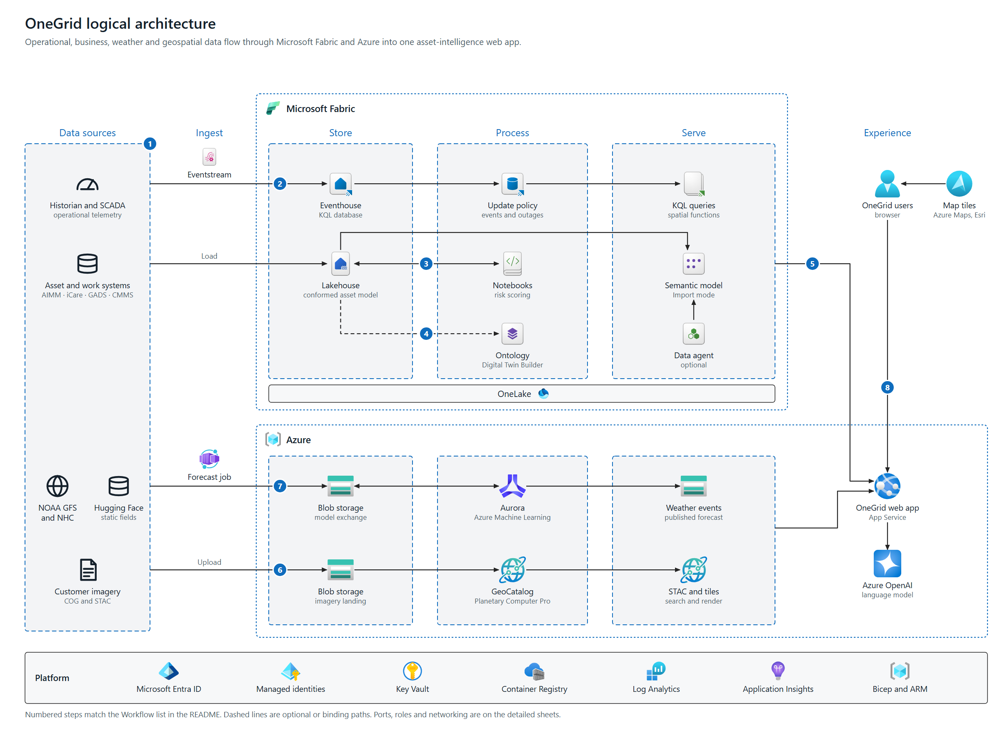

# OneGrid asset and weather intelligence architecture

OneGrid brings operational data, asset and maintenance records, geospatial information,
weather forecasts, and AI into a unified asset-intelligence application. Energy and oil
and gas teams use the same asset context to investigate equipment health, prioritize
maintenance, assess storm exposure, and coordinate response.

The solution uses Microsoft Fabric for real-time and historical analytics, Microsoft
Planetary Computer Pro for geospatial services, Azure OpenAI in Microsoft Foundry for
AI-assisted analysis, and Aurora on Azure Machine Learning for weather inference. A unified
application on Azure App Service presents the results through operational, engineering,
and executive experiences.

## Architecture

<a href="docs/diagrams/onegrid-reference-baseline.svg"><picture><source media="(prefers-color-scheme: dark)" srcset="docs/diagrams/onegrid-reference-baseline-dark.png"></picture></a>

[Download SVG](docs/diagrams/onegrid-reference-baseline.svg) |
[All nine sheets, light and dark](docs/diagrams/onegrid-reference-gallery.html) |
[Diagram guide](docs/diagrams/README.md) |
[Routing, identity, security and monitoring](docs/architecture/traffic-and-security.md)

This is the logical view. Sources move through ingest, store, process, and serve stages in
Microsoft Fabric and Azure to the OneGrid web app; numbered steps match the
[Workflow](#workflow) below. Ports, roles, subnets, and recovery detail are on the eight
technical sheets: Fabric, enterprise networking, DNS, weather orchestration, identity,
monitoring, regulated workload, and multiregion recovery. Enterprise additions and
illustrative IP allocations are labeled separately from baseline IaC.

The architecture separates six responsibilities:

| Plane | Responsibility | Main components |
| --- | --- | --- |
| **Data and analytics** | Ingest telemetry, curate asset history, run reliability analytics, and expose governed business data | Fabric Eventstream, Eventhouse/KQL, OneLake/Lakehouse, notebooks, pipeline, semantic models, Digital Twin Builder, Data Agent |
| **Geospatial** | Catalog customer imagery and geospatial assets; provide STAC search, tiles, and spatial context | Planetary Computer Pro GeoCatalog, Blob Storage, ingestion managed identity |
| **Weather and Aurora** | Prepare weather inputs, run GPU inference, track storms, and publish application-ready forecasts | Container Apps Job, Azure ML workspace and online endpoint, Container Registry, Blob Storage |
| **AI and models** | Interpret questions and ground answers in operational, business, and equipment context | Azure OpenAI model deployment, OneGrid Node AI agent, Fabric data tools, manuals retrieval |
| **Application** | Deliver the unified user experience and server-side APIs | App Service on Linux/Node 22, report-app BFF, TanStack Start/React SSR, REST, WebSocket, Entra ID |
| **Deployment and management** | Provision resources, create Fabric items, configure identities, and distribute the app | ARM/Bicep, deployment scripts, PowerShell provisioner, GitHub release package, monitoring |

### Workflow

1. **Acquire operational and business data.** Historian/PI and SCADA-derived readings enter
   the real-time lane. AIMM, iCare, GADS, CMMS/work orders, asset registers, and GIS data
   provide business and spatial context. Equipment manuals supply maintenance knowledge.
2. **Process real-time telemetry.** Fabric Eventstream receives events through the
   `PIForwarderEndpoint` custom source. Eventhouse lands canonical events in `PiEventsRaw`;
   an update policy produces the curated `PiEvents` table for KQL queries.
3. **Curate history and calculate health.** Fabric notebooks prepare source datasets,
   engineer features, detect anomalies, calculate short-term stop risk and long-term
   survival, and produce scored results and daily narratives.
4. **Unify the asset context.** The conformed hierarchy
   `dim_site -> dim_unit -> dim_asset -> dim_tag` links reliability, maintenance, telemetry,
   weather exposure, and operational posture. Digital Twin Builder adds asset relationships.
5. **Serve business and operational queries.** The Import semantic model serves DAX
   queries; Eventhouse serves KQL. The application uses both without requiring users to
   switch analytical tools.
6. **Add geospatial context.** Customer raster assets are registered in GeoCatalog using
   managed-identity ingestion. STAC search and rendered tiles add imagery and GIS context
   to the map.
7. **Generate weather intelligence.** The scheduled Container Apps Job retrieves NOAA GFS
   initial conditions, invokes Aurora, tracks storms, and publishes normalized
   `WeatherEvent` objects to `model-outputs/weather-events.json`.
8. **Present decisions and explanations.** Users sign in with Entra ID to view asset health,
   twin context, alerts, forecasts, and exposure. The Node AI agent uses Azure OpenAI and
   connected data tools to explain findings and answer questions.

### Components

**Microsoft Fabric.** A workspace contains the schema-enabled Lakehouse, Eventhouse/KQL
database, Eventstream, notebooks, prediction pipeline, semantic models, dashboards, ontology,
and Data Agent. ARM creates or connects the capacity; deployment scripts use Fabric APIs
to provision the workspace and its items.

**Geospatial services.** GeoCatalog provides STAC and tile services. The `sample-assets`
container stores customer assets for ingestion. A dedicated user-assigned managed identity
has read access to that container and is associated with the catalog.

**Weather inference.** An Azure ML workspace hosts the Aurora managed online endpoint and
GPU deployment. Its supporting resources include storage, Key Vault, and Application
Insights. A CPU-based Container Apps Job orchestrates the pipeline; the GPU endpoint performs
inference. The job uses a managed identity for storage, registry, and model access.

**AI and knowledge.** An Azure OpenAI account hosts the configured model deployment
(`gpt-5-mini` by default in ARM). OneGrid hosts agent orchestration alongside the application.
The agent can query DAX/KQL, use the configured Fabric Data Agent, and retrieve equipment
manual context. The manuals experience includes a bundled corpus and a separate search
integration for indexed content.

**Application hosting.** App Service runs `node report-app/server/index.js`, which serves
the report APIs, coordinates React SSR and chat, and exposes real-time WebSocket updates.
The deployment mounts the prebuilt `onegrid-app.zip` from Blob Storage using
`WEBSITE_RUN_FROM_PACKAGE`.

**Management.** The template creates managed identities and scoped role assignments.
Separate app-plane and Fabric-plane deployment scripts configure their respective
dependencies. Application Insights and Log Analytics support the weather/model components;
workload operations correlate these signals with application, Fabric, and identity health.

### Traffic flows and network boundaries

The browser, application, Fabric services, and forecast job initiate different connections.
Their traffic doesn't share a single network path:

- **User access:** browser -> application ingress -> App Service. In the enterprise
  implementation, Application Gateway WAF reaches the application's private endpoint.
- **Application dependencies:** App Service initiates DAX, KQL, AI, catalog, and Blob
  requests. Its outbound VNet integration is separate from inbound private access.
- **Forecast inference:** the Container Apps Job retrieves inputs and calls Aurora through
  its own environment network. App Service starts an on-demand execution through Azure
  Resource Manager; it doesn't proxy the scoring request.
- **Service and browser access:** Fabric refresh, shortcuts, and GeoCatalog ingestion
  have service-originated connections. Basemap tiles and glyphs are fetched by the
  browser. Neither path inherits App Service's outbound routing.

Use the [enterprise traffic-flow matrix](docs/architecture/enterprise-landing-zone.md#traffic-flow-matrix)
to plan protocols, DNS, private connectivity, and egress. Validate the actual callers with
the [network acceptance procedure](docs/operations-runbook.md#validate-network-and-traffic-flows).

## Data model

Reliability and weather share the same asset spine rather than maintaining separate
registries for the map, digital twin, and maintenance views.

| Data group | Tables or artifacts | Purpose |
| --- | --- | --- |
| Asset hierarchy | `dim_site`, `dim_unit`, `dim_asset`, `dim_tag` | Stable identity, site location, equipment, and signal context |
| Reliability | `aakr_health`, `watchlist`, `anomaly_advisories`, `root_cause`, `predictions_shortterm`, `predictions_longterm` | Health assessment, prioritization, explanations, and risk |
| Maintenance | `fact_work_requests`, `daily_narrative` | Work context and operational summaries |
| Weather | `dim_weather_event`, `WeatherForecast`, `fact_asset_exposure`, `fact_posture` | Events, forecast values, asset exposure, and site response posture |
| Real-time operations | `PiEventsRaw`, `PiEvents`, `PCIOutages` | Streaming observations and outage/derate context |
| Relationships | `OneGridOntology` | Plants, units, assets, sensors, work, advisories, outages, and predictions |

The unified deployment generates the `og.*` Delta tables and deploys
`OneGridModelImport` over the Lakehouse SQL analytics endpoint. The dedicated refresh
identity materializes the model; the app's runtime identity queries it. Refresh the
Import model after its source data changes.

## Application experiences

| Experience | Information brought together |
| --- | --- |
| Fleet and executive views | Availability, watchlist, actions, reliability trends, and business scorecards |
| Asset explorer and maintenance | Equipment hierarchy, telemetry, advisories, work requests, and manual context |
| Digital twin and simulation | Asset relationships, component health, telemetry, and failure scenarios |
| Weather intelligence | Storm tracks, forecast timelines, exposure, corridor weather, and response posture |
| Oil and gas | Platforms, pipelines, wells, processing/storage facilities, and weather exposure |
| Governance and administration | Data-access inventory, ontology, thresholds, deployment connections, IT/OT context |
| Copilot | Natural-language questions grounded in configured operational and business data |

`oneGridModules` selects `exec`, `weather`, `twin`, `infra`, `sap`, `esu`, `onerig`, and
`copilot`. Core pages remain available independently of those module choices.

## Architecture configurations

| Configuration | Design focus | OneGrid guidance |
| --- | --- | --- |
| **Baseline** | Single-region application, data, geospatial, weather, and AI flows | [Baseline architecture](docs/architecture/baseline.md) |
| **Enterprise landing zone** | Integration with existing identity, security, networking, governance, and management | [Enterprise implementation](docs/architecture/enterprise-landing-zone.md) |
| **Regulated workload** | Data boundaries, controlled administration, audit evidence, AI oversight, and operational approvals | [Regulated architecture](docs/architecture/regulated-workload.md) |
| **Multiregion** | Application recovery, Fabric item/data recovery, inference capacity, and controlled failover | [Multiregion architecture](docs/architecture/multiregion.md) |

Use the workload template for OneGrid resources and Fabric provisioning. Apply
environment-specific networking, enterprise controls, and recovery configuration through
the platform and workload delivery pipelines.

## Architecture diagram sheets

The four configurations above describe deployment choices. The complete diagram set has
nine sheets. Use these direct image links on GitHub; the
[HTML gallery](docs/diagrams/onegrid-reference-gallery.html) is for local browsing.

| Sheet | Design focus and notes | Diagrams | OneGrid guidance |
| --- | --- | --- | --- |
| **Baseline (logical view)** | Single-region operational, business, weather, and geospatial sources flow through Fabric and Azure to the web app. Shared platform services support the application and AI flows. | [Light](docs/diagrams/onegrid-reference-baseline.png) / [Dark](docs/diagrams/onegrid-reference-baseline-dark.png) | [Baseline architecture](docs/architecture/baseline.md) |
| **Fabric** | Streaming and historical ingestion feed Eventhouse and Lakehouse analytics. Notebooks, the asset ontology, and the Import semantic model provide operational and business context; model refresh is separate from runtime queries. | [Light](docs/diagrams/onegrid-reference-fabric.png) / [Dark](docs/diagrams/onegrid-reference-fabric-dark.png) | [Fabric architecture](docs/architecture/fabric.md) |
| **Enterprise networking** | Hub and workload VNets provide private ingress, service endpoints, and controlled egress. App Service inbound private access and outbound VNet integration are separate paths; address ranges are illustrative design allocations. | [Light](docs/diagrams/onegrid-reference-enterprise.png) / [Dark](docs/diagrams/onegrid-reference-enterprise-dark.png) | [Enterprise implementation](docs/architecture/enterprise-landing-zone.md) |
| **DNS and private endpoints** | Corporate and workload clients resolve original service hostnames through the hub resolver. Private DNS zones resolve Azure service names; the forwarding ruleset sends customer-domain queries to corporate DNS. | [Light](docs/diagrams/onegrid-reference-dns.png) / [Dark](docs/diagrams/onegrid-reference-dns-dark.png) | [Name resolution flow](docs/architecture/enterprise-landing-zone.md#name-resolution-flow) |
| **Weather orchestration** | A scheduled or on-demand CPU job prepares weather inputs, invokes Aurora GPU inference through a Blob exchange, and publishes storm events for the app. Forecast generation is separate from asset-health scoring. | [Light](docs/diagrams/onegrid-reference-weather.png) / [Dark](docs/diagrams/onegrid-reference-weather-dark.png) | [Weather run](docs/architecture/traffic-and-security.md#weather-run) |
| **Identity and authorization** | Trace user, application, ingestion, forecast, refresh, workspace, and deployment principals through Entra ID to their permitted resources. User sign-in, workload credentials, and data grants are distinct; network access does not grant data permission. | [Light](docs/diagrams/onegrid-reference-identity.png) / [Dark](docs/diagrams/onegrid-reference-identity-dark.png) | [Identity and authorization](docs/architecture/traffic-and-security.md#identity-and-authorization) |
| **Logging and monitoring** | Separate baseline-wired telemetry from collection that requires enterprise configuration. Follow job, model, Fabric, app, Azure, and identity signals to monitoring destinations; freshness checks and alerts identify failures beyond resource availability. | [Light](docs/diagrams/onegrid-reference-monitoring.png) / [Dark](docs/diagrams/onegrid-reference-monitoring-dark.png) | [Logging and monitoring](docs/architecture/traffic-and-security.md#logging-and-monitoring) |
| **Regulated workload** | Four trust zones separate OT transfer, classified Fabric data, the application, and model/geospatial services. Controlled administration, AI oversight, audit evidence, and operational approvals define the design; the drawing alone does not establish compliance. | [Light](docs/diagrams/onegrid-reference-regulated.png) / [Dark](docs/diagrams/onegrid-reference-regulated-dark.png) | [Regulated architecture](docs/architecture/regulated-workload.md) |
| **Multiregion recovery** | Coordinate application recovery with Fabric item/data recovery and inference capacity. Regional targets and release gates support controlled failover; Front Door routing alone does not recover the complete workload. | [Light](docs/diagrams/onegrid-reference-multiregion.png) / [Dark](docs/diagrams/onegrid-reference-multiregion-dark.png) | [Multiregion architecture](docs/architecture/multiregion.md) |

## Considerations

### Reliability

Measure availability across the complete journey: sign-in, application, DAX/KQL, source
freshness, model inference, and published forecasts. Keep forecast timestamps and dataset
refresh times visible. Size App Service and Fabric for peak demand, and define recovery
objectives per dependency. Protect source data, item definitions, model bindings, and
application packages so the environment can be restored.

### Security

Separate user authentication, deployment privileges, app runtime permissions, refresh
credentials, ingestion identity, and forecast-job identity. Use Entra ID and managed identity
for supported runtime calls. Apply minimum required Azure and Fabric permissions, protect
the refresh service-principal credential, and validate data access through the backend's
actual query identity. Enterprise ingress, DNS, egress, and supported private endpoints
must preserve package loading, Fabric access, inference, and operational administration.

### Cost Optimization

Track Fabric capacity, App Service, GPU uptime, Azure OpenAI tokens, storage, registry,
diagnostics, and data transfer separately. Use the component selections to match the required
scenario. Schedule refresh and analytics deliberately, and monitor capacity contention before
increasing SKUs.

### Operational Excellence

Record source commit, application package, model version, configuration, Fabric item IDs,
and identity ownership for each environment. Validate changes in nonproduction, retain
known-good packages, and rehearse rollback and restore. Establish alerts for broken data
flows as well as application errors.

### Performance Efficiency

Use KQL for streaming operations and DAX for the governed business model. Measure latency,
concurrency, capacity utilization, refresh duration, model throttling, and forecast cycle
time with representative asset and telemetry volumes. The forecast job orchestrates work
with 2 vCPU/4 GiB; Aurora computation runs on the GPU endpoint.

## Deploy this solution

1. Select the subscription, resource group, and region. Establish Azure role-assignment
   rights, Fabric tenant/capacity permissions, and Entra registration/refresh identities.
2. Select the Fabric plane, app, sample storage, AI model, and required modules. Create a
   Fabric capacity or supply an approved existing one.
3. Enable historical seeding, GeoCatalog, and Aurora components according to the scenario.
   Aurora model deployment requires the model asset/terms and A100 quota; forecasting also
   requires storage and the scheduled job.
4. Validate and deploy the ARM template. Monitor the app and Fabric provisioning scripts.
5. Verify the app, sign-in, DAX/KQL, semantic refresh, enabled modules, imagery, chat, and
   weather outputs. Confirm whether each dataset is seeded, generated, or connected to an
   operational source.

The deployment accepts `eastus`, `northcentralus`, `westeurope`, `canadacentral`, and `uksouth`.
Check selected-service availability and quota in the chosen region. The portal selects
solution components; command-line deployments must set the component parameters explicitly.

For the complete procedure, parameters, identity setup, data formats, and verification,
see [Deploy and configure OneGrid](docs/deployment-and-data-guide.md). The
[Copilot deployment runbook](DEPLOY-WITH-COPILOT.md) provides the guided execution workflow.

## Operate the solution

Use the [Day 2 operations guide](docs/operations.md) and
[operational procedures](docs/operations-runbook.md) to monitor:

- Application/API health, sign-in, WebSocket connections, and deployed package identity.
- Eventstream ingestion, latest telemetry, KQL queries, and Fabric capacity.
- Lakehouse updates, semantic-model binding, refresh completion, and DAX results.
- Azure OpenAI deployment health, grounded answers, token use, and tool access.
- Aurora inference, job execution, input cycles, and `weather-events.json` freshness.
- Identity changes, credential expiry, governance decisions, and recovery readiness.

## Implementation

| Entry point | Purpose |
| --- | --- |
| [ARM/Bicep](planetary-computer-pro-poc/deploy/azure/main.bicep) | Azure workload resources, identities, role assignments, and deployment scripts |
| [Compiled ARM template](planetary-computer-pro-poc/deploy/azure/azuredeploy.json) | Deployment payload used by the portal |
| [Fabric provisioner](planetary-computer-pro-poc/infra/deploy.ps1) | Workspace, artifacts, data/model binding, ontology, permissions, and application wiring |
| [Fabric artifacts](planetary-computer-pro-poc/infra/fabric/) | Eventstream, KQL, notebooks, pipeline, semantic models, reports, and ontology |
| [Application](OGE-OneGrid/) | Report BFF, SSR web app, Node AI agent, and operational experiences |
| [Aurora pipeline](planetary-computer-pro-poc/aurora/) | Weather input preparation, inference, tracking, normalization, and publication |
| [Release workflow](.github/workflows/release-onegrid-app.yml) | Build and publish the unified app package |

The [implementation guide](docs/implementations.md) maps the logical architecture to
resource symbols, deployment phases, application settings, and repository locations.
