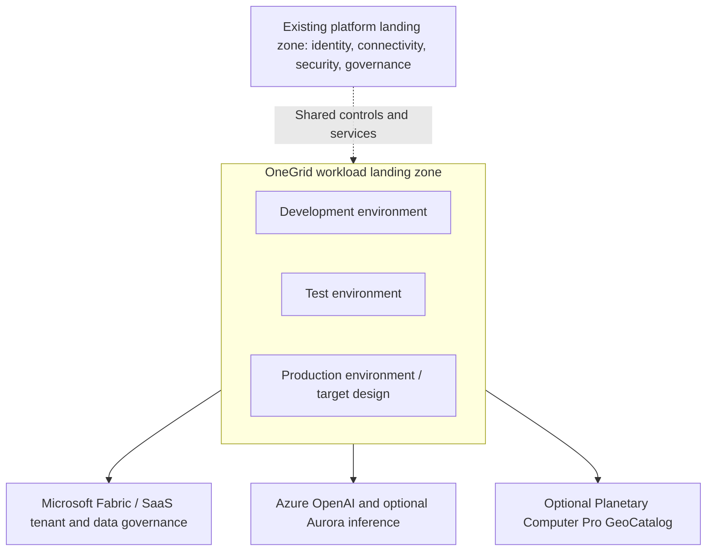

# OneGrid landing zone architecture

OneGrid is an Azure workload accelerator for asset, weather, and operational intelligence
in energy and oil and gas. It combines Microsoft Fabric, Microsoft Planetary Computer Pro,
Azure OpenAI models in Microsoft Foundry, and optional Aurora weather inference with a
Microsoft Entra-authenticated application.

An enterprise deployment has two distinct parts:

- **Platform landing zone:** your organization's existing identity, connectivity, security,
  management, and governance foundation.
- **Workload landing zone:** the environments in which your team deploys and operates OneGrid,
  integrated with that foundation.

> [!IMPORTANT]
> The supplied implementation is a single-region, App Service-based evaluation accelerator.
> Enterprise integration, regulated controls, and multiregion recovery below are target
> designs, not deployable template profiles. AKS is an alternative, not a deployed component.
> This project is not an official Microsoft reference architecture or a compliance certification.

Article structure: [What is an Azure landing zone?](https://learn.microsoft.com/azure/cloud-adoption-framework/ready/landing-zone/).
The linked articles use the corresponding baseline, enterprise, regulated, multiregion,
Fabric security, and operations article structures; see the
[source-to-document map](docs/implementations.md#documentation-structure).

## In this article

- [Azure landing zone architecture](#azure-landing-zone-architecture)
- [Platform landing zone](#platform-landing-zone)
- [Workload landing zone](#workload-landing-zone)
- [Technology adoption in an Azure landing zone](#technology-adoption-in-an-azure-landing-zone)
- [Next steps](#next-steps)

## Azure landing zone architecture

Use the conceptual view to establish responsibilities. Then select the workload reference
architecture that matches your requirements. A workload deployment button does not create
the enterprise foundation.

### Conceptual architectures

This is a conceptual ownership diagram, not a deployment diagram. The evaluation template
creates one environment, not all three. Fabric remains a SaaS dependency, not a service
deployed inside the workload's VNet.

### Reference architectures

| Architecture | Scenario | Implementation |
| --- | --- | --- |
| [Baseline architecture](docs/architecture/baseline.md) | Validate application, data, geospatial, and AI flows in one region. | Existing Bicep, Fabric provisioning, and release workflow; tenant prerequisites and verification required. |
| [Enterprise landing zone integration](docs/architecture/enterprise-landing-zone.md) | Connect the workload to existing security, networking, and governance. | Target design; separate enterprise implementation still required. |
| [Regulated workload architecture](docs/architecture/regulated-workload.md) | Establish shared responsibility, control boundaries, evidence, and release gates. | Target design; control implementation and independent assessment required. |
| [Multiregion architecture](docs/architecture/multiregion.md) | Recover application and data journeys after a regional outage. | Target design; no automated cross-region replication or failover supplied. |

These are architectural increments. Start with the baseline, integrate with the platform,
then add regulated or multiregion controls where business requirements justify them.

## Platform landing zone

The platform team owns subscription vending, management groups, policy assignments, shared
connectivity and DNS, identity guardrails, and central security/monitoring. OneGrid should
consume these capabilities rather than create a second platform foundation.

The evaluation template does not deploy management groups, a connectivity hub, enterprise
policies, a WAF, or centralized security operations. Follow the
[enterprise ownership and integration contract](docs/architecture/enterprise-landing-zone.md#components)
before targeting a governed production subscription.

For platform implementation options, use Microsoft's
[landing zone guidance](https://learn.microsoft.com/azure/cloud-adoption-framework/ready/landing-zone/implementation-options)
and the [GitHub implementation catalog](docs/implementations.md#microsoft-reference-implementations).
Do not redeploy a foundation your organization already operates.

## Workload landing zone

The workload team owns the application, workload identities, data products, model
integrations, deployment configuration, and service objectives within platform guardrails.
Keep development, test, and production data and permissions separated.

Use the [baseline architecture](docs/architecture/baseline.md) for the actual runtime,
components, workflow, alternatives, and Well-Architected considerations. Use
[enterprise integration](docs/architecture/enterprise-landing-zone.md) for subscription,
compute, network, policy, monitoring, and change-management decisions.

The [implementation catalog](docs/implementations.md#onegrid-implementation-map) links the
Bicep, compiled ARM template, portal form, Fabric provisioner, application, and GitHub release
workflow. Publication of a GitHub package does not prove a running tenant has been updated.

## Technology adoption in an Azure landing zone

| Technology | OneGrid implementation | Architecture and operational guidance |
| --- | --- | --- |
| Microsoft Foundry / Azure OpenAI | Azure OpenAI account/model and app-hosted chat orchestration; optional Azure ML Aurora endpoint. No implied Foundry Agent Service or project. | [Model and tool selection](docs/architecture/baseline.md#model-and-tool-selection), [enterprise compute](docs/architecture/enterprise-landing-zone.md#compute), [Microsoft Foundry implementation](docs/implementations.md#microsoft-reference-implementations). |
| Microsoft Fabric | Capacity, workspace, Lakehouse, Eventhouse/KQL, Import semantic model, optional Data Agent. | [Fabric security and governance](docs/architecture/fabric.md), [Fabric data plane](docs/architecture/baseline.md#fabric-data-plane), [data operations](docs/operations-runbook.md#data-and-model-lifecycle). |
| App Service / optional AKS alternative | Linux App Service hosts the unified Node app. AKS is not deployed. | [Alternatives](docs/architecture/baseline.md#alternatives), [AKS reference implementation](docs/implementations.md#microsoft-reference-implementations), [Day 2 guide](docs/operations.md). |
| Planetary Computer Pro | Optional GeoCatalog for STAC, ingestion, and tiles. | [Baseline workflow](docs/architecture/baseline.md#workflow), [imagery ingestion](docs/deployment-and-data-guide.md#ingest-imagery-and-rasters). |
| Weather inference | Optional Container Apps Job, Aurora GPU endpoint, and Blob outputs. | [Weather pipeline](planetary-computer-pro-poc/aurora/README.md), [multiregion dependencies](docs/architecture/multiregion.md#components). |

## Next steps

1. Review the [baseline architecture](docs/architecture/baseline.md).
2. Select an approved evaluation environment, or complete the
   [enterprise implementation sequence](docs/architecture/enterprise-landing-zone.md#implementation-sequence).
3. Follow the [deployment runbook](DEPLOY-WITH-COPILOT.md), then
   [load data and run acceptance checks](docs/deployment-and-data-guide.md).
4. Establish ownership and procedures using the [Day 2 operations guide](docs/operations.md).

**Deploy the evaluation baseline:** the button below launches the current template, not the
enterprise, regulated, or multiregion target designs. Review permissions and billable Fabric,
App Service, storage, and optional model resources before deployment.

