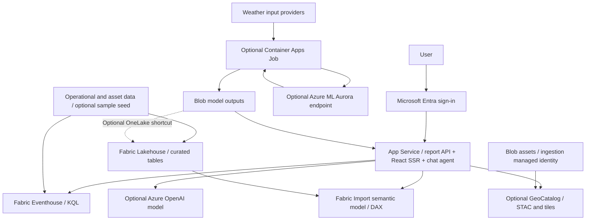

# OneGrid baseline architecture

[Documentation home](../../README.md) | [Enterprise integration](enterprise-landing-zone.md)

This architecture describes the existing single-region evaluation implementation for asset,
weather, and operational intelligence. Use it to validate application and dependency flows
before adding enterprise controls. The defaults do not establish production readiness,
regulatory compliance, or an availability SLA.

Article structure: [Baseline Microsoft Foundry chat reference architecture](https://learn.microsoft.com/azure/architecture/ai-ml/architecture/baseline-microsoft-foundry-chat).
The architecture below describes OneGrid, not all services in Microsoft's Foundry sample.

## In this article

- [Architecture](#architecture)
- [Considerations](#considerations)
- [Deploy this scenario](#deploy-this-scenario)
- [Contributors](#contributors)
- [Next step](#next-step)
- [Related resources](#related-resources)

## Architecture

Arrows show logical flows, not private endpoints or guaranteed network isolation. Enabled
components and provisioning results determine what actually exists.

### Workflow

1. A user signs in with Entra ID when sign-in is configured. The browser calls OneGrid;
   the backend uses its configured identities to call dependencies.
2. Asset, maintenance, and historical data are loaded into Fabric. Sample seeding proves
   wiring but does not establish a production source connector.
3. The application queries an Import semantic model with DAX and Eventhouse with KQL.
   Authorization must hold at both API and data boundaries.
4. When selected, the application searches GeoCatalog STAC collections and renders tiles.
   Customer imagery uses an ingestion identity; public sample imagery can use a temporary
   source SAS.
5. When selected, the app-hosted chat agent invokes Azure OpenAI and connected data tools.
   Verify a grounded answer with actual query results, not just HTTP success.
6. When selected, the weather job retrieves inputs, invokes Aurora, and publishes output
   artifacts. Check timestamps and provenance before presenting forecasts as current.

### Components

| Component | Responsibility | Implementation boundary |
| --- | --- | --- |
| App Service | Hosts report API, React SSR, and chat orchestration on Linux/Node 22; supports WebSockets | Unified app package, not an AKS deployment |
| Microsoft Entra ID | User sign-in and workload identities | Requires successful registration/configuration and separate data permissions |
| Fabric capacity and workspace | Hosts Lakehouse, Eventhouse, semantic artifacts, optional Data Agent | Capacity can be created through ARM; workspace/items use Fabric APIs |
| Blob storage and identities | Asset ingestion, model outputs, app package distribution | `Standard_LRS`; nonanonymous containers do not imply private networking |
| Optional GeoCatalog | STAC search, ingestion, spatial layers, tiles | Regional service and separate data-plane roles |
| Optional Azure OpenAI | Model deployment for app-hosted chat | Not Foundry Agent Service, a Foundry project, AI Search, or Cosmos DB |
| Optional Azure ML endpoint | GPU-backed Aurora inference | Workspace/endpoint creation alone does not establish model readiness |
| Optional Container Apps Job | Scheduled forecast processing and publication | Needs image, input access, working inference, and output permissions |
| Deployment scripts | Configure Fabric, application, and cross-plane permissions | Separate Azure, Entra, and Fabric privileges |

#### Application hosting

The application entry point is `node report-app/server/index.js`. App Service mounts a
self-contained package using `WEBSITE_RUN_FROM_PACKAGE`; provisioning can rehost the package
in deployment storage with managed-identity access. The app combines the report API, SSR UI,
and chat runtime rather than publishing only the web UI.

#### Fabric data plane

The unified path loads conformed `og.*` Lakehouse tables and deploys an Import semantic model
over the SQL analytics endpoint. A dedicated refresh identity binds and refreshes the model;
the app's query identity has separate permissions. Schedule refresh after data updates.

The [deployment handoff](../../OGE-OneGrid/data/HANDOFF.md) records a managed-identity/Direct
Lake query limitation. Keep Import as the documented application path unless the exact
alternative authentication and query path has been validated. Optional workspace
identity/cloud connections support OneLake shortcuts.

#### AI and model plane

`deployAiAgent` creates an Azure OpenAI account/model deployment. The app hosts agent
orchestration. Aurora uses a separate Azure ML managed online endpoint with Entra token
authentication. The workspace, endpoint, GPU deployment, and actual inference are distinct
readiness checks.

### Model and tool selection

The template defaults to `gpt-5-mini` and a pinned model version. Confirm regional/model
availability, quota, processing geography, content safety, tool permissions, and evaluation
results before using real data. The default `GlobalStandard` deployment type is not proof
of region-bound processing.

Aurora needs an approved model asset, accepted terms, A100 quota, and a healthy deployment.
Weather inputs and generated outputs need provenance and age checks. Do not treat generated
exposure scores or recommendations as the sole input to safety-critical decisions.

### Alternatives

- **AKS hosting:** consider only for justified Kubernetes requirements or an existing
  organizational platform. Container packaging, ingress/WebSockets, workload identity,
  probes, scaling, upgrades, and a delivery pipeline remain implementation work. AKS does
  not replace Fabric or the model/geospatial dependencies.
- **Foundry Agent Service or an AI gateway:** requires application, identity, network, and
  tool integration. It is not enabled by renaming the current app-hosted agent.
- **Reduced evaluation deployment:** GeoCatalog, chat, and weather components are optional.
  Verify template dependencies and expose disabled features explicitly.
- **Enterprise deployment:** extend the baseline with the separate
  [landing zone architecture](enterprise-landing-zone.md), not a security opt-out.

## Considerations

These considerations use the five pillars of the
[Azure Well-Architected Framework](https://learn.microsoft.com/azure/well-architected/).

### Reliability

The implementation is single-region. The default plan does not establish zone redundancy,
and storage defaults to LRS. Select supported SKUs and recovery controls based on business
objectives. A running app does not prove Fabric refresh, inference, or weather freshness.
Test complete journeys and dependency failures. See the [multiregion design](multiregion.md).

### Security

| Boundary | Current limitation | Required decision |
| --- | --- | --- |
| Network | Public service endpoints; no hub/spoke, WAF, private endpoint, or enterprise DNS implementation | Implement approved ingress/egress and supported private paths |
| User access | Sign-in needs successful registration/configuration | Test authenticated and denied API/data access before exposure |
| Runtime credentials | Managed identities serve Azure paths; Import refresh can require a service-principal secret | Inventory and rotate credentials; the solution is not entirely secret-free |
| Provisioning | Resource-group Owner and storage-scoped assignment rights can be granted | Separate bootstrap and runtime privileges; reduce standing access |
| Policy | Optional opt-out tags only work with compatible organizational policies | Default off; require approved, time-bound exceptions |
| Data | Backend query identity may differ from the signed-in user | Prove effective data isolation for DAX, KQL, chat, and exports |

### Cost Optimization

Budget Fabric capacity, App Service, model tokens, GPU hours, storage, and diagnostics
separately. Optional resources can bill while idle. Start with representative measurements,
not the assumption that an evaluation SKU is production capacity.

### Operational Excellence

Record source/package/model versions, configuration, Fabric item IDs, and identity owners.
Gate releases and test rollback/restore. Component telemetry is not a complete workload
SLO/alert suite; implement the [Day 2 procedures](../operations.md).

### Performance Efficiency

Measure DAX/KQL latency, capacity contention, API concurrency, WebSocket behavior, model
throttling, and forecast processing time with representative data. Configure refresh and
job schedules so they do not unexpectedly compete with interactive workloads.

## Deploy this scenario

Use the [implementation map](../implementations.md#onegrid-implementation-map) for Bicep,
compiled ARM, portal form, Fabric provisioning, and release workflow. Then follow the
[deployment runbook](../../DEPLOY-WITH-COPILOT.md).

Run the [acceptance checks](../deployment-and-data-guide.md#acceptance-checks). ARM success
is insufficient: verify sign-in, DAX/KQL, model refresh, and each selected optional feature.
Record skipped/degraded components rather than reporting them as passed.

## Contributors

This project-maintained adaptation belongs to the
[OneGrid repository contributors](https://github.com/paulshaheen/OneGrid/graphs/contributors);
it does not imply authorship or endorsement by the Microsoft Learn article's contributors.

## Next step

[Integrate OneGrid with an enterprise landing zone](enterprise-landing-zone.md).

## Related resources

- [Microsoft Foundry baseline and GitHub implementation](https://learn.microsoft.com/azure/architecture/ai-ml/architecture/baseline-microsoft-foundry-chat).
- [AKS baseline](https://learn.microsoft.com/azure/architecture/reference-architectures/containers/aks/baseline-aks).
- [Fabric security and governance](fabric.md).
- [Deployment and evaluation data](../deployment-and-data-guide.md).
- [OneGrid implementation catalog](../implementations.md).
