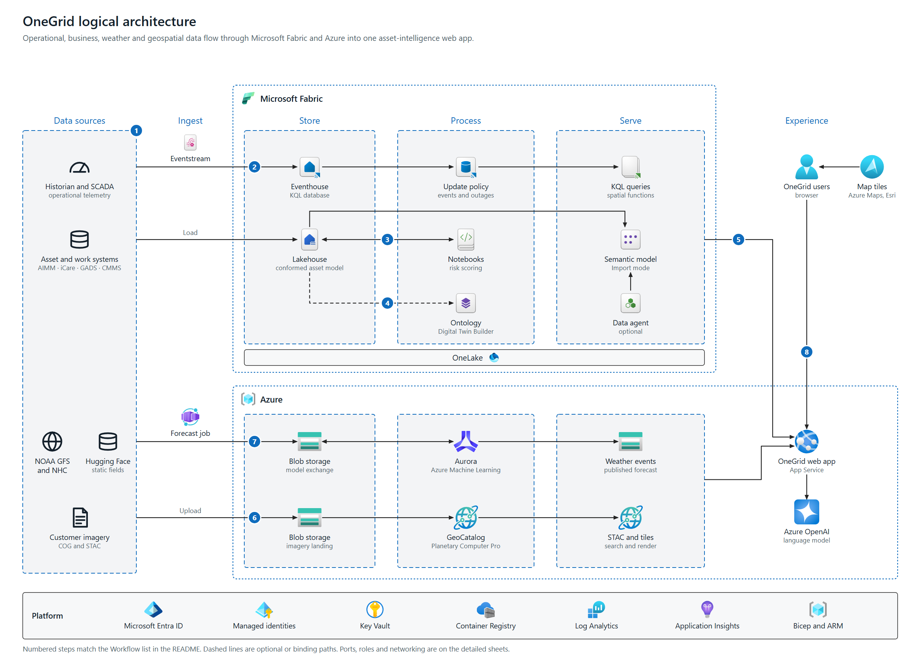

# Baseline architecture for OneGrid

[Solution overview](../../README.md)

The OneGrid baseline connects real-time operations, historical asset analytics, geospatial
data, weather forecasts, and AI in one regional workload. The application presents equipment
health and weather exposure using a common asset model, so maintenance and storm-response
decisions refer to the same sites, units, equipment, and sensors.

## Architecture

<a href="../diagrams/onegrid-reference-baseline.svg"><picture><source media="(prefers-color-scheme: dark)" srcset="../diagrams/onegrid-reference-baseline-dark.png"></picture></a>

[Download SVG](../diagrams/onegrid-reference-baseline.svg) |
[Diagram source](../diagrams/sheets/baseline.py) |
[All nine technical sheets](../diagrams/onegrid-reference-gallery.html) |
[Traffic and security contracts](traffic-and-security.md)

The diagram shows the complete enabled solution. Data sources on the left move through
ingest, store, process, and serve stages: operational and business data in Microsoft Fabric,
weather and geospatial data in Azure. Both reach the OneGrid web app on the right, and shared
platform services sit in the bottom row. Deployment parameters select which planes are
provisioned. Numbered steps match the workflow below. Arrows point toward the component that
receives data or a call, with responses omitted; dashed lines are optional or binding paths.
Protocols, roles, and network detail are on the [technical sheets](traffic-and-security.md).

### Workflow

1. **Acquire data.** Historian/PI and SCADA readings; AIMM, iCare, GADS, and CMMS asset and
   work history; NOAA GFS analyses and NHC storm positions; Hugging Face static weather
   fields; and customer COG/STAC imagery are the sources.
2. **Process real-time telemetry.** The connector publishes to the Eventstream
   `PIForwarderEndpoint` custom source. Eventhouse lands `PiEventsRaw`, an update policy
   produces `PiEvents` and outage tables, and KQL functions serve current grid state.
3. **Curate history and calculate health.** Approved loads land asset, maintenance, and
   history data in the Lakehouse. Notebooks read features from it and persist scores and
   narratives back to it.
4. **Unify the asset context.** The conformed hierarchy
   `dim_site -> dim_unit -> dim_asset -> dim_tag` binds the Digital Twin Builder ontology
   to Lakehouse tables.
5. **Serve business and operational queries.** The Import semantic model refreshes from the
   Lakehouse SQL analytics endpoint after source changes and serves DAX; Eventhouse serves
   KQL; the optional Data Agent is grounded on the semantic model.
6. **Add geospatial context.** Customer imagery lands in a private Blob container. GeoCatalog
   ingests it with its associated managed identity, and STAC search and tiles serve map layers.
7. **Generate weather intelligence.** The scheduled forecast job downloads initial
   conditions, exchanges large payloads with the Aurora endpoint through Blob storage, and
   publishes `weather-events.json` to `model-outputs`. The app can also start a run through
   Azure Resource Manager. When configured, a OneLake shortcut exposes model outputs to Fabric.
8. **Present decisions and explanations.** Users sign in with Entra ID and use the OneGrid
   web app. It queries KQL, DAX, Blob Storage, and GeoCatalog with its workload identity and
   calls Azure OpenAI for the AI agent. Basemap tiles load directly in the browser.

User authentication is separate from these data paths. A user signs in with Entra ID, and
the application uses its workload identities to query its configured dependencies.

### Flow contracts

| Initiator | Destination | Contract |
| --- | --- | --- |
| Operational connector | Eventstream custom source | Publish canonical events to the resolved `PIForwarderEndpoint`; validate destination and table mapping first |
| Eventstream | Eventhouse | Land `PiEventsRaw`; its update policy creates curated `PiEvents` |
| Fabric notebooks | Lakehouse | Read source tables and persist features, predictions, and narratives using the conformed asset keys |
| Import refresh identity | Lakehouse SQL analytics endpoint | Materialize `OneGridModelImport` after source updates |
| Application identity | Semantic model, Eventhouse, configured Data Agent | Initiate DAX, KQL, and grounded-agent requests against the configured item IDs |
| GeoCatalog ingestion | Source Blob container | Read imagery with the associated ingestion identity; catalog search and tile access are separate application operations |
| Forecast job | NOAA GFS and Aurora endpoint | Download initial conditions and invoke GPU inference; use `aurora-channel` for large-payload exchange |
| Forecast job | `model-outputs` | Normalize and publish `weather-events.json` with forecast provenance |
| Application weather adapter | `model-outputs` | Read published events; starting a job uses the Azure management API, not the scoring or Blob endpoint |
| OneLake shortcut | `model-outputs` | Read files through the configured storage connection; analytical hazard-table loading is a separate transformation |

### Components

| Plane | Component | Role |
| --- | --- | --- |
| Data | Fabric capacity/workspace | Compute allocation and item/permission boundary |
| Data | Eventstream | Custom endpoint `PIForwarderEndpoint` for canonical source events |
| Data | Eventhouse/KQL database | Streaming landing/curation, operational queries, outages, spatial hazard functions |
| Data | OneLake/Lakehouse | Curated source data, conformed `og.*` Delta tables, and model inputs |
| Analytics | Fabric notebooks | Source preparation, features, anomaly detection, stop risk, survival, scoring, narrative |
| Analytics | `Prediction_Pipeline` | Orchestrates the supplied prediction workflow |
| Business model | `OneGridModelImport` | Materializes the unified Lakehouse tables for application DAX queries |
| Context | `OneGridOntology` Digital Twin Builder item | Plants, units, assets, sensors, work, advisories, outages, predictions |
| AI access | Fabric Data Agent | Natural-language access to configured business/operational data |
| Geospatial | GeoCatalog and ingestion identity | STAC ingestion/search, tiles, and spatial layers |
| Weather | Container Apps Job and registry | Forecast trigger, orchestration, and pipeline image |
| Weather | Azure ML workspace/online endpoint | Managed Aurora GPU inference |
| AI | Azure OpenAI model deployment | Reasoning and tool-assisted answer generation |
| Application | App Service, report-app, React SSR, Node AI agent | Unified UI, REST/WebSocket, dependency orchestration |
| Identity | Entra ID and managed identities | User sign-in and scoped workload access |
| Management | ARM, deployment scripts, PowerShell, GitHub package | Resource/item provisioning and application distribution |

#### Fabric data and analytics

The supplied source-processing notebooks cover PI, AIMM, iCare, GADS, and intake data.
Feature selection and engineering feed predictive modeling and batch scoring. SmartSignal
notebooks provide anomaly workflows; Cox and survival notebooks support long-term
reliability. Daily narrative and real-time report notebooks expose results for operators.

The unified notebook creates the shared hierarchy:

```text
dim_site
  -> dim_unit
     -> dim_asset
        -> dim_tag
```

Reliability tables include `aakr_health`, `watchlist`, `anomaly_advisories`, `root_cause`,
`predictions_shortterm`, and `predictions_longterm`. Work and weather attach through
`fact_work_requests`, `dim_weather_event`, `WeatherForecast`, `fact_asset_exposure`, and
`fact_posture`. Preserve the exact `WeatherForecast` case in SQL/model source navigation.

`OneGridModelImport` reads the Lakehouse SQL analytics endpoint. A dedicated service
principal binds and refreshes the Import connection. The app identity queries the refreshed
model and independently queries Eventhouse. Plan refresh after source updates.

#### Geospatial plane

The sample storage account contains `sample-assets`. The ingestion identity has
Storage Blob Data Reader on the source storage account and is associated with GeoCatalog. The app
identity has the catalog and blob permissions needed for browsing, ingestion orchestration,
and asset uploads.

Keep raster/STAC ingestion distinct from an asset register. CSV/GeoJSON describes customer
infrastructure; COG/STAC describes imagery. GeoCatalog serves map imagery, while the
conformed asset hierarchy supplies the business joins.

The browser basemap is a separate path from GeoCatalog. The dark basemap uses Azure Maps
when `VITE_AZURE_MAPS_KEY` is provided at build time; otherwise it uses Esri. Satellite and
bathymetry layers use Esri endpoints, and map glyphs use `demotiles.maplibre.org`. Include
these browser-originated requests in network acceptance rather than treating App Service
egress controls as browser egress controls.

#### Weather and Aurora plane

The Container Apps Job runs the forecast client with 2 vCPU and 4 GiB. It obtains NOAA GFS
initial conditions, detects cyclone seeds, invokes Aurora through the online endpoint,
tracks the rollout, normalizes events, and writes `weather-events.json`.

The transfer channel uses the `aurora-channel` container for large model payloads.
`model-outputs` holds published forecast artifacts. The job's managed identity acquires
tokens and creates the short-lived delegation credentials needed by the blob channel.

The default UTC cron is `0 1,7,13,19 * * *`. One job replica runs per trigger; its timeout
is 3,600 seconds and its retry limit is one. The app can start the same job on demand through
job-scoped Container Apps Jobs Operator permission.

#### AI and application plane

The application hosts the Node AI agent and its data tools. Azure OpenAI provides model
inference; the configured Fabric Data Agent provides an additional grounded data mode.
Manual retrieval uses the bundled equipment corpus or the configured indexed-manuals
integration.

App Service runs Node 22 on Linux with HTTPS, TLS 1.2 minimum, FTPS disabled, Always On,
and WebSockets. The application binds port 8080. The report BFF, SSR web application,
and AI agent are distributed in one package rather than as independently deployed sites.

### Model and deployment selection

| Selection | Configuration |
| --- | --- |
| Business/operational AI | ARM model default `gpt-5-mini`, version `2025-08-07`, `GlobalStandard`, capacity 10 |
| Aurora inference | `Standard_NC24ads_A100_v4`; model asset supplied explicitly or selected with `createAuroraModelDeployment` |
| Geospatial | GeoCatalog `Basic`; customer-source containers and managed-identity ingestion |
| App plan | `chatAgentAppServiceSku`, default `B1`; select capacity/features for the environment |
| Fabric | Existing capacity ID or `createFabricCapacity`; creation SKU defaults to `F2` |
| Data seeding | `deployOneGridData` selects the historical bundle; `deployUnifiedModel` selects unified tables/model |
| Forecast scheduling | `deployAuroraSchedule`, `auroraJobCron`, image/registry settings |

Creating the Aurora workspace/endpoint and deploying its GPU model are separate steps.
Allocate quota and accept model terms before inference validation. Choose model processing
geography and version according to data requirements.

## Networking

The baseline connects to authenticated service endpoints. The supplied template creates
the application, resources, and identity assignments; the enterprise network layer adds
the gateway, VNet integration, private endpoints, private DNS, and controlled egress.
Select that layer through the [enterprise implementation](enterprise-landing-zone.md)
when the workload must use the organization's private connectivity and inspection policies.

Treat these as independent traffic boundaries:

1. **Browser to application.** Use HTTPS and secure WebSockets through the published host.
   Register its sign-in callback and preserve the host through any reverse proxy.
2. **Application to dependencies.** Resolve the configured Fabric, Azure OpenAI, catalog,
   and Blob endpoints from the App Service runtime. VNet integration controls outbound
   connections; it doesn't provide private inbound application access.
3. **Forecast job to inference and storage.** The Container Apps environment provides
   this path. Its DNS, image pulls, NOAA access, Azure ML scoring, and Blob channel must
   work without relying on App Service networking.
4. **Service-to-source access.** GeoCatalog reads imagery with its ingestion identity.
   Fabric refresh and shortcuts read their configured sources. A client private endpoint
   to a service doesn't establish that service's outbound connection to storage.
5. **Browser to map providers.** Validate tiles and glyphs on the user's network,
   independently of the server-side application path.

The [traffic-flow matrix](enterprise-landing-zone.md#traffic-flow-matrix) identifies the
protocol and enterprise route for each caller. Keep authentication, network reachability,
and data freshness as separate acceptance checks.

## Deployment architecture

The [ARM template](../../planetary-computer-pro-poc/deploy/azure/azuredeploy.json) provisions
Azure resources. Two deployment scripts then invoke the
[PowerShell provisioner](../../planetary-computer-pro-poc/infra/deploy.ps1):

- **App plane:** configures model access, package delivery, app settings, geospatial access,
  sign-in, and weather connections.
- **Fabric plane:** provisions workspace/items, applies data definitions, loads selected
  data, binds models, configures the Data Agent, and writes app query targets and permissions.

The scripts share deployed resource settings, but Fabric-specific state is applied by the
Fabric path. Their separate logs make application wiring and data-plane failures observable
independently.

The provisioner's phase order is:

```text
workspace -> core -> fabricplane -> artifacts -> data -> semantic -> oge -> unified
          -> governance -> foundry -> dataagent -> chatagent -> permissions
```

Selection determines which phases execute. Governance configuration controls OneLake role
provisioning. Operational connectors are enabled through the separate `dataplane` phase.

## Design decisions

| Decision | Rationale | Trade-off |
| --- | --- | --- |
| Separate real-time KQL and Import/DAX serving | Operators query current observations while business measures use curated history | Each path needs its own permissions, freshness target, and incident checks |
| Use one conformed asset hierarchy | Reliability, maintenance, twin context, and weather exposure share stable joins | Source onboarding must reconcile identifiers and reject orphan records |
| Package the UI, BFF, and Node agent together | Promote one compatible application artifact | Scale and release these components together; size for combined concurrency |
| Separate CPU orchestration from GPU inference | Forecast scheduling and data preparation don't consume GPU compute | A successful job trigger doesn't prove the model is healthy or output is current |
| Keep private connectivity in the enterprise implementation | Integrate with existing DNS, address space, policy, and shared services | Production acceptance includes platform-owned dependencies beyond ARM resource creation |

## Considerations

### Reliability

Track application availability separately from data/model freshness. Set targets for
Eventstream delivery, Import refresh, DAX/KQL, AI answers, and forecast publication.
Retain source data, package versions, item definitions, model connections, and ingestion
checkpoints for restoration. Use [multiregion guidance](multiregion.md) when recovery
objectives require a second region.

### Security

Use distinct deployment, application, ingestion, refresh, workspace-connection, and
forecast-job identities. Apply minimum Azure and Fabric permissions, protect the refresh
credential, and verify data filtering through actual query identities. Keep storage containers
nonanonymous; configure network access separately from blob authorization.

### Cost Optimization

Attribute Fabric, App Service, model tokens, GPU, registry, storage, and diagnostics costs
to the workload. Match historical seeding, forecast cadence, and model capacity to the use
case. Measure shared-capacity contention before scaling.

### Operational Excellence

Treat application package, configuration, Fabric schema/model, identities, and model version
as one release record. Validate pipeline results, not just resource creation. Keep known-good
packages and tested restore procedures.

### Performance Efficiency

Use the real-time KQL lane for operational observations and the semantic model for curated
business measures. Test expected concurrency, refresh overlap, query latency, forecast cycle
duration, and token throttling. Scale the orchestrator and GPU independently.

## Deploy this scenario

Follow [Deploy and configure OneGrid](../deployment-and-data-guide.md). Verify the selected
resource outputs, application sign-in, semantic connection/refresh, DAX/KQL, chat, GeoCatalog,
and weather publication. Record which datasets originate from customer feeds versus
seeded/generated data.

## Next steps

- [Integrate with the enterprise landing zone](enterprise-landing-zone.md).
- [Configure Fabric ingestion, models, and governance](fabric.md).
- [Apply regulated workload controls](regulated-workload.md).
- [Establish Day 2 operations](../operations.md).
