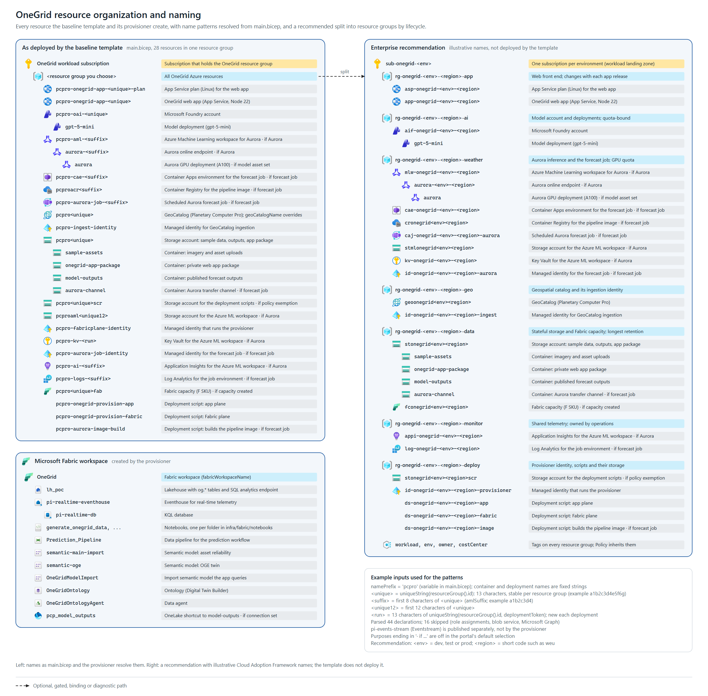

# OneGrid landing zone design guide

[Solution overview](../../README.md) | [Enterprise landing zone](enterprise-landing-zone.md) |
[Deploy and configure OneGrid](../deployment-and-data-guide.md)

This guide explains how OneGrid fits into an Azure landing zone and how the reference
implementation in this repository maps to it. It's for architects and technical
decision-makers who plan a OneGrid environment and need to understand the reference
implementation quickly: which subscriptions it uses, what the platform team provides,
what the template deploys, and which decisions you make before deployment.

The guide links to the detailed architecture articles for each decision. It doesn't repeat
their procedures.

## Landing zone concepts

An Azure landing zone is a set of subscriptions, management groups, and policies, deployed
as code, that gives every workload a prepared and governed place to run. Its design covers
eight areas, from billing and identity through networking, security, management,
governance, and automation. Subscriptions are the unit of isolation and scale: each one
separates the resources, costs, quotas, and access of one workload or shared service.

Landing zones come in two types:

- **Platform landing zones** host the shared services that many workloads use. A central
  platform team usually operates them in separate subscriptions for identity,
  connectivity, and management: the hub network, firewall, private DNS, central logging,
  and security tooling.
- **Application landing zones** host workloads. Each workload gets its own subscriptions,
  placed under the landing zones management group so that they inherit the organization's
  policies and role assignments. The workload team owns what it deploys inside them.

### Where OneGrid fits

OneGrid is a workload. Its Azure resources (App Service, Microsoft Foundry, storage,
GeoCatalog, and the optional Aurora and forecast-job resources) belong in an application
landing zone: one subscription per environment, under the Corp or Online management group.
OneGrid consumes platform services for identity, connectivity, and management; it doesn't
provide them.

Microsoft Fabric sits partly outside this model. Fabric is a software as a service (SaaS)
platform that runs in your organization's Fabric tenant, which is tied to your Microsoft
Entra tenant. The OneGrid workspace and its items (Lakehouse, Eventhouse, notebooks,
semantic models, ontology, and data agent) live there, not in an Azure resource group. The Fabric capacity that the
workspace runs on is an Azure resource (`Microsoft.Fabric/capacities`): it sits in a
subscription, is billed through Azure, and follows Azure Policy and role assignments. You
govern the workspace and items through Fabric administration and workspace roles, so plan
both control planes.

## Reference architecture

The reference architecture places OneGrid in a workload landing zone beside the platform
subscriptions that a typical enterprise already operates. Use it to agree responsibilities
between the platform team and the OneGrid workload team before you deploy.

The architecture provides these benefits:

- **Scalability.** You repeat the OneGrid stamp for each environment or region, and you size
  the Fabric capacity, App Service plan, model quota, and GPU capacity independently.
- **Security.** User access, deployment, runtime, refresh, ingestion, and forecast-job
  identities stay separate, and enterprise deployments reach the workload through the
  platform's private connectivity, DNS, and inspected egress.
- **Operational efficiency.** One template and one provisioner deploy each environment,
  while central monitoring, policy, and security tooling come from the platform instead of
  being rebuilt per workload.

<a href="../diagrams/onegrid-reference-landing-zone.svg"><picture><source media="(prefers-color-scheme: dark)" srcset="../diagrams/onegrid-reference-landing-zone-dark.png"></picture></a>

[Download SVG](../diagrams/onegrid-reference-landing-zone.svg) |
[Download the draw.io file](../diagrams/onegrid-architecture.drawio) |
[Diagram source](../diagrams/sheets/landing_zone.py)

The OneGrid production and non-production subscriptions sit under the Corp or Online
management group. Production holds the OneGrid workload resource group and, in an
enterprise deployment, a workload VNet peered to the connectivity hub; the VNet is dashed
because the baseline template doesn't create it. The OneGrid workspace runs in the
Microsoft Fabric tenant on the capacity in the workload subscription. Each subscription
carries the same governance strip. The lettered markers correspond to the design areas in
the next table.

### Design areas

| Legend | Design area | Objective |
| --- | --- | --- |
| A | Billing and Microsoft Entra tenant | Assign each OneGrid subscription and Fabric capacity an approved Entra tenant, billing scope, and cost owner when you [set up the subscriptions](enterprise-landing-zone.md#subscription-setup). |
| B | Identity and access management | Reuse enterprise groups, Conditional Access, and PIM for people, and keep the [deployment, runtime, refresh, ingestion, and forecast-job identities](traffic-and-security.md#identity-and-authorization) separate and least privileged. |
| C | Resource organization | Place each OneGrid environment's subscription under the Corp or Online management group, with the [resource groups, names, and tags](#resource-organization-and-naming) your organization standardizes. |
| D | Network topology and connectivity | Peer the OneGrid workload network to the connectivity hub for [private ingress, private endpoints, DNS, and inspected egress](enterprise-landing-zone.md#networking) when the workload can't use public endpoints. |
| E | Security | Protect operational data, prompts, credentials, and supply-chain artifacts with Defender for Cloud and the [control evidence](regulated-workload.md#control-implementation-and-evidence) that your obligations require. |
| F | Management | Send OneGrid signals to the central Log Analytics workspace and route [freshness, failure, and security alerts](traffic-and-security.md#logging-and-monitoring) to named owners. |
| G | Governance | Apply Azure Policy, role assignments, and budgets to every OneGrid subscription, and keep any [policy exception](enterprise-landing-zone.md#monitoring-and-policy) scoped, owned, and time-bound. |
| H | Platform automation and DevOps | Promote versioned infrastructure, application, and Fabric configuration through the [template, provisioner, and release workflow](../implementations.md#build-promote-and-restore) instead of portal-only changes. |
| C, F | Business continuity and disaster recovery | Set [recovery objectives per journey](multiregion.md#recovery-objectives-by-journey), repeat the OneGrid stamp in a recovery region with its own hub, and rehearse the [failover and failback procedures](multiregion.md#failover-and-failback). This area isn't lettered separately: it spans C (a stamp per region) and F (recovery monitoring and operations). |

The same eight areas, with OneGrid's decision and required outcome for each, are in
[Landing zone design decisions](enterprise-landing-zone.md#landing-zone-design-decisions).

> [!TIP]
> The eight design areas above are landing zone design areas: the platform team and the
> workload team settle them together. OneGrid also has workload design areas that the
> platform doesn't decide. Review them in the detailed articles:
> [Fabric data and analytics](fabric.md),
> [weather orchestration](traffic-and-security.md#weather-run),
> [geospatial services](baseline.md#geospatial-plane), and
> [AI and the application](baseline.md#ai-and-application-plane).

### Design principles

The reference architecture applies the Azure landing zone design principles to OneGrid:

- **Subscription democratization.** Give each OneGrid environment its own subscription so
  the workload team can deploy and operate inside the guardrails the platform team sets,
  without a request for each resource.
- **Policy-driven governance.** Enforce controls through Azure Policy assignments at the
  management group, and fix nonconforming OneGrid resources rather than exempting them.
  Keep the template's `exemptStorageFromPolicy` parameter `false` unless the platform owner
  approves a scoped exception.
- **Application-centric service model.** Treat the OneGrid stamp (the resource group and its
  Fabric workspace) as the unit you deploy, version, and retire. Keep shared network,
  monitoring, and identity resources outside its deletion boundary.
- **Single control and management plane.** Manage OneGrid's Azure resources with the same
  Azure Resource Manager, Azure Policy, Azure Monitor, and Defender for Cloud tooling as
  other workloads, without a custom management layer. Fabric items are the exception:
  assign Fabric administration and workspace roles explicitly.
- **Customer-owned data.** OneGrid deploys into your subscription and your Fabric tenant.
  Operational data, the asset model, imagery, and forecasts stay in resources you own, and
  model calls go to the Microsoft Foundry deployment in your subscription. Choose a model
  deployment type that meets your processing-geography requirements; the template default
  is `GlobalStandard`.

## Reference implementation

The reference implementation is the code in this repository: a Bicep template compiled to
ARM, a portal form, a PowerShell provisioner, Fabric item definitions, the packaged web app,
and the Aurora forecast pipeline. It deploys one OneGrid stamp per run.

### Architecture

> [!IMPORTANT]
> For an enterprise deployment, deploy or confirm your platform landing zone before you
> deploy OneGrid: management groups, policy assignments, the connectivity hub and DNS,
> central monitoring, and identity guardrails. The baseline template doesn't create VNets,
> private endpoints, an application gateway, or a firewall. The baseline also runs
> standalone in any subscription with authenticated public service endpoints. Use it for
> evaluation, or in an Online landing zone when your security review accepts public
> endpoints; the [enterprise implementation](enterprise-landing-zone.md) adds private
> connectivity.

The reference implementation uses these subscriptions:

- **OneGrid workload subscription.** One per environment, such as development, test, and
  production. It holds the OneGrid resource group, which also contains the Fabric capacity
  when the template creates one. Place it under Corp when users and dependencies connect
  privately through the hub, or under Online when the workload uses authenticated public
  endpoints.
- **Management subscription.** Provides the central Log Analytics workspace, Azure Monitor
  alerts, Defender for Cloud, and Automation. OneGrid's diagnostic settings send resource
  logs and activity here, and its alerts route through Azure Monitor. The template's own
  Log Analytics workspace and Application Insights cover only the forecast job and the
  Azure Machine Learning workspace.
- **Connectivity subscription.** Provides the hub VNet with Azure Firewall, DNS Private
  Resolver, private DNS zones, and the VPN or ExpressRoute gateway. In an enterprise
  deployment, the OneGrid workload VNet peers with the hub for private name resolution and
  inspected egress, and corporate users and OT data-plane connectors reach OneGrid through
  the gateway.
- **Identity subscription.** Hosts domain services when your organization uses them.
  OneGrid authenticates users with Microsoft Entra ID and workloads with managed identities
  and service principals, so it doesn't depend on this subscription.

The OneGrid workspace isn't in any subscription. It runs in your Microsoft Fabric tenant,
on the capacity you select.

#### Logical view

<a href="../diagrams/onegrid-reference-baseline.svg"><picture><source media="(prefers-color-scheme: dark)" srcset="../diagrams/onegrid-reference-baseline-dark.png"></picture></a>

[Download SVG](../diagrams/onegrid-reference-baseline.svg) |
[Download the draw.io file](../diagrams/onegrid-architecture.drawio)

The logical view shows what OneGrid does: operational, business, weather, and geospatial
data move through Microsoft Fabric and Azure into one web app and its AI agent. The
numbered steps match the [Workflow](../../README.md#workflow) in the solution overview,
which also describes each component. The [baseline architecture](baseline.md) adds flow
contracts, model selection, and design decisions.

#### Deployment view

<a href="../diagrams/onegrid-reference-deployment.svg"><picture><source media="(prefers-color-scheme: dark)" srcset="../diagrams/onegrid-reference-deployment-dark.png"></picture></a>

[Download SVG](../diagrams/onegrid-reference-deployment.svg) |
[Download the draw.io file](../diagrams/onegrid-architecture.drawio) |
[Diagram source](../diagrams/sheets/deployment.py)

The deployment view shows what one run of the baseline template deploys into a resource
group you choose, what its provisioner creates in Microsoft Fabric, and the OneGrid stamp,
the scale unit you repeat per environment or region. Dashed outlines are components that
the portal's default selection leaves off. The governance strip is inherited from the
platform landing zone.

1. Azure Resource Manager deploys the Bicep template, compiled to `azuredeploy.json`. It
   creates the selected resources, the managed identities, and the Azure role assignments
   in the resource group.
2. The app-plane deployment script (`pcpro-onegrid-provision-app`) wires the web app's
   settings and re-hosts the application package in the private `onegrid-app-package`
   container. The web app's managed identity reads the package from there.
3. The Fabric-plane deployment script (`pcpro-onegrid-provision-fabric`) creates the
   OneGrid workspace on the capacity and provisions its items: the Lakehouse, Eventhouse
   and KQL database, notebooks, pipeline, semantic models, ontology, and data agent. The
   app plane runs first because `fabricPlaneScript` depends on `appProvisionScript`, so the
   Fabric plane is the last writer of the app's Fabric settings. It doesn't create the
   Eventstream; see [Known gap](#known-gap-live-ingestion-eventstream).
4. The provisioner's `permissions` phase grants the web app's identity access to the
   Eventhouse, the semantic model, and the data agent: KQL database viewer, plus a
   workspace role that is Member by default, or Viewer with semantic model build access
   when `governance.leastPrivilegeApp` is set.
5. Users sign in with Microsoft Entra ID, and the web app calls Microsoft Foundry, Fabric,
   GeoCatalog, and storage with its managed identity.

The scripts keep separate logs, so an application-wiring failure and a Fabric failure are
visible independently. The [baseline architecture](baseline.md#deployment-architecture)
lists the provisioner's phase order.

### Benefits of the reference implementation

- **Faster deployment.** One portal form or parameter file deploys the Azure resources,
  creates the Fabric workspace and items, seeds data, and wires the app, instead of
  separate manual steps per service.
- **Repeatable stamps.** Names derive from the resource group, so each environment or
  region is an independent stamp, and redeploying into the same resource group reuses it.
- **Separated planes.** App and Fabric provisioning run as separate deployment scripts, so a
  failed capacity doesn't block the app's GeoCatalog, Microsoft Foundry, and storage wiring.
- **Secure defaults.** Managed identities replace keys for runtime calls, App Service and
  storage enforce HTTPS and TLS 1.2, Blob containers are private, and the app's role
  assignments are scoped to the resources it uses, such as the one forecast job it can
  start.

### Repository overview

#### Deployment options

| Option | How it deploys | Use it for |
| --- | --- | --- |
| Azure portal | The **Deploy to Azure** button opens the ARM template with its portal form, where you select components, the Fabric capacity, models, and app modules | First deployments and evaluations |
| Azure CLI or PowerShell | `az deployment group` or `New-AzResourceGroupDeployment` validates, previews (what-if), and deploys `azuredeploy.json`, compiled from `main.bicep`, with a parameter file you keep outside the repository | Repeatable and pipeline-driven deployments |
| GitHub Copilot runbook | An agent collects the same choices as the portal form, shows the plan, and deploys the same template from the command line after you confirm | Guided command-line deployments |
| Deploy wizard | A localhost web UI runs the provisioner (`deploy.ps1`) directly against an existing Fabric capacity, with prerequisite checks, live progress, and teardown | Evaluations of the Fabric workspace, Microsoft Foundry, and web app |

The deploy wizard doesn't run the ARM template, so it doesn't create GeoCatalog, Aurora, or
the forecast job. [Deploy OneGrid](../deploy/README.md) compares the options and the
scenarios that the shipped
[parameter files](../../planetary-computer-pro-poc/deploy/azure/parameters/README.md) cover.
Follow [Deploy from the Azure portal](../deploy/deploy-portal.md),
[Deploy from the command line](../deploy/deploy-cli.md), the
[Copilot runbook](../../DEPLOY-WITH-COPILOT.md), or the
[deploy wizard](../../planetary-computer-pro-poc/infra/deploy-ui/README.md). The
[parameter reference](../deploy/reference/parameters.md) documents every template parameter
and the portal step that sets it.

#### Greenfield and brownfield deployments

In a greenfield deployment, you deploy into a new, empty resource group, and the template
creates what OneGrid needs, including a new Fabric capacity (`createFabricCapacity`) and,
with approved Microsoft Graph permission, the sign-in registration and refresh identity.

In a brownfield deployment, you connect OneGrid to what already exists:

| Existing asset | How to reuse it |
| --- | --- |
| Fabric capacity | Choose an existing capacity in the portal form, or set `fabricCapacityId` |
| Sign-in app registration | Set `entraSignInClientId` |
| Import refresh service principal | Set the `refreshServicePrincipal*` parameters |
| Fabric storage connection | Set `fabricConnectionId` for the `pcp_model_outputs` shortcut |
| Forecast pipeline image | Set `auroraJobImage`; grant the job identity pull access to a supplied registry |
| Hub network | Peer a workload VNet and apply network integration through your own IaC; the template doesn't join networks |
| Operational data | Use the data-plane add-on for live telemetry, and the [data loading procedures](../deployment-and-data-guide.md#load-and-connect-data) for asset registers, imagery, and history |

#### Add-ons

Add-ons run on top of a deployed OneGrid environment. Each one's README describes how to
deploy and configure it.

| Add-on | What it adds | Guidance |
| --- | --- | --- |
| Data plane | PI and relational (SQL Server, Oracle) forwarders with a durable outbox that publish live telemetry to the Eventstream custom endpoint `PIForwarderEndpoint` | [Data plane README](../../planetary-computer-pro-poc/infra/bolt-ons/data-plane/README.md) |
| Foundry IQ manuals | An Azure AI Search vector and semantic index over a synthetic equipment-manual corpus, embedded with a Microsoft Foundry model, behind the agent's manuals tool and the work-order manual lookup | [Foundry IQ manuals README](../../planetary-computer-pro-poc/infra/bolt-ons/foundry-iq-manuals/README.md) |
| Teams | An Azure Bot and bot container that forward Microsoft Teams chat to the OneGrid assistant and the Fabric data agent | [Teams README](../../planetary-computer-pro-poc/infra/bolt-ons/teams-demo/README.md) |

The manuals add-on configures the app with an Azure AI Search key, and the Teams add-on
creates an app registration with a client secret. Review both against your credential
policy before you use them outside evaluation.

#### Resource organization and naming

<a href="../diagrams/onegrid-reference-naming.svg"><picture><source media="(prefers-color-scheme: dark)" srcset="../diagrams/onegrid-reference-naming-dark.png"></picture></a>

[Download SVG](../diagrams/onegrid-reference-naming.svg) |
[Download the draw.io file](../diagrams/onegrid-architecture.drawio) |
[Diagram source](../diagrams/sheets/naming.py)

The left side is what the baseline template declares, read from `main.bicep` when the
diagram is built. The template targets one resource group and declares 28 resources there:
24 resources and 4 Blob containers. Names combine the fixed prefix `pcpro` with
`uniqueString(resourceGroup().id)`, so they're stable per resource group and a redeployment
reuses them. Two names behave differently:

- GeoCatalog and the sample storage account both resolve to `pcpro<unique>`. They're
  different resource types, so the names don't collide, but inventory and cost reports
  show the same name twice. Set `geoCatalogName` to give the catalog its own name.
- The Key Vault for the Azure Machine Learning workspace is named `pcpro-kv-<run>`, where
  `<run>` derives from `deploymentToken` (`utcNow()`). Each deployment generates a new
  name, which avoids collisions with soft-deleted vaults but means you can't predict the
  name in inventory or policy.

Every resource is conditional on the component selection. The portal's default selection
is the baseline: GeoCatalog, sample storage, Microsoft Foundry, the Fabric plane, the web
app, and the historical data seed. Aurora, the forecast job, deployment-script storage, and
a new Fabric capacity deploy only when you enable them. In Fabric, the provisioner creates
the OneGrid workspace (`fabricWorkspaceName`) with `lh_poc`, `pi-realtime-eventhouse` and
`pi-realtime-db`, the notebooks, `Prediction_Pipeline`, the semantic models including
`OneGridModelImport`, `OneGridOntology`, `OneGridOntologyAgent`, and, when a storage
connection is supplied or created, the `pcp_model_outputs` shortcut.

The right side is an enterprise recommendation with illustrative names; the template
doesn't deploy it. It uses one subscription per environment (`sub-onegrid-<env>`) and
splits resources into resource groups by lifecycle and owner, with Cloud Adoption Framework
abbreviations:

| Resource group | Contents | Reason to separate |
| --- | --- | --- |
| `rg-onegrid-<env>-<region>-app` | App Service plan and web app | Changes with each application release |
| `rg-onegrid-<env>-<region>-ai` | Microsoft Foundry account and model deployments | Quota-bound; model lifecycle differs from the app |
| `rg-onegrid-<env>-<region>-weather` | Azure Machine Learning workspace, Aurora endpoint, Container Apps environment and job, registry, and their storage, Key Vault, and identity | GPU quota and the Aurora lifecycle |
| `rg-onegrid-<env>-<region>-geo` | GeoCatalog and its ingestion identity | Geospatial catalog lifecycle |
| `rg-onegrid-<env>-<region>-data` | Storage account (sample data, outputs, app package) and Fabric capacity | Stateful resources with the longest retention |
| `rg-onegrid-<env>-<region>-monitor` | Application Insights and Log Analytics | Owned by operations |
| `rg-onegrid-<env>-<region>-deploy` | Provisioner identity, deployment scripts, and script storage | Deployment-time privilege, kept apart from runtime |

Apply the tags `workload`, `env`, `owner`, and `costCenter` to every resource group so
Azure Policy and cost reports can use them. The template is scoped to one resource group
and sets no tags apart from the optional storage policy-exemption tag, so implement the
split and the tags in your own IaC.

### Deployment steps

1. **Prepare the prerequisites.** Confirm Azure rights to create resources and role
   assignments, a supported region, registered resource providers, Fabric tenant settings
   and capacity rights, the sign-in and refresh identities, and, for Aurora, model terms and
   A100 quota. Work through the [prerequisite checklists](../deploy/getting-started.md#prerequisites),
   and [validate them](../deploy/getting-started.md#validate-prerequisites) with
   `Test-OneGridPrerequisites.ps1`.
2. **Deploy or confirm the platform landing zone.** For an enterprise deployment, confirm
   the management groups, policy, hub network, DNS, central monitoring, and identity
   guardrails, and approve the
   [integration contract](enterprise-landing-zone.md#implement-the-enterprise-deployment)
   with the platform team.
3. **Deploy OneGrid.** Select a [deployment option](#deployment-options) and the
   [components](../deploy/getting-started.md#choose-components) for your scenario, starting
   from a [parameter file](../../planetary-computer-pro-poc/deploy/azure/parameters/README.md)
   for a command-line deployment. Validate and deploy from the
   [portal](../deploy/deploy-portal.md) or the [command line](../deploy/deploy-cli.md), and
   then watch both deployment scripts. Use [Troubleshooting](../deploy/troubleshooting.md)
   and [Known issues](../deploy/known-issues.md) when a step fails. For an enterprise
   deployment, apply network integration, diagnostic settings, and governance
   configuration through reviewed IaC.
4. **Accept the deployment.** Run `Test-OneGridDeployment.ps1`, the automated
   [acceptance checks](../deployment-and-data-guide.md#acceptance-checks), complete the
   manual checks, and run the
   [network acceptance procedure](../operations-runbook.md#validate-network-and-traffic-flows).
   Record the results, and hand the environment to [Day 2 operations](../operations.md).

### Deployment scenarios

| Scenario | What it adds to the baseline | Guidance |
| --- | --- | --- |
| Baseline | The starting point: one region, the template and provisioner as delivered, and authenticated public service endpoints | [Baseline architecture](baseline.md) |
| Enterprise landing zone | Workload VNet peered to the hub, Application Gateway WAF, private endpoints, hub DNS resolution, firewall-controlled egress, central monitoring, and policy | [OneGrid in an enterprise landing zone](enterprise-landing-zone.md) |
| Regulated workload | OT publication boundary, data classification, model and tool approval, permitted and denied access tests, and retained audit evidence | [Regulated workload architecture](regulated-workload.md) |
| Multiregion recovery | A recovery-region stamp behind Azure Front Door Premium, storage copies, Fabric item recovery with source replay, and a single forecast publisher; per-journey recovery objectives, a lettered landing-zone BCDR view, and a numbered failover sequence | [Multiregion architecture](multiregion.md) |

### Known gap: live-ingestion Eventstream

The repository includes the `pi-events-stream` Eventstream definition, with its custom
endpoint source `PIForwarderEndpoint`, in
[`infra/fabric/eventstream/pi-events-stream`](../../planetary-computer-pro-poc/infra/fabric/eventstream/pi-events-stream/).
No deployment path creates it. The provisioner's `core` phase creates the Lakehouse,
Eventhouse, and KQL database, and later phases create the notebooks, pipelines, semantic
models, ontology, and data agent, but none publishes the Eventstream, although the
provisioner's header comment and `core` log message list it.

A baseline deployment therefore has no live ingestion path. Eventhouse holds the tables,
mappings, and functions from the schema and, when historical seeding is selected,
`PiEvents` rows loaded directly from the bundled data. The provisioner's `dataplane` phase,
which wires the data-plane add-on, looks up `pi-events-stream` (or else the first
Eventstream in the workspace) to resolve the connector endpoint. When the workspace has
no Eventstream, the phase logs a warning and leaves a `REPLACE-ME` placeholder for the
endpoint in the generated connector settings. To enable live ingestion, publish the Eventstream definition to the
OneGrid workspace, bind its destination to the Eventhouse database and the `PiEventsRaw`
mapping in `ProcessedIngestion` mode, confirm the `PIForwarderEndpoint` source, and then run
the data-plane add-on. See [Ingest operational data](fabric.md#ingest-operational-data).

## Next steps

- [Deploy and configure OneGrid](../deployment-and-data-guide.md): prerequisites, component
  choices, commands, data loading, and acceptance checks.
- [OneGrid in an enterprise landing zone](enterprise-landing-zone.md): networking, DNS,
  ingress, egress, identity, and policy decisions for each design area.
- [OneGrid traffic, identity, security, and monitoring](traffic-and-security.md): the
  technical sheets with ports, roles, and signal collection.
- [OneGrid data and analytics in Microsoft Fabric](fabric.md): ingestion, the asset model,
  semantic queries, and data governance.
- [OneGrid Day 2 operations](../operations.md): ownership, monitoring, release, and recovery.

## Related resources

- [What is an Azure landing zone?](https://learn.microsoft.com/azure/cloud-adoption-framework/ready/landing-zone/)
- [Azure landing zone design areas](https://learn.microsoft.com/azure/cloud-adoption-framework/ready/landing-zone/design-areas)
- [Azure landing zone design principles](https://learn.microsoft.com/azure/cloud-adoption-framework/ready/landing-zone/design-principles)
- [Subscription vending](https://learn.microsoft.com/azure/architecture/landing-zones/subscription-vending)
- [Define your naming convention](https://learn.microsoft.com/azure/cloud-adoption-framework/ready/azure-best-practices/resource-naming)
- [Abbreviation recommendations for Azure resources](https://learn.microsoft.com/azure/cloud-adoption-framework/ready/azure-best-practices/resource-abbreviations)
- [Define your tagging strategy](https://learn.microsoft.com/azure/cloud-adoption-framework/ready/azure-best-practices/resource-tagging)
- [Deployment Stamps pattern](https://learn.microsoft.com/azure/architecture/patterns/deployment-stamp)
- [Azure Virtual Desktop landing zone design guide](https://learn.microsoft.com/azure/architecture/landing-zones/azure-virtual-desktop/design-guide),
  the pattern this guide follows
