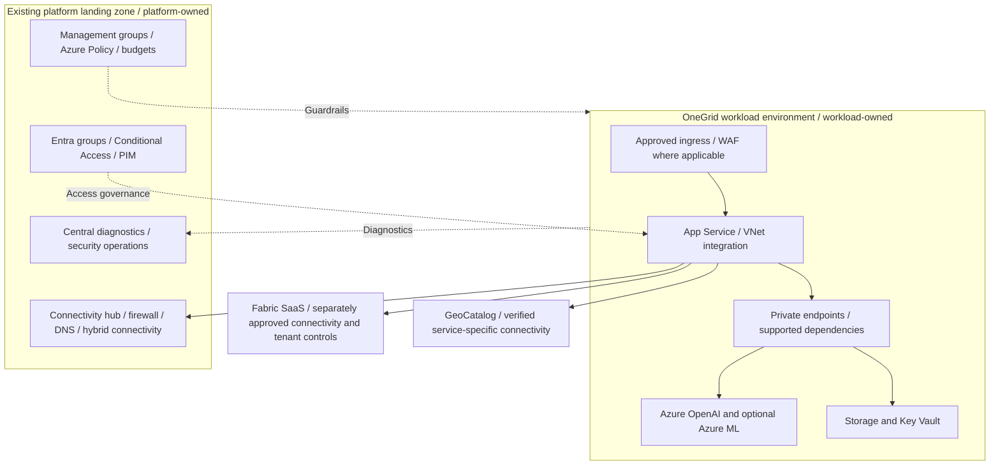

# OneGrid baseline architecture in an Azure landing zone

[Documentation home](../../README.md) | [Baseline](baseline.md) | [Operations](../operations.md)

Integrate OneGrid with an organization's existing identity, security, networking, governance,
and operations foundation. This article takes the workload team's perspective and identifies
the shared capabilities it needs from platform teams. Fabric is a separately governed SaaS
dependency, not a service deployed inside the workload VNet.

> [!IMPORTANT]
> This is a target design, not a supplied enterprise deployment profile. The current template
> does not implement the networking, policy, or centralized operations described here.

Article structure: [Baseline Microsoft Foundry chat reference architecture in an Azure landing zone](https://learn.microsoft.com/azure/architecture/ai-ml/architecture/baseline-microsoft-foundry-landing-zone).

## In this article

- [Article layout](#article-layout)
- [Architecture](#architecture)
- [Subscription setup](#subscription-setup)
- [Compute](#compute)
- [Networking](#networking)
- [Data scientist and agent developer access](#data-scientist-and-agent-developer-access)
- [Monitor resources](#monitor-resources)
- [Azure Policy](#azure-policy)
- [Manage changes over time](#manage-changes-over-time)
- [Enterprise architecture team](#enterprise-architecture-team)
- [Considerations](#considerations)
- [Contributors](#contributors)
- [Next step](#next-step)
- [Related resources](#related-resources)

## Article layout

| Architecture | Design decisions | Well-Architected Framework approach |
| --- | --- | --- |
| Architecture diagram; workload-owned and platform-provided resources | Subscription setup; compute; networking; developer access; monitoring; policy; change management | Reliability; Security; Cost Optimization; Operational Excellence; Performance Efficiency |

## Architecture

Private endpoint arrows apply only to services and paths that support the required
configuration. Verify regional and feature support, including provisioning APIs, Fabric,
GeoCatalog, SQL analytics, package downloads, and Aurora inference.

### Components

#### Workload team-owned resources

The workload team owns the application, workload identities, supported private endpoints,
environment configuration, data products, model connections, and application diagnostics.
It remains accountable for data authorization, delivery, recovery, and user-journey health.

#### Platform team-provided resources

The platform team provides subscription governance, shared connectivity/DNS, identity
guardrails, policy, monitoring destinations, and central security operations.

| Design area | Platform team owns | Workload team owns | Integration handoff |
| --- | --- | --- | --- |
| Resource organization | Management groups, subscription vending, policies | Resource groups, naming, tags, inventory | Scope IDs, allowed locations/SKUs, constraints |
| Identity | Entra groups, Conditional Access, privileged access, Graph consent | Runtime identities, app registration integration, scoped permissions | Groups, consent process, identity owners |
| Connectivity | Hub/vWAN, IP plan, firewall, private DNS, VPN/ExpressRoute | Spoke/subnets, App Service integration, supported endpoints/routes | Network IDs, routes, egress rules, endpoint approvals |
| Security operations | SIEM, Defender standards, incident response | Application/dependency signals and remediation | Diagnostic destinations, retention, escalation |
| Data governance | Fabric tenant policy, Purview/classification standards | Workspace/item permissions, data products, model security | Capacity/workspace approval, classification, retention |
| Delivery | Federated identity standards, environment approvals | Versioned artifacts, migrations, rollback | Runner network access, deployment scope |
| Cost/resilience | Budget policy, shared-service commitments | Capacity sizing, recovery, workload cost alerts | Budget, SLO/RTO/RPO, recovery-region constraints |

## Subscription setup

Use approved subscription vending and management group placement. Separate environments and
permissions according to organizational policy. Avoid embedding shared hub, DNS, SIEM, or
identity-service lifecycle in the OneGrid resource-group template.

### Workload requirements and fulfillment

Before provisioning, obtain allowed regions/SKUs, data classification, existing network IDs,
quota, role-assignment boundaries, approved Graph consent, Fabric capacity/workspace access,
diagnostic destinations, and cost/recovery requirements. Resolve policy incompatibilities
as design work, not as unexpected production deployment failures.

## Compute

Use a supported App Service plan for the approved networking, scale, availability, and
deployment requirements. The evaluation plan is not a production sizing recommendation.
Container Apps Jobs and Azure ML GPU inference remain separate compute dependencies.

#### Foundry and model access

Decide whether the workload owns Azure OpenAI deployments or consumes a central AI gateway.
Record model versions, quota, content safety, allowed tools, evaluations, data retention,
and processing geography. The existing app calls Azure OpenAI directly and hosts its own
agent; adopting a gateway or Foundry Agent Service requires integration work.

Keep Aurora's Azure ML identity and inference lifecycle separate. Do not add the Microsoft
sample's Search, Cosmos DB, agent-state, or Foundry-project services to the deployed inventory
unless they are actually implemented.

AKS is not deployed. If selected later, establish a separate container platform design,
application packaging, workload identity, ingress, delivery pipeline, and operating model.

## Networking

Implement and validate network paths before disabling public endpoints. The current template
does not expose a complete enterprise network profile.

### Virtual network subnets

Obtain address space and approved subnets for App Service VNet integration, supported private
endpoints, ingress infrastructure, and private runners/management where needed. Size for
scale and service delegation requirements. Reuse platform connectivity instead of creating
an ungoverned parallel hub.

### Ingress traffic

Classify users as internal, external, or both. Select the approved private-access or
internet-facing WAF/reverse-proxy pattern. Restrict direct origin access to prevent bypass.
Inbound private endpoints and outbound App Service VNet integration solve different problems.

### DNS configuration

Test resolution from application, deployment runner, operator, and hybrid client networks.
Include storage/package mounting, Azure OpenAI, Azure ML, Fabric/SQL endpoints, and optional
GeoCatalog paths. A valid public hostname does not prove traffic uses a private address.

### Egress traffic

Inventory Entra, Azure/Fabric control planes, weather/imagery providers, registries, packages,
and telemetry endpoints. Separate build-time, bootstrap, and runtime needs. Route and filter
through platform-approved controls without assuming all external weather inputs are private.

### Azure private DNS zones

Use the platform's zone ownership, linking, and forwarding model for each supported endpoint.
Coordinate endpoint approval and split-horizon resolution. Disable public access only after
runtime, deployment, package mounting, and operator paths all succeed through the intended
network. The deployment-scripts helper storage/ACI path needs explicit compatibility work
under deny-public or deny-shared-key policies.

## Data scientist and agent developer access

Use group-based access and approved workstations or network-connected developer environments.
Separate model experimentation, Fabric development, and production administration. Do not
give developers standing production Owner merely to simplify a notebook or deployment.

### The role of the jump box

A jump box is an optional platform-approved access mechanism, not a resource the template
deploys or a mandatory choice. If private services require it, define privileged access,
patching, monitoring, and allowed tooling. Private runners may be more appropriate for
automated deployments.

## Monitor resources

Connect workload diagnostics and health signals to platform destinations with agreed
retention, redaction, alert routing, and incident ownership. Include app, identity, network,
Fabric refresh/query, model throttling, and forecast freshness signals.

Use the [Day 2 guide](../operations.md); dashboards alone are not operational acceptance.

## Azure Policy

Keep `exemptStorageFromPolicy=false`. The template's opt-out tags work only with policies
that recognize them; they are not a universal Azure Policy exemption. Approved exceptions
need an owner, compensating controls, expiration, and a removal plan.

Review the provisioner's resource-group Owner assignment and optional Graph application
permission separately from runtime roles. Design a privileged bootstrap and least-privilege
steady state; the current template does not automatically remove those privileges.

Fabric SaaS controls are separate from Azure Policy. Apply approved capacity, tenant,
workspace, sharing, classification, and data access controls using the
[Fabric security guide](fabric.md). A signed-in user does not automatically confer per-user
RLS when the backend queries with a shared service identity.

## Manage changes over time

Version application, infrastructure, configuration, data/model schema, and security decisions
together. Agree on a platform/workload change notification and validation process.

### Platform changes that affect the workload

Revalidate after firewall/DNS changes, policy updates, Conditional Access changes, identity
restrictions, central AI gateway changes, logging changes, or Fabric tenant/capacity changes.
Test runtime and deployment paths in nonproduction before rollout.

### Workload changes that affect the platform

Request review for new endpoints, tools, regions, model deployments, preview features,
permissions, data classifications, load, or recovery dependencies. Record shared-service
capacity and incident-response effects.

#### Implementation sequence

1. Discover platform ownership, policies, addresses, service support, Fabric constraints,
   classification, and recovery requirements.
2. Agree on the integration contract, endpoint matrix, threat model, authorization, and
   operational acceptance criteria.
3. Implement reviewed networking, diagnostics, policy-compatible bootstrap, identity
   integration, and environment-specific configuration as code.
4. Implement approved federated credentials, private runners, immutable packages, secret
   storage/rotation, and promotion approvals.
5. Validate runtime/control-plane paths, policy compliance, denied access, query isolation,
   restore, rollback, and monitoring in nonproduction.
6. Obtain platform, data, security, and workload owner approval before production.

#### Exit criteria

- No unexplained policy failures or unapproved opt-outs.
- Approved ingress/egress and DNS; no unintended public bypass.
- Identity, data isolation, refresh, model, and package-access tests pass.
- Alerts reach an accountable team; budgets and recovery procedures are tested.
- Every remaining deviation has an owner and explicit acceptance.

## Enterprise architecture team

Own cross-workload consistency and exceptions. Confirm the workload fits enterprise
identity, network, security, data, AI, and resilience standards without imposing a second
platform foundation. Resolve disputed ownership and approve material architecture deviations.

## Considerations

### Reliability

Include shared platform dependencies in failure analysis and recovery exercises. An app
with healthy compute but broken central DNS, Fabric, or model connectivity is unavailable.
Use [multiregion guidance](multiregion.md) only after setting dependency-specific objectives.

### Security

Test server-side authorization and effective data permissions across app APIs, chat, exports,
DAX, KQL, and SQL paths. Inventory refresh secrets and prevent sensitive configuration or
tokens from entering source control, deployment artifacts, or logs.

### Cost Optimization

Allocate shared platform charges and workload consumption separately. Budget private
connectivity, ingress, monitoring, Fabric, AI, and optional GPU costs before choosing topology.

### Operational Excellence

Use approved network-capable runners, controlled promotion, environment inventory, and
tested rollback. Keep platform/workload incident and change ownership explicit.

### Performance Efficiency

Measure the effect of forced routing, private connectivity, gateways, data capacity, and
model quotas on actual application journeys; validate peak and recovery-region load.

## Contributors

Project-maintained adaptation by the
[OneGrid repository contributors](https://github.com/paulshaheen/OneGrid/graphs/contributors).
The article structure does not imply Microsoft authorship or endorsement.

## Next step

Evaluate [regulated controls](regulated-workload.md) and [multiregion recovery](multiregion.md)
against approved requirements; these require additional implementation.

## Related resources

- [Microsoft Foundry landing zone architecture](https://learn.microsoft.com/azure/architecture/ai-ml/architecture/baseline-microsoft-foundry-landing-zone).
- [Azure landing zone implementation options](https://learn.microsoft.com/azure/cloud-adoption-framework/ready/landing-zone/implementation-options).
- [Fabric security and governance](fabric.md).
- [GitHub implementations](../implementations.md).
- [Day 2 operations](../operations.md).
