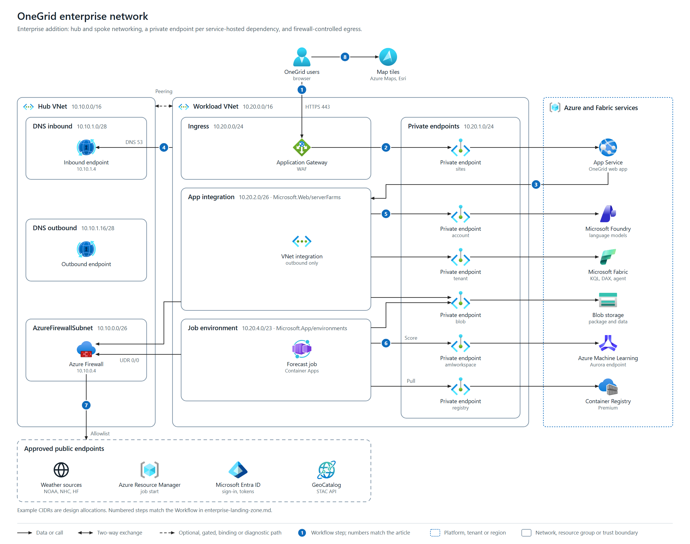
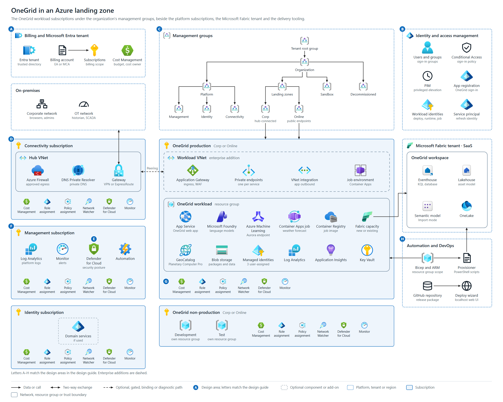
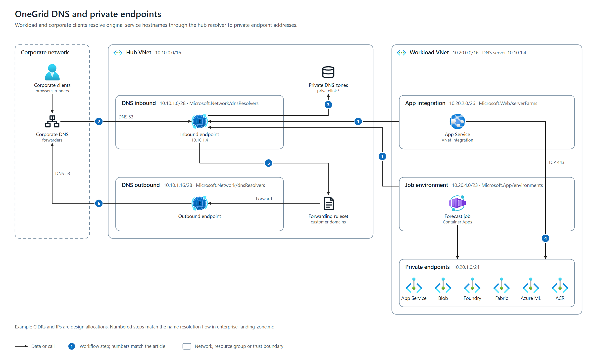

# OneGrid in an enterprise landing zone

Part of the [OneGrid landing zone design guide](design-guide.md).

[Solution overview](../../README.md) | [Baseline architecture](baseline.md)

An enterprise deployment places OneGrid's workload resources inside an organization's
existing platform foundation. The application and its data, geospatial, weather, and AI
planes retain their functional responsibilities. Platform services supply identity
guardrails, connectivity, DNS, policy, central monitoring, and security operations.

The implementation combines the OneGrid ARM deployment and Fabric provisioner with the
organization's network, governance, and environment-delivery configuration.

## Architecture

<a href="../diagrams/onegrid-reference-enterprise.svg"><picture><source media="(prefers-color-scheme: dark)" srcset="../diagrams/onegrid-reference-enterprise-dark.png"></picture></a>

[Download SVG](../diagrams/onegrid-reference-enterprise.svg) |
[Diagram source](../diagrams/sheets/enterprise.py) |
[DNS detail](#name-resolution-flow) |
[Traffic and security contracts](traffic-and-security.md)

The hub VNet holds the DNS Private Resolver inbound and outbound endpoints and Azure
Firewall. The peered workload VNet holds the Application Gateway ingress subnet, the
delegated app integration and job environment subnets, and a private endpoint subnet with
a separate private endpoint for each service, drawn level with the service-hosted target it
fronts. Approved public endpoints sit behind the firewall. This implementation adds the
gateway, private endpoints, network integration, DNS, and platform egress configuration;
the baseline OneGrid deployment doesn't create these VNets, private endpoints, gateway, or
firewall. Each dependency has its own service connection and access policy.

### Workflow

1. The browser resolves the published application host and opens an HTTPS connection
   (TCP 443) to Application Gateway in the ingress subnet. WAF evaluates the request
   before forwarding it.
2. The gateway resolves the App Service origin to its private endpoint (`sites`) and
   establishes a new HTTPS connection. The backend host, certificate, and probe identify
   the same app.
3. App Service handles the UI, REST API, and WebSocket session. Entra sign-in establishes
   the user identity; runtime data calls use the separately authorized workload identity.
   Outbound calls leave through the delegated app integration subnet; App Service compute
   stays outside the VNet.
4. The workload VNet uses the hub resolver's inbound endpoint (example `10.10.1.4`) as its
   DNS server. Private service hostnames resolve to private endpoint addresses, as
   described in the [name resolution flow](#name-resolution-flow).
5. App Service reaches Microsoft Foundry, Fabric, and Blob Storage through their private
   endpoints over TCP 443. Fabric executes KQL, DAX, and configured Data Agent requests;
   refresh, notebooks, and shortcuts use their own source connections rather than the
   application's subnet.
6. The forecast job runs in its own Container Apps environment subnet. It invokes Aurora
   through the Azure ML workspace private endpoint, exchanges Blob payloads through the
   Blob private endpoint, and pulls its image through the Container Registry private
   endpoint.
7. App and job traffic to public destinations follows each subnet's `0.0.0.0/0` UDR to
   Azure Firewall (example next hop `10.10.0.4`), which allows only the approved
   endpoints: GeoCatalog, Azure Resource Manager, Microsoft Entra ID, and the job's NOAA
   GFS, NHC, and Hugging Face inputs. An app-initiated job run starts through Azure
   Resource Manager, not the scoring endpoint.
8. Browser basemap and glyph requests leave the user's network directly for the map
   providers; they don't traverse the VNets.

Central diagnostics collect out-of-band signals from the enabled services; see
[Monitoring and policy](#monitoring-and-policy).

### Components and ownership

| Area | Platform responsibility | OneGrid responsibility |
| --- | --- | --- |
| Organization | Subscription vending, management group placement, policies | Workload resource groups, naming, tags, inventory |
| Identity | Entra groups, Conditional Access, privileged elevation, directory consent | App registration, managed identities, refresh identity, scoped data permissions |
| Connectivity | Shared hub/vWAN, hybrid links, DNS, firewall/egress standards | App integration, supported service endpoints, dependency rules, runner connectivity |
| Security operations | Central destinations, threat response, retention standards | Workload signals, redaction, alert ownership, remediation |
| Data governance | Fabric tenant/capacity standards, classification and sharing policy | Workspace/items, model permissions, source contracts, lineage and access tests |
| Delivery | Federated identity standards, deployment approvals | Versioned app/infrastructure/data configuration, migration, rollback |
| Continuity and cost | Shared-service commitments, budgets, recovery constraints | Workload sizing, dependency recovery, cost allocation, exercises |

## Landing zone design decisions

Resolve the eight platform design areas for the OneGrid environment before deployment.
The output is an integration contract, not a second platform foundation. The legend letters
match the lettered markers on the landing zone drawing and the
[design areas](design-guide.md#design-areas) in the design guide.

<a href="../diagrams/onegrid-reference-landing-zone.svg"><picture><source media="(prefers-color-scheme: dark)" srcset="../diagrams/onegrid-reference-landing-zone-dark.png"></picture></a>

[Download SVG](../diagrams/onegrid-reference-landing-zone.svg) |
[Download the draw.io file](../diagrams/onegrid-architecture.drawio) |
[Diagram source](../diagrams/sheets/landing_zone.py)

| Legend | Design area | OneGrid decision | Required outcome |
| --- | --- | --- | --- |
| A | Billing and Microsoft Entra tenant | Select the Azure subscription, Fabric tenant/capacity, and accountable cost owner | Approved tenant relationship, billing scope, and budget |
| B | Identity and access management | Reuse enterprise sign-in groups; separate deployment, runtime, refresh, ingestion, and job identities | Identity inventory, consent, least-privilege grants, and credential owners |
| C | Resource organization | Place environment subscriptions/resource groups under the existing management hierarchy | Naming, tags, ownership, retention, and shared-resource deletion boundaries |
| D | Network topology and connectivity | Select ingress, subnet allocations, private endpoints, DNS, hybrid access, and egress | Reviewed traffic matrix and deployment/operator network paths |
| E | Security | Protect data, model inputs, tools, administrative access, and supply-chain artifacts | Threat model, approved controls, and permitted/denied access evidence |
| F | Management | Integrate workload telemetry, alerting, source freshness, backups, and incident response | Service objectives, on-call ownership, retention, and tested recovery |
| G | Governance | Apply Azure Policy and Fabric/data-governance decisions to the correct control planes | Policy assignments, data classifications, access reviews, and owned exceptions |
| H | Platform automation and DevOps | Promote versioned infrastructure, app, data/model configuration, and network changes | Approved pipelines, connected runners, release record, and rollback evidence |

## Subscription setup

Separate development, test, and production according to the organization's subscription
model. Give each environment its own resource group, Fabric workspace/item targets,
application registration/settings, data connections, and release record.

Before provisioning, collect:

- Approved subscription/resource group, region, SKUs, quota, naming, and tags.
- Platform network/subnet IDs, DNS forwarding, ingress path, and egress policy.
- Fabric capacity ID or approval to create capacity, workspace ownership, and tenant settings.
- Entra group object IDs, sign-in registration, refresh identity, and directory consent.
- Monitoring destinations, retention, data classification, budget, and recovery objectives.

Keep shared network and management resources outside the workload resource group's deletion
boundary. Reuse an existing Fabric capacity only after agreeing on capacity administration,
content isolation, and performance/cost ownership.

## Compute and model configuration

Select the App Service tier and instance configuration for the required networking,
availability, and concurrency. The app package contains the report BFF, React SSR, and Node
AI agent; preserve its startup command, port 8080, WebSocket support, and package access.

Use the configured Microsoft Foundry account and deployment consistently across model settings and
application configuration. Record deployment name, catalog model, version, processing
geography, quota, allowed tools, and evaluation results. When the enterprise supplies an
AI gateway, integrate its endpoint, identity, authorization, and routing with the agent.

For Aurora, allocate regional GPU quota and model readiness independently from the CPU
forecast job. Keep image access, blob channel, output publication, and inference permissions
in the same reviewed configuration.

## Networking

### Subnets and private connectivity

Allocate supported App Service integration, private endpoint, ingress, and management/runner
subnets through the platform address plan. Configure supported private service connections
and resource access rules for storage, Microsoft Foundry, Azure ML, and Key Vault.

The drawings use this example plan. The ranges are design allocations, not discovered
Azure addresses; replace them with the platform's allocations.

| VNet or subnet | Example range | Delegation and purpose |
| --- | --- | --- |
| Hub VNet | `10.10.0.0/16` | Platform-owned DNS, peering, and egress |
| `AzureFirewallSubnet` | `10.10.0.0/26` | Azure Firewall; example private IP and UDR next hop `10.10.0.4` |
| DNS inbound | `10.10.1.0/28` | `Microsoft.Network/dnsResolvers`; inbound endpoint with static IP `10.10.1.4` |
| DNS outbound | `10.10.1.16/28` | `Microsoft.Network/dnsResolvers`; separate subnet, no client-facing inbound IP |
| Workload VNet | `10.20.0.0/16` | Custom DNS server `10.10.1.4` |
| Ingress | `10.20.0.0/24` | Dedicated Application Gateway subnet |
| Private endpoints | `10.20.1.0/24` | One private endpoint per target: App Service `sites`, Blob `blob`, Microsoft Foundry `account`, Fabric `tenant`, Azure ML `amlworkspace`, Container Registry `registry` |
| App integration | `10.20.2.0/26` | `Microsoft.Web/serverFarms`; outbound only |
| Job environment | `10.20.4.0/23` | `Microsoft.App/environments`; workload profiles environment |

Peer the workload VNet with the hub explicitly and confirm the return paths; peering isn't
transitive. Hybrid clients reach the hub through the approved ExpressRoute or VPN
connection. Review NSGs and route tables separately so that they permit the DNS and
application paths. A private endpoint is a network interface with a private address in
the workload VNet; the services stay service-hosted, and a private endpoint isn't a VM
that hosts them.

Use the App Service private endpoint for inbound application access. Use a separate,
delegated integration subnet for outbound connections; VNet integration doesn't provide
inbound access or move App Service compute into that subnet. Delegate the integration
subnet to `Microsoft.Web/serverFarms`; keep it separate from the gateway and private
endpoint subnets. Size its address space for scale operations as well as steady-state
instances.

Validate GeoCatalog and Fabric connectivity against the selected service features, region,
and tenant configuration. Fabric access is a SaaS integration; it is not deployed inside
the application subnet.

Fabric Private Link protects client-initiated access to Fabric. Configure Fabric-to-source
access independently, including storage connections and shortcut paths.

For the combined OneGrid workspace, use **tenant-level Fabric Private Link** and validate
the complete item inventory before blocking public access. This choice preserves the
`OneGridModelImport` semantic-model serving path. Workspace-level Private Link has a
different item-compatibility contract; don't substitute it for tenant-level connectivity
in the existing combined workspace. Review a data-only workspace split as a separate
architecture change, including cross-workspace connections and query targets.

Retain the Eventstream artifact's `ProcessedIngestion` destination mode and validate the
rebound Eventhouse mapping. Don't change to direct ingestion as part of network lockdown.
Assess the tenant-wide impact of Fabric settings with the platform and Fabric owners.

For private Aurora inference, the job reaches the managed endpoint through the Azure ML
workspace private endpoint. Azure ML deployment outbound access to its backing resources
and the Blob transfer channel is controlled through its managed network. Configure the Container Apps environment's own network and DNS paths for
NOAA downloads, registry pulls, inference, and the Blob transfer channel.

Choose a VNet-integrated **workload profiles environment** for a forecast job that requires
UDRs and firewall-controlled egress. Allocate its dedicated subnet when the environment
is created; an Azure-managed network can't later be changed into a customer VNet.
The app's integration subnet is not a substitute for this environment network. The job
has no inbound HTTP application endpoint; it needs only outbound paths, and it calls the
`AADToken`-authenticated scoring endpoint with its own managed identity.

For a private registry path, select Azure Container Registry **Premium** and validate the
registry and image-data endpoints. The template's automatically created registry uses
Basic; include the SKU/network change in enterprise IaC before restricting image access.
Validate build-time image publication separately from runtime image pulls. Grant the job
identity `AcrPull`, and scope the image-build identity and its runner path separately.

### Ingress

The illustrated entry point is Application Gateway WAF, which reaches the App Service
private endpoint. Select an internal or external frontend, restrict direct origin access,
and register the published host's sign-in callback. Test browser navigation, API
authorization, and WebSocket traffic through the same entry point.

Preserve the published host end to end by binding the custom domain and TLS certificate
to App Service and using that host for the gateway backend and custom probe. Resolve the
backend privately from the gateway network. A private IP alone doesn't provide the
correct HTTP host or TLS server name indication (SNI).

After private access passes, explicitly disable App Service public network access and test
that the direct public origin is denied. Creating a private endpoint doesn't, by itself,
remove the public access path. App Service access restrictions aren't evaluated for traffic
arriving through a private endpoint; apply the intended private-path controls at the
network and application boundaries.

### DNS and egress

Use centrally owned private DNS zones, links, and forwarding. Test name resolution from
Application Gateway, App Service, the forecast job, deployment runners, operator
workstations, and hybrid networks.

#### Name resolution flow

<a href="../diagrams/onegrid-reference-dns.svg"><picture><source media="(prefers-color-scheme: dark)" srcset="../diagrams/onegrid-reference-dns-dark.png"></picture></a>

[Download SVG](../diagrams/onegrid-reference-dns.svg) |
[Diagram source](../diagrams/sheets/dns.py)

1. App Service, through its integration subnet, and the forecast job send queries for
   original service hostnames to the resolver inbound endpoint (`10.10.1.4`), the workload
   VNet's custom DNS server, on UDP/TCP 53 over the hub peering. The job's DNS path is its
   own; it isn't inherited from App Service.
2. Corporate clients query corporate DNS, which conditionally forwards the Azure service
   (`privatelink`) namespaces to the same inbound endpoint over the approved ExpressRoute or
   VPN connection.
3. The resolver answers through Azure DNS from the private DNS zones linked to the hub VNet
   and returns the private endpoint's address. Azure DNS is a platform service, not a DNS VM
   in the hub, and peering doesn't proxy DNS.
4. The client connects to the private endpoint over TCP 443 (encrypted TDS on TCP 1433 for
   SQL clients) by using the original hostname, so TLS still validates the service name.
5. Queries for customer namespaces match a rule in the forwarding ruleset that's linked to
   the hub VNet.
6. The outbound endpoint forwards the matched queries to corporate DNS on UDP/TCP 53.

Delegate both resolver subnets to `Microsoft.Network/dnsResolvers` and keep them separate;
the outbound endpoint has no client-facing inbound IP. Accept DNS queries only from
approved clients. Associate the ruleset with the outbound endpoint and forward only
approved customer domains. Don't add a rule that sends the private zones back to the
inbound endpoint, and don't let corporate DNS forward those namespaces back into a loop.
A ruleset's virtual network link isn't a network route: it can resolve without peering,
but DNS and application traffic to the resolved addresses still needs a reachable path.
Public names, such as GeoCatalog, NOAA, Entra, Azure Resource Manager, and the browser map
hosts, keep resolving publicly.

Keep the original service hostname in requests and let private DNS resolve it to the
approved endpoint. Don't replace SDK endpoints with private IP addresses. Private DNS and
private endpoints don't grant data-plane access, such as `Cognitive Services OpenAI User`
or `AcrPull`, and they don't disable a service's public network access.

| DNS boundary | Configuration | Validation point |
| --- | --- | --- |
| App Service origin | Link `privatelink.azurewebsites.net` and register the app record; add the SCM record when used | Gateway backend, probe, and connected deployment runner |
| Blob Storage | Link `privatelink.blob.core.windows.net`; add other storage subresources only when used, such as `privatelink.dfs.core.windows.net` for an ADLS source path | App package bootstrap, imagery access, job channel/output, and each service-source connection; test Blob and DFS separately when a source uses both |
| Microsoft Foundry | Link `privatelink.openai.azure.com` for the deployed account endpoint | Actual App Service model client |
| Azure ML workspace/scoring | Use the workspace private endpoint's supplied records under `privatelink.api.azureml.ms`, including inference resolution; add the notebook zone only when used | Container Apps job network and model administration path |
| Container Registry | Link `privatelink.azurecr.io`, including the registry and service-generated image-data records | Job image pull and the connected build runner |
| Fabric | Use the tenant private endpoint's DNS configuration and actual KQL, Power BI, and API connection targets | App runtime, connected operators/runners, and the selected Fabric experiences |
| Hybrid clients | Forward relevant private zones through the platform resolver; preserve public resolution for approved external sources | Corporate browser, connector host, and administrative network |

After resolution passes from every real caller, test HTTPS or TDS, valid TLS/SNI,
authorized data access, and denial of the direct public origin.

#### Egress

Maintain an endpoint matrix for:

- Entra, Azure control plane, Fabric/Power BI APIs, KQL, and SQL analytics.
- Blob package mounting, assets, forecast output, and Aurora transfer channels.
- Microsoft Foundry and Azure ML scoring.
- NOAA GFS, approved weather/static-data sources, and imagery ingestion sources.
- Container image pulls, source/package distribution, and diagnostic ingestion.
- Browser-loaded basemap tiles and glyphs: the configured Azure Maps path, selected Esri
  layers, and `demotiles.maplibre.org`.

Typical approved public hosts include `management.azure.com`, `login.microsoftonline.com`
and the other required Entra endpoints, the GeoCatalog API, the NOAA GFS S3 bucket,
`nhc.noaa.gov`, and Hugging Face with its actual download/CDN hosts. A connected
build/bootstrap runner also needs GitHub release/source hosts, image-build dependencies,
and the service control planes.

Separate bootstrap, build-time, and runtime access. Change public endpoint access only after
the corresponding private/runtime/deployment paths have been validated.

Test browser-originated map requests from the user's network. These requests don't traverse
App Service VNet integration. The current basemap adapter selects Azure Maps for the dark
basemap when `VITE_AZURE_MAPS_KEY` is present at build time; satellite and bathymetry layers
use Esri, and the default dark basemap also uses Esri when that setting isn't supplied.

For App Service, review application and configuration routing together. When policy requires
all outbound traffic through the VNet, configure `outboundVnetRouting.allTraffic` and validate
package mounting, token acquisition, diagnostics, and dependency access through that route.
An authenticated, nonanonymous Blob container is an authorization boundary; private network
access additionally requires the corresponding endpoint, DNS, and routing configuration.

A `0.0.0.0/0` route to Azure Firewall controls default egress; it doesn't override the
more-specific `/32` route that each private endpoint adds. The diagram therefore separates
direct private endpoint access from inspected public egress. If policy requires private
endpoint traffic inspection, configure the endpoint subnet's network policies and specific
routes, then validate the actual next hop and symmetric return path.

### Traffic-flow matrix

Use this matrix as the workload input to firewall and DNS policy. Resolve service-generated
hostnames from the deployed resources and connection definitions. Platform dependencies,
service tags, and regional endpoints also need the service-specific rules recorded in the
[routing evidence](../diagrams/README.md#flow-verification).

| Initiator | Destination | Protocol / port | Enterprise path | Acceptance evidence |
| --- | --- | --- | --- | --- |
| User browser | Published application host | HTTPS and WSS / TCP 443 | Approved user network -> Application Gateway WAF | Sign-in, API authorization, and WebSocket reconnect |
| Application Gateway | App Service origin | HTTPS / TCP 443 | Gateway subnet -> app private endpoint | Private DNS result, valid host/SNI, healthy custom probe |
| App Service | Fabric DAX, KQL, and Data Agent endpoints | HTTPS / TCP 443 | App integration -> tenant Fabric private connectivity for the verified endpoints | Real query/answer against intended workspace/item IDs |
| App Service | Microsoft Foundry account endpoint | HTTPS / TCP 443 | App integration -> account private endpoint | Authorized grounded model/tool response |
| App Service | GeoCatalog account endpoint | HTTPS / TCP 443 | App integration -> approved platform egress | Authorized STAC/search, catalog operations, and imagery retrieval |
| App Service | Blob package and runtime data | HTTPS / TCP 443 | App integration -> Blob private endpoint | Package loads after restart; authorized read/write operations succeed |
| App Service | Azure Resource Manager job API | HTTPS / TCP 443 | App integration -> approved platform egress | Job-scoped start/status request; no app-to-scoring dependency |
| Operational connector | Resolved Eventstream custom endpoint | AMQP over WebSockets / TCP 443 by default | Approved source transfer zone -> configured Fabric ingress | Producer acknowledgment and new curated `PiEvents` row |
| Connected SQL client or provisioning task | Lakehouse SQL analytics endpoint | Encrypted TDS / TCP 1433 | Approved runner/operator network -> selected Fabric SQL path | Authenticated SQL query; firewall treats traffic as MSSQL, not HTTPS |
| Forecast job | Aurora managed online endpoint | HTTPS / TCP 443 | Job environment network -> workspace private endpoint | Scoring succeeds with the job identity and current model |
| Forecast job | NOAA inputs, registry, Blob channel/output | HTTPS / TCP 443 for workload calls | Job's own DNS/private endpoints and approved egress | Image pull, input retrieval, payload exchange, and fresh published output |
| GeoCatalog ingestion service | Source imagery container | HTTPS / TCP 443 | Independently approved service-to-storage connection | Associated ingestion identity reads the source; ingestion and tiles complete |
| Fabric refresh, notebooks, and shortcuts | Configured source/connection | Source-specific; SQL uses TDS, Blob uses HTTPS | Fabric-managed source access, not App Service integration | Import refresh, notebook output, and shortcut content access |
| Browser | Azure Maps, Esri, and glyph hosts | HTTPS / TCP 443 | User network egress, not the application subnet | Each selected map style and glyph request succeeds |

The supplied connectors set `UseAmqpWebSockets=true`. If explicitly changed to native
AMQP/TLS, allow TCP 5671 as well as HTTPS dependencies for identity and SDK operations.
An HTTP-only proxy policy must support the configured WebSocket transport.

Keep Entra token endpoints, Azure management APIs, deployment-script dependencies,
diagnostics, and Container Apps platform requirements in the approved ruleset. Don't
interpret the workload's HTTPS rows as a complete platform allowlist. Managed identity
and short-lived Blob delegation credentials authorize requests; they don't bypass
storage or service network rules.

GeoCatalog is an approved public API dependency in this design. Its source-ingestion
connection must be reachable by the service; a Blob private endpoint used by App Service
doesn't establish that connection. Test ingestion and actual imagery access before
tightening source-storage network access.

## Identity and data governance

Use existing group-based access and explicit identity owners. Separate resource provisioning
and role assignment from app runtime access. Review the provisioner's resource-group Owner,
storage role-assignment rights, and optional Graph application permission as bootstrap
privileges with an approved ongoing lifecycle.

Use `entraSignInClientId` for a pre-created SPA registration. Use the
`refreshServicePrincipal*` parameters for an existing Import refresh identity, or approve
the directory permissions required for the provisioner to create the needed identities.
Rotate the refresh secret through the approved secret-management process and test refresh
after rotation.

Configure OneGrid governance in the provisioner:

- `governance.enabled` controls the governance phase.
- `governance.mode=inventory` reviews existing roles without provisioning role writes.
- `governance.groups` binds executive, control-room, maintenance, ontology, reviewer, and
  platform-administrator groups.
- `governance.autoCreateGroups=false` keeps group creation under enterprise administration.
- Review `governance.leastPrivilegeApp` against actual runtime and semantic permissions.

The ARM wrapper initializes governance disabled; apply the approved governance configuration
through the provisioner rather than assuming selecting the app configures enterprise roles.
Validate effective data filtering through DAX, KQL, SQL, OneLake, chat, and exports.

## Monitoring and policy

Route application, model, job, Fabric, identity, and network signals to approved destinations.
Correlate source lag, semantic refresh, model calls, and forecast publication with
user-facing failures. Assign an owner to every alert and test escalation.

Keep `exemptStorageFromPolicy=false` in the normal deployment configuration. A policy
exception requires platform approval, its scope, owner, expiration, and compensating
controls. The template's opt-out tags only affect policies configured to recognize them.
Deployment scripts require their supporting storage/container access; validate bootstrap
compatibility before rollout into a policy-controlled environment.

## Implement the enterprise deployment

1. Approve the resource, identity, data, network, monitoring, and recovery integration contract.
2. Provision or identify shared connectivity, DNS, diagnostic destinations, groups, and
   deployment runners through the platform pipeline.
3. Configure the OneGrid environment parameters, component choices, capacity, app package,
   sign-in, and refresh identity.
4. Validate and deploy ARM; inspect app-plane and Fabric-plane provisioning results.
5. Apply workload network integration, diagnostic settings, approved Fabric/governance
   configuration, access rules, and operating schedules through reviewed IaC/automation.
6. Test sign-in, denied access, package loading, DAX/KQL, model refresh, optional imagery,
   AI answers, and forecast publication through the enterprise network.
7. Record the approved configuration, exceptions, release versions, owners, and recovery
   evidence before promoting to production.

Keep enterprise network settings in the promoted resource definitions, not only in
post-deployment portal changes. The baseline `openAi` resource, the Microsoft Foundry
account, explicitly sets public network access to `Enabled`; the enterprise deployment must
change that setting with its private connectivity configuration. Review what-if output and enforce policy on
every release so a baseline redeployment can't reopen an approved private dependency.
Stage and validate private access before enforcing denial during the initial migration.

### Acceptance criteria

- Every deployed component has an owner, environment label, and cost/recovery classification.
- Identity and data-access positive/negative tests pass.
- DNS, ingress/egress, package access, queries, and inference use the intended paths.
- Source ingestion, semantic refresh, and forecast freshness are monitored.
- Policy exceptions are explicitly approved; diagnostic redaction/retention is verified.
- Rollback, data restoration, and escalation have been exercised.

## Considerations

### Reliability

Include platform DNS, identity, network, shared Fabric capacity, and model
quota in dependency analysis and recovery exercises.

Regional DNS recovery is a configured design, not an automatic side effect. Provide
independently reachable resolver endpoints and zone links in each region; cross-region
ruleset virtual network links aren't supported. Don't copy a DNS failover lab's synthetic
domains, upstream VMs, test addresses, or NVA route assumptions into OneGrid.

### Security

Protect asset locations, operational data, prompts, credentials, and audit
records; verify shared runtime identities cannot cross approved data boundaries.

### Cost Optimization

Allocate both shared-platform and workload costs, including private
connectivity, diagnostics, AI tokens, GPU capacity, and Fabric consumption.

### Operational Excellence

Review platform and workload changes together. Revalidate after
policy, DNS, firewall, identity, data-source, model, or capacity changes.

### Performance Efficiency

Measure latency through the enterprise ingress/egress path,
query concurrency, refresh overlap, and recovery-region capacity rather than only local tests.

## Next steps

- [Apply regulated workload controls](regulated-workload.md).
- [Design multiregion recovery](multiregion.md).
- [Configure Fabric data products and governance](fabric.md).
- [Establish Day 2 operations](../operations.md).
