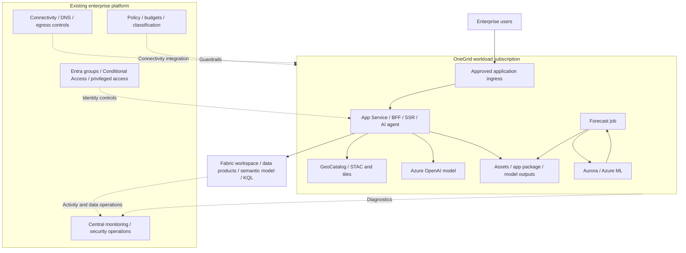

# OneGrid in an enterprise landing zone

[Solution overview](../../README.md) | [Baseline architecture](baseline.md)

An enterprise deployment places OneGrid's workload resources inside an organization's
existing platform foundation. The application and its data, geospatial, weather, and AI
planes retain their functional responsibilities. Platform services supply identity
guardrails, connectivity, DNS, policy, central monitoring, and security operations.

The implementation combines the OneGrid ARM deployment and Fabric provisioner with the
organization's network, governance, and environment-delivery configuration.

## Architecture

### Components and ownership

| Area | Platform responsibility | OneGrid responsibility |
| --- | --- | --- |
| Organization | Subscription vending, management group placement, policies | Workload resource groups, naming, tags, inventory |
| Identity | Entra groups, Conditional Access, privileged elevation, directory consent | App registration, managed identities, refresh identity, scoped data permissions |
| Connectivity | Shared hub/vWAN, hybrid links, DNS, firewall/egress standards | App integration, supported service endpoints, dependency rules, runner connectivity |
| Security operations | Central destinations, threat response, retention standards | Workload signals, redaction, alert ownership, remediation |
| Data governance | Fabric tenant/capacity standards, classification and sharing policy | Workspace/items, model permissions, source contracts, lineage and access tests |
| Delivery | Federated identity standards, deployment approvals | Versioned app/infrastructure/data configuration, migration, rollback |
| Continuity and cost | Shared-service commitments, budgets, recovery constraints | Workload sizing, dependency recovery, cost allocation, exercises |

## Subscription setup

Separate development, test, and production according to the organization's subscription
model. Give each environment its own resource group, Fabric workspace/item targets,
application registration/settings, data connections, and release record.

Before provisioning, collect:

- Approved subscription/resource group, region, SKUs, quota, naming, and tags.
- Platform network/subnet IDs, DNS forwarding, ingress path, and egress policy.
- Fabric capacity ID or approval to create capacity, workspace ownership, and tenant settings.
- Entra group object IDs, sign-in registration, refresh identity, and directory consent.
- Monitoring destinations, retention, data classification, budget, and recovery objectives.

Keep shared network and management resources outside the workload resource group's deletion
boundary. Reuse an existing Fabric capacity only after agreeing on capacity administration,
content isolation, and performance/cost ownership.

## Compute and model configuration

Select the App Service tier and instance configuration for the required networking,
availability, and concurrency. The app package contains the report BFF, React SSR, and Node
AI agent; preserve its startup command, port 8080, WebSocket support, and package access.

Use the configured Azure OpenAI account/deployment consistently across model settings and
application configuration. Record deployment name, catalog model, version, processing
geography, quota, allowed tools, and evaluation results. When the enterprise supplies an
AI gateway, integrate its endpoint, identity, authorization, and routing with the agent.

For Aurora, allocate regional GPU quota and model readiness independently from the CPU
forecast job. Keep image access, blob channel, output publication, and inference permissions
in the same reviewed configuration.

## Networking

### Subnets and private connectivity

Allocate supported App Service integration, private endpoint, ingress, and management/runner
subnets through the platform address plan. Configure supported private service connections
and resource access rules for storage, Azure OpenAI, Azure ML, and Key Vault.

Validate GeoCatalog and Fabric connectivity against the selected service features, region,
and tenant configuration. Fabric access is a SaaS integration; it is not deployed inside
the application subnet.

### Ingress

Select the internal or external application entry point. Apply the enterprise reverse proxy
and WAF pattern where required, restrict direct origin access, and register the published
host's sign-in callback. Test browser navigation, API authorization, and WebSocket traffic
through the same entry point.

### DNS and egress

Use centrally owned private DNS zones, links, and forwarding. Test name resolution from
App Service, deployment runners, operator workstations, and hybrid networks.

Maintain an endpoint matrix for:

- Entra, Azure control plane, Fabric/Power BI APIs, KQL, and SQL analytics.
- Blob package mounting, assets, forecast output, and Aurora transfer channels.
- Azure OpenAI and Azure ML scoring.
- NOAA GFS, approved weather/static-data sources, and imagery ingestion sources.
- Container image pulls, source/package distribution, and diagnostic ingestion.

Separate bootstrap, build-time, and runtime access. Change public endpoint access only after
the corresponding private/runtime/deployment paths have been validated.

## Identity and data governance

Use existing group-based access and explicit identity owners. Separate resource provisioning
and role assignment from app runtime access. Review the provisioner's resource-group Owner,
storage role-assignment rights, and optional Graph application permission as bootstrap
privileges with an approved ongoing lifecycle.

Use `entraSignInClientId` for a pre-created SPA registration. Use the
`refreshServicePrincipal*` parameters for an existing Import refresh identity, or approve
the directory permissions required for the provisioner to create the needed identities.
Rotate the refresh secret through the approved secret-management process and test refresh
after rotation.

Configure OneGrid governance in the provisioner:

- `governance.enabled` controls the governance phase.
- `governance.mode=inventory` reviews existing roles without provisioning role writes.
- `governance.groups` binds executive, control-room, maintenance, ontology, reviewer, and
  platform-administrator groups.
- `governance.autoCreateGroups=false` keeps group creation under enterprise administration.
- Review `governance.leastPrivilegeApp` against actual runtime and semantic permissions.

The ARM wrapper initializes governance disabled; apply the approved governance configuration
through the provisioner rather than assuming selecting the app configures enterprise roles.
Validate effective data filtering through DAX, KQL, SQL, OneLake, chat, and exports.

## Monitoring and policy

Route application, model, job, Fabric, identity, and network signals to approved destinations.
Correlate source lag, semantic refresh, model calls, and forecast publication with
user-facing failures. Assign an owner to every alert and test escalation.

Keep `exemptStorageFromPolicy=false` in the normal deployment configuration. A policy
exception requires platform approval, its scope, owner, expiration, and compensating
controls. The template's opt-out tags only affect policies configured to recognize them.
Deployment scripts require their supporting storage/container access; validate bootstrap
compatibility before rollout into a policy-controlled environment.

## Implement the enterprise deployment

1. Approve the resource, identity, data, network, monitoring, and recovery integration contract.
2. Provision or identify shared connectivity, DNS, diagnostic destinations, groups, and
   deployment runners through the platform pipeline.
3. Configure the OneGrid environment parameters, component choices, capacity, app package,
   sign-in, and refresh identity.
4. Validate and deploy ARM; inspect app-plane and Fabric-plane provisioning results.
5. Apply workload network integration, diagnostic settings, approved Fabric/governance
   configuration, access rules, and operating schedules through reviewed IaC/automation.
6. Test sign-in, denied access, package loading, DAX/KQL, model refresh, optional imagery,
   AI answers, and forecast publication through the enterprise network.
7. Record the approved configuration, exceptions, release versions, owners, and recovery
   evidence before promoting to production.

### Acceptance criteria

- Every deployed component has an owner, environment label, and cost/recovery classification.
- Identity and data-access positive/negative tests pass.
- DNS, ingress/egress, package access, queries, and inference use the intended paths.
- Source ingestion, semantic refresh, and forecast freshness are monitored.
- Policy exceptions are explicitly approved; diagnostic redaction/retention is verified.
- Rollback, data restoration, and escalation have been exercised.

## Considerations

### Reliability

Include platform DNS, identity, network, shared Fabric capacity, and model
quota in dependency analysis and recovery exercises.

### Security

Protect asset locations, operational data, prompts, credentials, and audit
records; verify shared runtime identities cannot cross approved data boundaries.

### Cost Optimization

Allocate both shared-platform and workload costs, including private
connectivity, diagnostics, AI tokens, GPU capacity, and Fabric consumption.

### Operational Excellence

Review platform and workload changes together. Revalidate after
policy, DNS, firewall, identity, data-source, model, or capacity changes.

### Performance Efficiency

Measure latency through the enterprise ingress/egress path,
query concurrency, refresh overlap, and recovery-region capacity rather than only local tests.

## Next steps

- [Apply regulated workload controls](regulated-workload.md).
- [Design multiregion recovery](multiregion.md).
- [Configure Fabric data products and governance](fabric.md).
- [Establish Day 2 operations](../operations.md).
