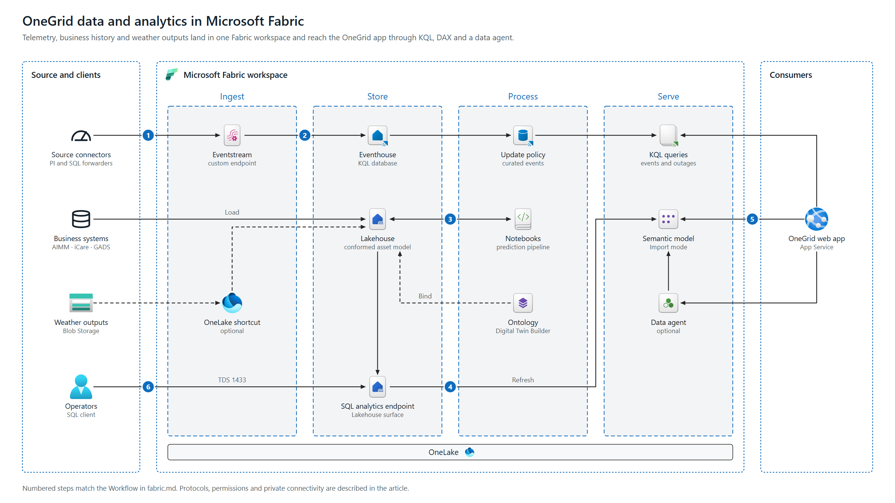

# OneGrid data and analytics in Microsoft Fabric

[Solution overview](../../README.md) | [Baseline architecture](baseline.md)

Fabric supplies OneGrid's real-time and historical data plane. Eventstream and Eventhouse
serve current operations; OneLake, notebooks, and semantic models serve curated history,
reliability analytics, and business measures. A conformed asset hierarchy connects these
paths to weather exposure and the digital twin.

## Architecture

<a href="../diagrams/onegrid-reference-fabric.svg"><picture><source media="(prefers-color-scheme: dark)" srcset="../diagrams/onegrid-reference-fabric-dark.png"></picture></a>

[Download SVG](../diagrams/onegrid-reference-fabric.svg) |
[Diagram source](../diagrams/sheets/fabric.py) |
[Identity detail](../diagrams/onegrid-reference-identity.png) |
[Traffic and security contracts](traffic-and-security.md)

Numbered steps match the workflow below. Solid arrows show data or calls toward the service
that receives them; dashed lines are optional, binding or evidence paths. The Lakehouse and
SQL analytics endpoint are two surfaces of the same analytical data. Real-time and
historical paths join through asset keys; each retains its own ingestion and freshness
checks.

### Workflow

1. Source connectors publish canonical events to the resolved Eventstream custom endpoint.
2. The processed Eventhouse destination writes `PiEventsRaw`; its update policy creates
   the curated `PiEvents` serving table.
3. Notebooks load and transform historical sources, calculate reliability results, and
   persist tables using the shared asset hierarchy.
4. The Import refresh connection reads the Lakehouse SQL analytics endpoint and
   materializes `OneGridModelImport` after processing completes.
5. The application queries KQL and DAX independently. The Data Agent queries its
   configured semantic-model datasource; the ontology is a separate relationship item
   bound to Lakehouse tables.
6. Operators verify source event time, processing completion, model refresh time, and
   query results, including through a connected SQL client over TDS, before declaring the
   complete data product current.

## Ingest operational data

The custom Eventstream source `PIForwarderEndpoint` accepts the canonical source-event
shape. Connectors publish through an Event Hubs-compatible transport; the shared connector
core provides durable buffering, acknowledgments, drain processing, and heartbeats.
Each connector exchanges its client certificate for a Microsoft Entra token, and the outbox
keeps events until they're acknowledged. The connection-string option is for testing only.

Publish/rebind the supplied
[`pi-events-stream` artifact](../../planetary-computer-pro-poc/infra/fabric/eventstream/pi-events-stream/)
to the target Eventhouse before enabling source producers. Confirm destination, table
mapping, source connection, the actual broker namespace, and source authentication in the
deployed workspace.

| Connector | Source access | Continuity mechanism |
| --- | --- | --- |
| PI forwarder | PI Web API channels and polling | Durable SQLite outbox, certificate-based publisher identity, heartbeat |
| Relational forwarder | SQL Server or Oracle polling | Durable per-source watermark and the same outbox/publisher core |

Required event fields are `webId`, `tag`, `ts`, `value`, and `plant`. Optional fields include
`valueType`, `questionable`, `substituted`, `source`, and `host`. `ts` is UTC event time;
quality flags preserve source measurement quality.

Eventhouse lands records in `PiEventsRaw`. The update policy produces `PiEvents` with
typed/curated columns, including ingestion time. Configure connectors to write to the source
endpoint rather than directly modifying the curated table. Monitor queue depth, latest
event time, ingest latency, and source heartbeats. Data access follows the KQL database,
table, and function permissions. Eventhouse doesn't replicate telemetry to the Lakehouse;
historical tables have their own load path.

The connector implementation and configuration are in the
[operational data-plane package](../../planetary-computer-pro-poc/infra/bolt-ons/data-plane/).

## Curate history and calculate predictions

| Stage | Supplied artifacts | Output |
| --- | --- | --- |
| Source preparation | `Process-PIData`, `Process-AIMM-Data`, `Process-iCare-Data`, `Process-GADS-Data`, intake checklist | Standardized source data |
| Discovery and cleanup | Data archaeology, diagnostics, schema cleanup, dimension mapping | Validated keys, schemas, coverage |
| Features | Gold feature selection, label construction, feature engineering | Model-ready features and labels |
| Reliability | Predictive model, batch scoring, SmartSignal anomaly workflows | Health, watchlist, advisories, short-term risk |
| Long-term risk | Cox and survival notebooks | Survival and long-term prediction results |
| Presentation | Daily narrative, real-time report, KQL dashboards | Operator summaries and observations |
| Orchestration | `Prediction_Pipeline` | Repeatable prediction processing |

Historical sources include AIMM, iCare, GADS, asset registers, and CMMS work history,
loaded through approved source reads or batch ingestion; check their freshness and quality
separately from telemetry. Notebooks and `Prediction_Pipeline` run under the notebook run
identity with their own source connections.

Use a controlled schedule for source loads, transformations, scoring, and model refresh,
and keep schedule, completion, and data-age evidence for each run. Historical bundles and
synthetic seeds support evaluation; preserve their provenance when transitioning to
customer sources.

## Build the unified asset model

The `generate_onegrid_data` notebook builds `og.*` tables using the hierarchy
`dim_site -> dim_unit -> dim_asset -> dim_tag`. Reliability and weather attach to the same
keys. Validate parent-child joins and orphan records before publishing downstream models.
Table names are case-sensitive; keep `WeatherForecast` exactly as named.

| Domain | Tables |
| --- | --- |
| Dimensions | `dim_site`, `dim_unit`, `dim_asset`, `dim_tag` |
| Reliability | `aakr_health`, `watchlist`, `anomaly_advisories`, `root_cause`, `predictions_shortterm`, `predictions_longterm` |
| Work and narrative | `fact_work_requests`, `daily_narrative` |
| Weather | `dim_weather_event`, `WeatherForecast`, `fact_asset_exposure`, `fact_posture` |

The unified deployment seeds HURDAT reference data, executes the generator, synchronizes
SQL endpoint metadata, deploys `OneGridModelImport`, binds its SQL connection, and refreshes
the model. The generator's overwrite behavior should be confined to intended generated
tables; use reviewed ingestion/transformation jobs for customer production data.

Accept the data product in order: publish the source and confirm a raw and a curated row,
verify SQL endpoint metadata, bind and refresh the Import model, then test real DAX, KQL,
and Data Agent queries.

## Serve queries and relationships

The app calls DAX, KQL, and the Data Agent over HTTPS on TCP 443 using the actual
workspace, dataset, and agent IDs; each API needs its own permission. The app has no
dependency on the SQL analytics endpoint.

**DAX.** The app targets `OneGridModelImport` through `PBI_WORKSPACE` and `PBI_DATASET`.
A dedicated service principal refreshes the SQL-backed Import connection. Schedule refresh
after data processing; query-time app identity and refresh identity are different roles.
`OneGridModelImport` is an Import model, not Direct Lake or streaming, so new data appears
only after a refresh.

The refresh connection is an encrypted Fabric connection to the Lakehouse SQL analytics
endpoint, not to a separate Azure SQL Database. It uses TDS on TCP 1433 with the item's SQL
hostname and actual database name, and the refresh identity needs SQL and table
permissions. Synchronizing SQL endpoint metadata doesn't refresh the model.

**KQL.** The app targets the Eventhouse query service and database through `KUSTO_CLUSTER`
and `KUSTO_DATABASE`. Validate actual data in `PiEvents` and `PCIOutages`; model-backed
pages and telemetry-backed pages have separate freshness signals.

**Digital Twin Builder.** `OneGridOntology` contextualizes plants, units, assets, sensors,
work, advisories, outages, and predictions. The ontology complements the application
knowledge graph and the asset hierarchy. Its entities are backed by Lakehouse tables
through explicit table bindings and item permissions; no separate Azure Digital Twins
instance is deployed.

**Fabric Data Agent.** The provisioner configures/publishes `OneGridOntologyAgent` and wires
its identifiers into the app. Test representative questions against its configured data
sources and effective identity permissions.

Despite its name, `OneGridOntologyAgent` is grounded on a semantic-model datasource.
`OneGridOntology` is a separate native Fabric item. Confirm the resolved semantic-model ID,
selected tables, and published agent configuration after deployment. Private connectivity
for the agent follows the supported path of its data source.

**Weather integration.** The `fabricplane` phase applies `HazardGeometry`, `AssetRegistry`,
spatial joins, and composite-risk functions. The `pcp_model_outputs` shortcut connects Blob
outputs when a storage connection is provided or created through workspace identity.
The shortcut exposes files; validate the ingestion/transformation path that populates
analytical hazard tables separately.

The optional shortcut needs a real Fabric cloud connection ID and a source endpoint that
Fabric can reach; granting a deployment identity Blob Reader isn't enough. Use the supplied
Blob connection or the optional workspace-identity ADLS Gen2 connection, which needs a
compatible storage endpoint and configuration. Blob or DFS network rules must admit Fabric
independently of client Private Link, and the shortcut reads files over HTTPS on TCP 443.

## Govern identities and data access

| Identity or role | Purpose |
| --- | --- |
| Fabric provisioner | Workspace/item creation, capacity assignment, configuration |
| App managed identity | Runtime DAX/KQL and configured Data Agent queries |
| Import refresh service principal | SQL connection binding and scheduled/model refresh |
| Workspace identity | Storage connection and shortcut access |
| Persona groups | Executive, control-room, maintenance, ontology, reviewer, platform administration |

The governance configuration has two modes: `demo` provisions configured persona roles;
`inventory` reviews existing access without role writes. Configure existing Entra security
groups, decide whether group auto-creation is allowed, and review `leastPrivilegeApp`.

OneLake role definitions scope table/folder access. The governance manifest also records
row-filter and hidden-column intent; implement and verify the corresponding semantic/SQL
enforcement for every relevant query path. The app's governance view explains access
inventory; it is not the enforcement layer.

Test a permitted and denied case through DAX, KQL, SQL, OneLake, chat, and exports. A shared
runtime identity requires explicit application/data-boundary enforcement rather than assuming
the signed-in user's permissions automatically flow to all tools.

## Network and administration

Coordinate tenant access, Conditional Access, Fabric connectivity, source firewalls, and
workspace connections with platform owners. For the existing combined workspace, use
tenant-level Private Link when private client access is required. `OneGridModelImport`
is part of this design: workspace-level Private Link is not a drop-in replacement for
the combined semantic-model workspace. A data-only workspace split changes item IDs,
source connections, permissions, and application targets and requires its own validation.

Keep the supplied Eventstream destination in `ProcessedIngestion` mode. Rebind the
workspace, Eventhouse, database, and table mapping without changing it to direct ingestion.
The connectors default to AMQP over WebSockets on TCP 443; native AMQP/TLS on TCP 5671
is a separate explicit configuration choice.

Distinguish these connections during acceptance:

| Connection | Network responsibility | Required evidence |
| --- | --- | --- |
| App -> DAX/KQL/Data Agent | Client DNS, selected tenant private connectivity, identity, and item permissions | Authorized queries against the expected item IDs |
| Operator/provisioning SQL client -> SQL analytics | Client TDS path on TCP 1433; SQL-aware firewall rules | Authenticated query, not just a successful TCP connection |
| Import refresh -> SQL analytics | Fabric connection and refresh identity | Refresh completes after source processing; rows/timestamps agree |
| Fabric -> Blob shortcut/source | Independently configured source access and connection identity | Both metadata listing and actual content read succeed |
| Notebook/pipeline -> source/output | Fabric execution network and connection configuration | Successful processing and persisted results |

Don't model encrypted SQL as HTTPS on port 1433 or route Fabric-hosted refresh through
the application subnet. Inbound Fabric Private Link doesn't provide an outbound path
to a firewalled source. Use the
[enterprise traffic matrix](enterprise-landing-zone.md#traffic-flow-matrix) for platform
integration and the [network procedure](../operations-runbook.md#validate-network-and-traffic-flows)
to capture deployed evidence.

Assign capacity/workspace owners, data owners, identity owners, and an on-call contact.
Collect supported administrative and activity signals, correlate them with app/deployment
events, and apply approved retention and redaction.

## Recovery and operations

Protect source data, item definitions, model connections, grants, reference files, and
connector checkpoints. Restore each item type using its recovery mechanism, rebind dependent
IDs/connections, refresh the Import model, and compare expected counts and timestamps.

Monitor DAX/KQL latency, capacity contention, refresh duration, failed notebooks, source lag,
and identity expiry. Use the [operations procedures](../operations-runbook.md) and
[multiregion design](multiregion.md) to coordinate data and application recovery.

## Next steps

- [Deploy and configure sources, models, and identities](../deployment-and-data-guide.md).
- [Integrate Fabric with the enterprise landing zone](enterprise-landing-zone.md).
- [Establish Day 2 operations](../operations.md).
