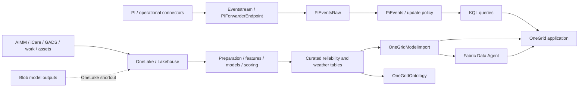

# OneGrid data and analytics in Microsoft Fabric

[Solution overview](../../README.md) | [Baseline architecture](baseline.md)

Fabric supplies OneGrid's real-time and historical data plane. Eventstream and Eventhouse
serve current operations; OneLake, notebooks, and semantic models serve curated history,
reliability analytics, and business measures. A conformed asset hierarchy connects these
paths to weather exposure and the digital twin.

## Architecture

## Ingest operational data

The custom Eventstream source `PIForwarderEndpoint` accepts the canonical source-event
shape. Connectors publish through an Event Hubs-compatible transport; the shared connector
core provides durable buffering, acknowledgments, drain processing, and heartbeats.

Publish/rebind the supplied
[`pi-events-stream` artifact](../../planetary-computer-pro-poc/infra/fabric/eventstream/pi-events-stream/)
to the target Eventhouse before enabling source producers. Confirm destination, table
mapping, and source connection in the deployed workspace.

| Connector | Source access | Continuity mechanism |
| --- | --- | --- |
| PI forwarder | PI Web API channels and polling | Durable SQLite outbox, certificate-based publisher identity, heartbeat |
| Relational forwarder | SQL Server or Oracle polling | Durable per-source watermark and the same outbox/publisher core |

Required event fields are `webId`, `tag`, `ts`, `value`, and `plant`. Optional fields include
`valueType`, `questionable`, `substituted`, `source`, and `host`. `ts` is UTC event time;
quality flags preserve source measurement quality.

Eventhouse lands records in `PiEventsRaw`. The update policy produces `PiEvents` with
typed/curated columns, including ingestion time. Configure connectors to write to the source
endpoint rather than directly modifying the curated table. Monitor queue depth, latest
event time, ingest latency, and source heartbeats.

The connector implementation and configuration are in the
[operational data-plane package](../../planetary-computer-pro-poc/infra/bolt-ons/data-plane/).

## Curate history and calculate predictions

| Stage | Supplied artifacts | Output |
| --- | --- | --- |
| Source preparation | `Process-PIData`, `Process-AIMM-Data`, `Process-iCare-Data`, `Process-GADS-Data`, intake checklist | Standardized source data |
| Discovery and cleanup | Data archaeology, diagnostics, schema cleanup, dimension mapping | Validated keys, schemas, coverage |
| Features | Gold feature selection, label construction, feature engineering | Model-ready features and labels |
| Reliability | Predictive model, batch scoring, SmartSignal anomaly workflows | Health, watchlist, advisories, short-term risk |
| Long-term risk | Cox and survival notebooks | Survival and long-term prediction results |
| Presentation | Daily narrative, real-time report, KQL dashboards | Operator summaries and observations |
| Orchestration | `Prediction_Pipeline` | Repeatable prediction processing |

Use a controlled schedule for source loads, transformations, scoring, and model refresh.
Historical bundles and synthetic seeds support evaluation; preserve their provenance when
transitioning to customer sources.

## Build the unified asset model

The `generate_onegrid_data` notebook builds `og.*` tables using the hierarchy
`dim_site -> dim_unit -> dim_asset -> dim_tag`. Reliability and weather attach to the same
keys. Validate parent-child joins and orphan records before publishing downstream models.

| Domain | Tables |
| --- | --- |
| Dimensions | `dim_site`, `dim_unit`, `dim_asset`, `dim_tag` |
| Reliability | `aakr_health`, `watchlist`, `anomaly_advisories`, `root_cause`, `predictions_shortterm`, `predictions_longterm` |
| Work and narrative | `fact_work_requests`, `daily_narrative` |
| Weather | `dim_weather_event`, `WeatherForecast`, `fact_asset_exposure`, `fact_posture` |

The unified deployment seeds HURDAT reference data, executes the generator, synchronizes
SQL endpoint metadata, deploys `OneGridModelImport`, binds its SQL connection, and refreshes
the model. The generator's overwrite behavior should be confined to intended generated
tables; use reviewed ingestion/transformation jobs for customer production data.

## Serve queries and relationships

**DAX.** The app targets `OneGridModelImport` through `PBI_WORKSPACE` and `PBI_DATASET`.
A dedicated service principal refreshes the SQL-backed Import connection. Schedule refresh
after data processing; query-time app identity and refresh identity are different roles.

**KQL.** The app targets the Eventhouse query service and database through `KUSTO_CLUSTER`
and `KUSTO_DATABASE`. Validate actual data in `PiEvents` and `PCIOutages`; model-backed
pages and telemetry-backed pages have separate freshness signals.

**Digital Twin Builder.** `OneGridOntology` contextualizes plants, units, assets, sensors,
work, advisories, outages, and predictions. The ontology complements the application
knowledge graph and the asset hierarchy.

**Fabric Data Agent.** The provisioner configures/publishes `OneGridOntologyAgent` and wires
its identifiers into the app. Test representative questions against its configured data
sources and effective identity permissions.

**Weather integration.** The `fabricplane` phase applies `HazardGeometry`, `AssetRegistry`,
spatial joins, and composite-risk functions. The `pcp_model_outputs` shortcut connects Blob
outputs when a storage connection is provided or created through workspace identity.
The shortcut exposes files; validate the ingestion/transformation path that populates
analytical hazard tables separately.

## Govern identities and data access

| Identity or role | Purpose |
| --- | --- |
| Fabric provisioner | Workspace/item creation, capacity assignment, configuration |
| App managed identity | Runtime DAX/KQL and configured Data Agent queries |
| Import refresh service principal | SQL connection binding and scheduled/model refresh |
| Workspace identity | Storage connection and shortcut access |
| Persona groups | Executive, control-room, maintenance, ontology, reviewer, platform administration |

The governance configuration has two modes: `demo` provisions configured persona roles;
`inventory` reviews existing access without role writes. Configure existing Entra security
groups, decide whether group auto-creation is allowed, and review `leastPrivilegeApp`.

OneLake role definitions scope table/folder access. The governance manifest also records
row-filter and hidden-column intent; implement and verify the corresponding semantic/SQL
enforcement for every relevant query path. The app's governance view explains access
inventory; it is not the enforcement layer.

Test a permitted and denied case through DAX, KQL, SQL, OneLake, chat, and exports. A shared
runtime identity requires explicit application/data-boundary enforcement rather than assuming
the signed-in user's permissions automatically flow to all tools.

## Network and administration

Coordinate tenant access, Conditional Access, Fabric connectivity, source firewalls, and
workspace connections with platform owners. Select the appropriate inbound and outbound
controls for each path. Verify app queries, SQL refresh, notebooks, shortcuts, provisioning,
and operator access under the selected network restrictions.

Assign capacity/workspace owners, data owners, identity owners, and an on-call contact.
Collect supported administrative and activity signals, correlate them with app/deployment
events, and apply approved retention and redaction.

## Recovery and operations

Protect source data, item definitions, model connections, grants, reference files, and
connector checkpoints. Restore each item type using its recovery mechanism, rebind dependent
IDs/connections, refresh the Import model, and compare expected counts and timestamps.

Monitor DAX/KQL latency, capacity contention, refresh duration, failed notebooks, source lag,
and identity expiry. Use the [operations procedures](../operations-runbook.md) and
[multiregion design](multiregion.md) to coordinate data and application recovery.
