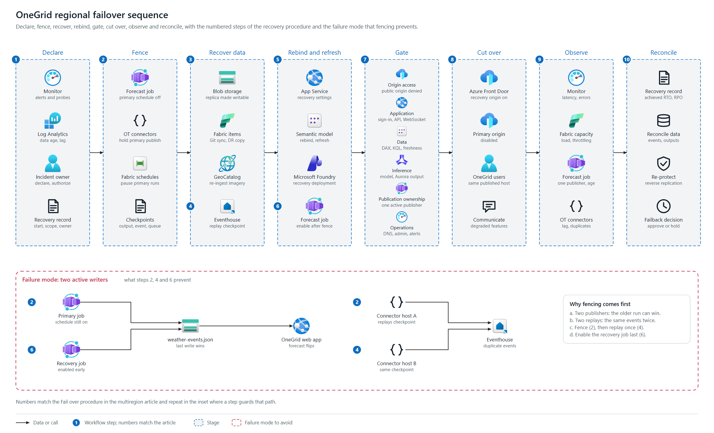

# OneGrid multiregion business continuity and disaster recovery

Part of the [OneGrid landing zone design guide](design-guide.md).

[Solution overview](../../README.md) | [Enterprise implementation](enterprise-landing-zone.md) |
[Operational runbook](../operations-runbook.md)

A multiregion OneGrid deployment coordinates application availability with recovery of
operational data, semantic models, geospatial content, AI inference, and weather publication.
Define recovery time (RTO), recovery point (RPO), and maximum accepted data age for each
journey rather than assigning one untested objective to the whole workload.

This article describes a primary region and a recovery region in the same Azure landing
zone, the recovery mechanism for each OneGrid store and service, and the failover, failback,
and drill procedures that prove them. It follows the structure of
[Multiregion BCDR for Azure Virtual Desktop](https://learn.microsoft.com/azure/architecture/example-scenario/azure-virtual-desktop/azure-virtual-desktop-multi-region-bcdr)
and uses its drawing conventions.

## Goals and scope

This guidance has the following goals:

- Restore each OneGrid user journey in the recovery region within its declared RTO, with no
  more data loss than its declared RPO and no data older than its maximum accepted age.
- Keep exactly one writer for every output: one forecast publisher, one active ingestion
  path for each checkpoint range, and one active Front Door origin.
- Prove the objectives through drills instead of assuming them from configuration.

RTO is how long a journey can be unavailable after a regional failure. RPO is how much
committed data you can lose, measured back from the failure. Maximum data age is how old the
data a restored journey shows can be before you label it stale or keep the journey closed.

### Recovery objectives by journey

The following values are **starting estimates** for the warm-standby (active-passive) model
that this article recommends. They aren't Microsoft guarantees or measured OneGrid results.
Replace them with values agreed with each owner, and then validate them in
[drills](#testing-and-drills).

| Journey | Starting RTO | Starting RPO | Maximum data age | Recovery mechanism | Owner |
| --- | --- | --- | --- | --- | --- |
| UI and sign-in | 1 hour | None; the app is stateless, and its package and settings are versioned | Not applicable | Standby App Service from the same package and settings, recovery origin enabled after the gate | Application/on-call |
| DAX reports | 4 hours | Last Lakehouse load that reached the OneLake disaster recovery copy | 24 hours after the last successful source load | Fabric capacity disaster recovery setting, items from the repository, Import model rebind and refresh | Fabric/data |
| KQL live events | 2 hours | 15 minutes of events, re-read from connector checkpoints | 15 minutes after replay drains | Connector outbox and checkpoint replay into the recovery Eventstream and Eventhouse | Fabric/data |
| Imagery and tiles | 8 hours, depending on catalog volume | Last replicated source imagery and STAC metadata | As old as the source imagery | Replicated source container, GeoCatalog re-ingestion in the recovery region | Geospatial data owner |
| Grounded chat | 2 hours | None for model configuration; answers depend on the DAX and KQL journeys | Inherits from DAX and KQL | Approved model deployment and quota in the recovery Microsoft Foundry account | AI/weather |
| Forecast publication | 6 hours, one schedule interval after cutover | One forecast cycle | 12 hours analysis age | Recovery forecast job enabled after the primary publisher is fenced, Aurora deployment with recovery-region GPU quota | AI/weather |

The achievable RTO depends on how much of the recovery stamp runs before a failure. A cold
standby adds deployment, model deployment, and capacity creation to every row. The
achievable RPO depends on asynchronous replication lag, the connector checkpoint you can
recover, and when the last forecast cycle completed.

### Scope

This guidance covers the loss of the Azure region that hosts a OneGrid stamp and the loss of
the region that hosts its Fabric capacity. It assumes:

- Microsoft Entra ID and Azure Front Door, which are global services, remain available.
- The Fabric tenant's home region remains available. Fabric's recovery guidance depends on
  the home region, and if it fails, recovery waits for Microsoft to restore it.
- The organization's corporate and OT networks reach both regional hubs.

Availability zones protect against a datacenter failure inside a region; they aren't a
disaster recovery solution. Deleted or corrupted data is a backup problem: replication
copies a deletion or a bad write to the recovery region. See [Backup](#backup).

## Prerequisites

Before you configure regional recovery, deploy the landing zone foundation in both regions.
Use the [enterprise implementation](enterprise-landing-zone.md) for subscription, identity,
and network design.

- **A hub in each region.** Each regional Connectivity subscription has a hub VNet with Azure
  Firewall, a DNS Private Resolver, and a VPN or ExpressRoute gateway. Don't let the recovery
  region depend on the primary hub's resolver or firewall.
- **Hub-to-hub connectivity.** Peer the two hubs, or connect them through the organization's
  global transit, so that administration, replication, and DNS forwarding work across
  regions. Peering isn't transitive; route each spoke through its own hub.
- **Hybrid connectivity to both hubs.** Connect the corporate network (administrators and
  corporate DNS) and the OT network (historian and connector hosts) to each hub through
  ExpressRoute or VPN. A recovery region that users and connectors can't reach doesn't
  restore the journey.
- **A OneGrid workload subscription per region, or one shared subscription.** Separate
  subscriptions isolate quota, policy, and cost per region. A shared subscription is simpler,
  but quota requests and role assignments then cover both stamps.
- **A Management workspace decision.** Choose a Log Analytics workspace per region or one
  shared workspace. See [BCDR monitoring](#bcdr-monitoring).
- **A recovery region that offers every regional service.** Confirm that the recovery region
  supports GeoCatalog, the Aurora GPU size (default `Standard_NC24ads_A100_v4`), the approved
  Microsoft Foundry model and version, App Service, and a Fabric capacity. Fabric's capacity
  disaster recovery setting replicates OneLake data only to the Azure-paired region when that
  region supports Fabric.
- **Approved quota in the recovery region.** Request Microsoft Foundry model quota and Aurora
  GPU quota before you need them. Quota doesn't reserve physical capacity.

### Landing zone placement

| Component | Primary region | Recovery region | Notes |
| --- | --- | --- | --- |
| Microsoft Entra ID, Azure Front Door Premium | Global | Global | One app registration, one published host, one Front Door profile with both origins |
| Connectivity subscription | Hub `10.10.0.0/16` | Hub `10.30.0.0/16` | Firewall, resolver, and gateway in each hub; hubs peered |
| Management subscription | Log Analytics, alerts, path probes | Same, or shared with the primary | Alerting must not depend only on the failed region |
| OneGrid workload subscription | Active stamp, workload VNet `10.20.0.0/16` | Standby stamp, workload VNet `10.40.0.0/16` | Same template and parameters; recovery forecast job off |
| Fabric capacity | Primary capacity and workspace | Recovery capacity and workspace | The capacity is an Azure resource; workspaces and items are in the Fabric tenant |
| OT connector hosts | On-premises | On-premises | Configured for the primary Eventstream endpoint; repointed during failover |

## Recovery models

Choose the model from measured recovery objectives and capacity availability.

| Metric | Active-active | Active-passive (warm standby) | Cold standby (redeploy) |
| --- | --- | --- | --- |
| RTO | Near zero for the web journey | Hours: data recovery, rebinding, and gates | Hours to a day: add deployment, model deployment, and capacity creation |
| RPO | Replication and ingestion lag in each region | Asynchronous replication lag and the recoverable connector checkpoint | Last backup or replicated copy |
| Steady-state cost | High: two running stamps, two capacities, two GPU deployments, dual ingestion | Medium: running app and storage, paused or small capacity, GPU on demand | Low: replicated storage and repository only |
| Administrator intervention | Write ownership must still be managed | Required: fence, recover, rebind, gate, cut over | Required: everything in active-passive plus deployment |
| Capacity guarantee | Yes, for what runs in both regions | No for GPU or Fabric capacity created at failover; quota isn't capacity | No |
| Test complexity | High: two writers, conflict handling, source routing | Medium: drills with the recovery origin and publisher disabled | Medium: full redeploy in drills |

Active-passive is often simpler for source ingestion and forecast publication, and it's the
model this article recommends. Active-active also requires write ownership, consistency,
source routing, conflict handling, and independent regional data readiness. Two healthy web
front ends alone don't provide that behavior.

## Architecture

<a href="../diagrams/onegrid-reference-multiregion.svg"><picture><source media="(prefers-color-scheme: dark)" srcset="../diagrams/onegrid-reference-multiregion-dark.png"></picture></a>

[Download SVG](../diagrams/onegrid-reference-multiregion.svg) |
[Diagram source](../diagrams/sheets/multiregion.py) |
[All architecture sheets](../diagrams/onegrid-reference-gallery.html) |
[Traffic and security contracts](traffic-and-security.md)

Microsoft Entra ID and Azure Front Door Premium are global. Regions are rows: the primary
region (active) is on top, and the recovery region (standby) is below in greyed, dashed
subscriptions. The recovery row mirrors the primary row so that every recovery copy sits
directly below its source. Each region has a Connectivity subscription, a Management
subscription, and a OneGrid workload subscription whose red dashed boundary is the regional
stamp that the same template deploys. The solid primary origin serves the primary App
Service; the dashed recovery origin stays disabled until the cutover gate passes. Letters
match the design areas in the following table; B2 through J2 mark the recovery copies.

### Design areas

| Design area | Description |
| --- | --- |
| A | **Identity.** Microsoft Entra ID is global and serves both regions. Keep one sign-in app registration whose single-page application redirect URI is the published host's `/auth/callback`; the provisioner merges each site's own `https://<host>/auth/callback` into the registration, so confirm the published host is present. Managed identities are regional resources in each stamp: the App Service system-assigned identity and the forecast job, GeoCatalog ingestion, and deployment user-assigned identities. Recreate their role assignments with the recovery stamp. Use controlled emergency access rather than broad incident grants. |
| B and B2 | **Connectivity.** Each region has its own hub with Azure Firewall, DNS Private Resolver, and a VPN or ExpressRoute gateway, connected to the corporate and OT networks. The hubs are peered. Each hub resolves the private DNS zones for its own region's private endpoints and applies its own egress policy. Confirm that DNS, administration paths, and source access work from the recovery hub when the primary hub is unavailable. |
| C and C2 | **Workload subscription and regional stamp.** The same Bicep template and parameter set deploy App Service with VNet integration, private endpoints, the job environment, and the regional services in each region. Record every regional ID, endpoint, and binding explicitly. Keep both stamps' configuration in version control and check them for drift. |
| D | **Global routing.** One Front Door Premium profile holds both regional origins in one origin group. The primary origin is enabled; the recovery origin is disabled until the cutover gate passes. Approve the managed Private Link connection for each regional origin and verify that direct public access to each origin is denied. A healthy probe doesn't prove data or model readiness. |
| E and E2 | **Storage.** Replicate the storage account that holds `sample-assets`, `model-outputs`, and `onegrid-app-package` to the recovery region with Blob object replication or geo-redundant storage. Destination containers in an object replication policy reject writes, so remove the rule for each container that must accept writes during failover. Keep versioning and soft delete for deletion and corruption. |
| F and F2 | **Forecast publication.** The forecast job, its Container Registry image, and the Aurora endpoint in Azure Machine Learning form one publication path. Deploy the recovery stamp with the job disabled (`deployAuroraSchedule=false`) and enable it only after the primary publisher is fenced. Replicate or rebuild the job image; geo-replication requires a Premium registry, and the template deploys Basic. GPU quota doesn't guarantee GPU capacity. |
| G and G2 | **Microsoft Foundry and GeoCatalog.** Both use region-specific endpoints and quota; don't assume any global model or catalog replication. Deploy the approved model and version in the recovery Microsoft Foundry account. Re-ingest imagery into a recovery GeoCatalog from the replicated source container and retained STAC metadata. |
| H and H2 | **Microsoft Fabric.** The capacity disaster recovery setting replicates OneLake data (Lakehouse and Warehouse) to the paired region. Item definitions, KQL databases, and Import refresh need their own mechanisms, per item. Recover into a capacity and workspace in the recovery region, then rebind connections and refresh the Import model. |
| I | **OT connector and live events (data-plane add-on).** Connectors keep events in a durable outbox until the Eventstream endpoint acknowledges them. During failover, repoint the connector to the recovery Eventstream, drain the outbox, and re-read the source from the recorded checkpoint once. Expect at-least-once delivery and check for duplicates. |
| J and J2 | **Management.** Log Analytics, alerts, and path probes must keep working when one region fails. Choose a workspace per region or a shared workspace, and alert on replication lag, checkpoint age, quota, certificates, and configuration drift in both regions. |

### Failover sequence

<a href="../diagrams/onegrid-reference-multiregion-failover.svg"><picture><source media="(prefers-color-scheme: dark)" srcset="../diagrams/onegrid-reference-multiregion-failover-dark.png"></picture></a>

[Download SVG](../diagrams/onegrid-reference-multiregion-failover.svg) |
[Diagram source](../diagrams/sheets/multiregion_failover.py)

The stages run left to right, and the numbers match the [Fail over](#fail-over) procedure.
The Gate stage lists the six [cutover acceptance](#cutover-acceptance) gates. The red dashed
inset shows the failure mode that fencing prevents. If the primary forecast job still runs
on its schedule when the recovery job starts, two publishers write `weather-events.json` and
the app can show the older run. If two connector hosts replay the same checkpoint range,
Eventhouse receives the same events twice. Fence the primary writers (step 2), replay each
checkpoint range once (step 4), and enable the recovery publisher last (step 6).

### How the design works

- Users reach the published host on Azure Front Door Premium over HTTPS (443). Front Door
  sends normal traffic to the accepted primary origin over its managed Private Link path.
  App Service queries its configured regional data, geospatial, storage, and model endpoints
  through VNet integration and private endpoints.
- Source ingestion, semantic refresh, and forecast publication run under the primary
  environment's ownership. Storage follows its configured copy policy, and Fabric item
  definitions and source data follow the chosen dependency-specific protection mechanisms.
- During an incident, operators fence the primary writers, including the forecast publisher,
  and record source and output checkpoints.
- Operators recover Fabric items and data, replay sources from checkpoints, and restore
  storage content, catalog context, and model dependencies in the recovery region.
- Operators apply the recovery environment's actual IDs, connections, permissions, and DNS
  configuration to the recovery app, rebind SQL connections, and refresh the Import model.
- The recovery environment passes data-backed readiness checks, including access, freshness,
  model inference, and sole forecast-publisher ownership.
- Operators enable the recovery origin only after these gates pass, observe the restored
  journeys, and reconcile state before an approved failback.

Configure each region through the OneGrid resource template and environment-specific
settings. Maintain routing, replication, item recovery, fencing, and cutover automation
alongside the regional deployments in the workload delivery pipeline.

### Components

| Component | Regional preparation | Recovery verification |
| --- | --- | --- |
| App Service | Compatible plan, immutable package, settings, sign-in callback, network path | UI/API, sign-in, WebSocket reconnect, data-backed journeys |
| Fabric capacity/workspace | Approved recovery capacity, item definitions, permissions, connection inventory | Recovered items, actual IDs, DAX/KQL and source freshness |
| Lakehouse and Import model | Protected source tables, SQL connection configuration, refresh identity | SQL metadata, model binding/refresh, counts and timestamps |
| Eventhouse | Retention/recovery design, source replay/checkpoints | Latest events, outage data, duplicates/late data behavior |
| Storage | Chosen redundancy/copy and retained versions for assets, outputs, packages | Required blobs, authorization, endpoint/configuration changes |
| GeoCatalog | Source imagery, STAC metadata, ingestion identity/configuration | Search, item completeness, ingestion, rendered tiles |
| Microsoft Foundry | Approved secondary model/version, quota, data-processing geography | Model call, grounded answer, tool authorization |
| Aurora | Model asset, image/environment, accepted terms, regional GPU quota | Actual inference and output normalization |
| Forecast job | Pipeline image, input access, job identity, publication ownership | Single active publisher, current cycle, valid normalized output |
| Identity/network/monitoring | Entra access, DNS, ingress/egress, certificates, operational visibility | Administration and alerts remain available during region loss |

## Design patterns

### Regional deployment stamps

Treat application package, configuration, model deployment, storage, and data connections
as a regional stamp. Record all workspace/item IDs and bindings explicitly. Reusing an item
name in another workspace does not preserve its ID or connection.

### One writer per output

Every output has exactly one active writer: the forecast job for `weather-events.json`, one
connector path for each checkpoint range, and one enabled Front Door origin. Failover moves
ownership in a fixed order: fence the old writer, recover, enable the new writer, prove it,
and only then move traffic. Failback reverses the same order.

## Recovery mechanisms

Separate replication, which protects against regional loss, from backup, which protects
against deletion and corruption. Replication copies a deletion or a bad write; a retained
version or backup lets you go back to a known-good point.

| Store or service | Replication for regional loss | Backup for deletion or corruption | Recovery action |
| --- | --- | --- | --- |
| Blob storage (`sample-assets`, `model-outputs`, `onegrid-app-package`) | Baseline is `Standard_LRS`, with no copy in another region. Use Blob object replication to an account in the recovery region, or geo-redundant storage with customer-managed failover. | Blob versioning, soft delete, and Azure Backup for blobs where retention requires it | Remove the object replication rule for each container that must accept writes, or fail the account over; confirm required blobs and versions |
| Fabric OneLake data (Lakehouse) | Capacity disaster recovery setting: opt-in, per capacity, replicates OneLake data to the paired region | Source files and historical data retained outside Fabric; notebooks can rebuild tables | Create the recovery capacity, workspace, and items, then copy tables and files from the replicated OneLake with a script or Azure Storage Explorer |
| Fabric item definitions (notebooks, pipelines, ontology, Eventstream, Data Agent) | Not replicated; varies per item | Item definitions in the repository (`infra/fabric`) and Fabric Git integration where you enable it | Redeploy items with the provisioner or Git sync into the recovery workspace; recreate the Data Agent with the provisioner's `dataagent` phase and verify it |
| Import semantic model (`OneGridModelImport`) | Power BI items stay readable in the paired region during a Microsoft failover, but refresh and metadata changes aren't supported | Model definition from the provisioner | Recreate in the recovery workspace, bind the refresh connection to the recovered Lakehouse SQL endpoint, and refresh |
| Eventhouse and KQL database | Not in OneLake; the capacity setting doesn't protect it. Fabric guidance recommends independent KQL databases in two regions with parallel ingestion | Source systems and connector checkpoints | Deploy the database schema, mappings, and policies, then replay from checkpoints, or run a second Eventhouse with parallel ingestion for a lower RPO |
| Eventstream (data-plane add-on) | No data loss when its destinations are protected; identical Eventstreams per region for active-active | `pi-events-stream` artifact in the repository | Publish the artifact to the recovery workspace, bind it to the recovery Eventhouse, and repoint connectors |
| GeoCatalog | Region-specific; don't assume catalog replication | Source imagery, STAC metadata, render settings, and ingestion configuration | Deploy a recovery GeoCatalog and re-ingest from the replicated source container |
| Container Registry | Geo-replication needs Premium; the template deploys Basic | Image digest and pipeline source in the repository | Use a Premium replica, or rebuild the image into the recovery registry |
| Key Vault (Azure Machine Learning workspace vault) | Microsoft-managed replication to the paired region in most paired regions, read-only after a Microsoft-initiated failover | Soft delete and purge protection; backup and restore only within the same subscription and geography | Deploy the recovery stamp's own vault with the template; don't depend on the primary vault |
| Log Analytics | Per-region or shared workspace; logs written in a failed region might be unavailable | Retention and export to an archive or SIEM | Keep alerting and recovery evidence in a workspace that survives the failed region |
| App package | Hosted in the deployment's private storage account, or the public `app-latest` release asset | Immutable known-good package retained outside the failed region | Point `WEBSITE_RUN_FROM_PACKAGE` at a package the recovery region can read |
| Microsoft Foundry and Aurora | No replication; regional deployments and quota | Model asset `azureml://registries/azureml/models/Aurora/versions/4` and deployment configuration | Deploy the approved model and version, and the Aurora deployment, in the recovery region |

### Storage

For storage, choose redundancy/copy policies based on residency, RPO, and retention.
The baseline sample storage is `Standard_LRS`, which keeps no copy in another region, so
choose explicit protection, copy, and restore for each account that holds packages,
imagery, or outputs. Retain versions or backups independently of replication, because
deletion or corruption can also be replicated.

[Blob object replication](https://learn.microsoft.com/azure/storage/blobs/object-replication-overview)
copies block blobs asynchronously from a source account to a destination account in another
region. It needs blob versioning on both accounts and change feed on the source, supports
general-purpose v2 accounts without a hierarchical namespace, and by default copies only
blobs created after the rule exists. While a rule is active, writes to the destination
container fail with 409 (Conflict), which keeps the recovery copy read-only until you remove
the rule during failover. Customer-managed account failover isn't supported for accounts in
an object replication policy. When both accounts are on the same continent, priority
replication adds a service-level agreement to replicate 99 percent of objects within 15
minutes for supported workloads. Monitor the pending-operations and pending-bytes replication
metrics, or each blob's replication status, to know what the recovery copy holds.

Geo-redundant storage keeps the account's endpoint names after a customer-managed failover,
so app settings don't change, but the failover applies to the whole account. Object
replication uses a separate account with its own endpoint, so the recovery app settings
change. The `aurora-channel` container holds per-run exchange payloads and usually doesn't
need replication.

### Fabric

Select Fabric recovery mechanisms for each item type and capacity setting, as described in
[Reliability in Microsoft Fabric](https://learn.microsoft.com/fabric/security/reliability-fabric)
and the
[experience-specific disaster recovery guidance](https://learn.microsoft.com/fabric/security/experience-specific-guidance).
Protect source data and item definitions separately. During recovery, recreate/recover
dependent items, restore permissions, rebind SQL/model connections, refresh Import, and update
the app's workspace/dataset/KQL settings.

- The **disaster recovery capacity setting** is a per-capacity switch for capacity admins.
  It replicates OneLake data, which includes Lakehouse and Warehouse data, to the Azure-paired
  region, and doesn't affect data stored outside OneLake. After you change it, you must wait
  30 days to change it again. Replication is billed as BCDR Storage and BCDR Operations.
- After a **Microsoft-initiated regional failover**, which typically completes in under an
  hour, the Fabric portal and Power BI are read-only. You can't open Lakehouse items, but you
  can read their files through OneLake APIs and tools. Power BI reports display, but refresh
  and publish aren't supported.
- To restore full function, create a capacity and workspace in a region that isn't affected,
  create items with the same names, and restore each item by its own procedure. Recovery
  **varies per item**. Notebook code doesn't replicate; Fabric recommends Git integration.
  Pipelines aren't replicated; build them in more than one workspace. KQL databases need
  independent databases with parallel ingestion. Eventstream relies on its destinations.
- The guidance applies when the primary region has an Azure-paired region that supports
  Fabric. For other regions, implement and manage your own recovery solution.

In OneGrid, the provisioner's phases create the workspace items, including the Eventhouse,
Lakehouse, notebooks, `OneGridModelImport`, the ontology, and the Data Agent, from the
repository. Run it against the recovery capacity to recreate the items, then load data. Reusing an item name doesn't preserve its ID,
so record the new IDs for the [per-region configuration](#per-region-configuration).

Plan Eventhouse replay from connector checkpoints and durable queues. Identify the last
confirmed event and data-loss/duplicate window. Validate restored queries rather than
assuming data is current because a workspace exists.

### Live events and connector checkpoints

The connectors keep each event in a durable SQLite outbox until the Eventstream endpoint
acknowledges it, so queued events survive a regional outage and drain to whichever endpoint
the connector is configured for. Events that the primary acknowledged but that didn't reach
a recovery copy are a loss window. Re-read them from the source: the relational forwarder
keeps a durable per-source watermark that you can reset to the recorded checkpoint, and the
PI forwarder reads PI Web API channels and polling, so plan any backfill from the PI archive
separately. Delivery is at-least-once, so check for duplicates after replay.

### GeoCatalog

Retain GeoCatalog source imagery, STAC metadata, render settings, and ingestion configuration.
Exercise the service recovery or catalog reconstruction path with representative data. Each
catalog has a region-specific endpoint, so the recovery GeoCatalog has a new URI.

## Per-region configuration

Most of OneGrid's runtime configuration is regional. The provisioner sets the App Service
settings with `az webapp config appsettings set`, which merges with existing settings. When
it has no Fabric state, it omits the Fabric keys instead of blanking them, so a recovery app
that started from copied primary settings can keep primary IDs. Set every changing value
explicitly and compare both regions in the [drift check](../operations-runbook.md#check-stamp-configuration-drift).

| Setting | Set by | Changes between regions | Recovery value |
| --- | --- | --- | --- |
| `WEBSITE_RUN_FROM_PACKAGE` | Template, then the provisioner | Yes | Package URL in the recovery storage account, or the public release asset |
| `KUSTO_CLUSTER`, `KUSTO_DATABASE` | Provisioner (Fabric state) | Cluster yes; database name usually no | Recovery Eventhouse query URI and KQL database |
| `PBI_WORKSPACE`, `PBI_DATASET` | Provisioner (Fabric state) | Yes | Recovery workspace ID and recovered Import model ID |
| `DATA_AGENT_WORKSPACE`, `DATA_AGENT_ID` | Provisioner (Fabric state) | Yes | Recovery workspace ID and republished Data Agent ID |
| `AZURE_AI_ENDPOINT`, `FOUNDRY_ENDPOINT` | Provisioner | Yes | Recovery Microsoft Foundry endpoint |
| `AZURE_AI_ACCOUNT`, `AZURE_AI_RESOURCE_GROUP`, `AZURE_AI_SUBSCRIPTION_ID` | Provisioner | Yes, when the account or subscription differs | Recovery account, resource group, and subscription |
| `AI_DEFAULT_MODEL`, `AI_MODELS`, `FOUNDRY_DEPLOYMENT` | Provisioner | Only if the recovery deployment names differ | Approved recovery deployment names |
| `GEOCATALOG_URI` | Provisioner | Yes | Recovery GeoCatalog URI |
| `SAMPLE_CONTAINER_URL`, `UPLOAD_CONTAINER_URL` | Provisioner | Yes with object replication; no after a geo-redundant account failover | Recovery account container URLs |
| `UPLOAD_CONTAINER_NAME` | Provisioner | No | `model-outputs` |
| `AURORA_ENDPOINT`, `AURORA_MODEL_DEPLOYED` | Provisioner | Endpoint yes | Recovery scoring URI, which includes the region |
| `AURORA_JOB_NAME`, `AURORA_JOB_RESOURCE_GROUP` | Provisioner | Yes, when names or resource groups differ | Recovery job and resource group |
| `ENTRA_CLIENT_ID`, `ENTRA_TENANT_ID` | Provisioner | No | Same registration; the published host's callback must be registered |
| `REPORT_PORT`, `WEBSITES_PORT`, `REPORT_API_URL`, `REPORT_API_ENABLED`, `WEBSITE_NODE_DEFAULT_VERSION`, `ONEGRID_MODULES` | Template and provisioner | No | Same values |
| Forecast job `AURORA_ENDPOINT`, `AURORA_BLOB_ACCOUNT_URL`, `OUTPUT_CONTAINER_URL` | Template | Yes | Recovery scoring URI and storage account |
| Forecast job `AZURE_CLIENT_ID` | Template | Yes | Recovery job identity's client ID |
| Forecast job `AURORA_BLOB_CONTAINER`, `OUTPUT_BLOB_NAME` | Template | No | `aurora-channel`, `weather-events.json` |
| Connector `Fabric:FabricNamespaceFqdn`, `Fabric:StreamName` | Connector `appsettings.json` | Namespace yes | Recovery Eventstream custom endpoint |
| Template `location`, `deployAuroraSchedule` | Deployment parameters | Yes | Recovery region; `false` until step 6 of failover |

## Network and traffic management

Use an enterprise-approved global ingress/routing policy. Keep regional origin restrictions,
certificates, callbacks, DNS, and dependency access equivalent. Do not route users to the
recovery app until DAX/KQL, authorization, selected model features, and freshness tests pass.

Front Door Premium provides WAF, TLS, the custom host, and WebSocket support for the
published host. Restrict each origin to the approved Front Door path. With Premium private
origins, Front Door reaches each regional app over its own managed Private Link origin path,
not through a gateway in a customer subnet; approve and validate each regional Private Link
connection.
Keep the recovery origin disabled until the release gate passes; a successful HTTP health
probe alone doesn't establish data or model readiness. Put both origins in one origin group,
and switch traffic by enabling the recovery origin and disabling the primary origin, so that
a partly recovered primary can't take traffic back on its own.

For public App Service origins, combine the `AzureFrontDoor.Backend` service tag with
an access restriction that matches **this profile's** `X-Azure-FDID` value. The shared
service tag alone doesn't identify the workload's Front Door instance. For Premium
private origins, approve each origin connection and explicitly verify public-origin
denial. Keep backend hostnames, TLS/SNI, custom probes, and application sign-in callbacks
consistent with the published host.

Recover the forecast job's network independently from App Service. The recovery job
must resolve and reach its regional Aurora endpoint, registry, input sources, and Blob
channel before publication is enabled. Revalidate service-to-source connections for
Fabric refresh, shortcuts, and GeoCatalog; global web routing doesn't recover these paths.

Include shared identity, DNS, deployment runners, registries, secrets, and monitoring in
failure analysis. Ensure the recovery environment does not still depend exclusively on
the failed region for package loading or critical configuration.

### Regional networks

Give each region its own hub and workload network. App Service compute stays outside the
workload subnet: regional VNet integration routes all app outbound traffic (`allTraffic`)
through the app integration subnet to private endpoints for Blob storage, Microsoft Foundry, and
the tenant Fabric endpoint, under the regional hub's DNS and firewall policy. The forecast
job runs in a dedicated subnet with its own identity, DNS, registry, and Blob channel access,
and reaches Aurora through the Machine Learning workspace private endpoint and managed model
outbound. Each region keeps an independent resolver, private DNS zone links, and approved
egress and reverse paths.

The example address plans are design allocations, not live inventory:

| Network | Primary region | Recovery region |
| --- | --- | --- |
| Hub | 10.10.0.0/16 | 10.30.0.0/16 |
| Workload | 10.20.0.0/16 | 10.40.0.0/16 |
| Private endpoint subnet | 10.20.1.0/24 | 10.40.1.0/24 |
| App integration subnet | 10.20.2.0/26 | 10.40.2.0/26 |
| Forecast job subnet | 10.20.4.0/23 | 10.40.4.0/23 |

## Forecast and model continuity

Reserve recovery-region Microsoft Foundry quota and validate model/version compatibility.
Test endpoint/deployment switching with the application's actual identity and data tools.
Microsoft Foundry, Aurora, and GeoCatalog use region-specific endpoints and quota; don't assume
any global model or catalog replication. Review keys, identities, and data-processing
geography for each recovery deployment.

Prepare Aurora GPU capacity according to RTO. A workspace and endpoint are not sufficient
without a healthy model deployment and inference test. Preserve model asset/version,
input configuration, channel/output permissions, and container image.

Keep exactly one forecast publisher responsible for the active output. One deployment
approach is to prepare the recovery model with `deployAuroraSchedule=false`, then enable
the recovery job through an approved regional template update during cutover. Include
that deployment time in RTO and fence the primary publisher before enabling the secondary.
If primary control is unavailable, use a previously tested fencing/ownership mechanism,
such as removing the primary job identity's write access to the output container.

## Cutover acceptance

| Gate | Pass condition |
| --- | --- |
| Origin access | Approved Front Door path succeeds; direct public-origin access is denied |
| Application | Sign-in, REST, and WebSocket reconnect succeed on the published host |
| Data | Actual recovery item IDs, bindings, permissions, DAX/KQL results, and freshness meet the declared objectives |
| Inference | Approved model/version responds; Aurora produces a valid normalized forecast when enabled |
| Publication ownership | Primary writer is fenced and the recovery job is the sole authorized active publisher |
| Operations | DNS, package loading, connected administration, diagnostics, and alert delivery don't depend exclusively on the failed region |

## Failover and failback

Declare failover against agreed activation thresholds, not on the first failed probe. See
[BCDR monitoring](#bcdr-monitoring). Automate repeatable steps through the workload delivery
pipeline, and keep the manual decisions (declare, gate, cut over, fail back) with named owners.

### Fail over

The numbers match the [failover sequence](#failover-sequence) drawing.

1. **Declare.** Confirm the regional failure from alerts, Azure Service Health, and journey
   probes. Identify failed journeys, record the start time and current data age, and have the
   incident owner authorize failover.
2. **Fence.** Stop the primary writers where required: the forecast publisher, connector
   publishing to the primary Eventstream, and primary Fabric schedules and refreshes. Record
   source and output checkpoints: the `analysisTimeIso` and `generatedAtIso` of the last
   `weather-events.json`, the latest KQL event, each connector's outbox depth and watermark,
   the last Import refresh, and replication status. If primary control is unavailable, use a
   previously tested fencing mechanism.
3. **Recover data.** Make the recovery storage writable: remove the object replication rule
   for each container that must accept writes, or fail the geo-redundant account over.
   Confirm the package, assets, and last outputs. Create or resume the recovery Fabric
   capacity, recreate the workspace items, and copy Lakehouse tables and files from the
   OneLake disaster recovery copy. Re-ingest GeoCatalog imagery. Deploy the approved model
   and the Aurora deployment if they aren't already running.
4. **Replay.** Repoint connectors to the recovery Eventstream endpoint, drain their outboxes,
   and re-read the source from the recorded checkpoint, once per checkpoint range. Record the
   replayed range.
5. **Rebind and refresh.** Apply the recovery IDs, bindings, grants, application settings, and
   sign-in configuration from the [per-region configuration](#per-region-configuration).
   Bind the refresh connection to `OneGridModelImport` and refresh it. Test DAX/KQL, counts,
   latest observations, and access boundaries.
6. **Enable the recovery publisher.** After step 2 is confirmed, enable the recovery forecast
   job through the approved template update. Run one cycle and test model calls and weather
   outputs, including provenance and maximum accepted age.
7. **Gate.** Run every [cutover acceptance](#cutover-acceptance) check. Don't continue until
   all pass, or the incident owner accepts a documented degraded mode.
8. **Cut over.** Enable the recovery origin and disable the primary origin in the Front Door
   origin group. Communicate feature and data degradation.
9. **Observe.** Watch latency, errors, capacity, throttling, connector lag, duplicates, data
   age, and publisher ownership.
10. **Reconcile.** Record achieved RTO and RPO for each journey, reconcile events and outputs,
    and decide whether and when to fail back. Stop competing writers before returning traffic.

### Fail back

Fail back is a planned move in the opposite direction. Run it in an approved window, not as
part of the incident.

**Preconditions**

- Azure Service Health reports the primary region as healthy, and the primary stamp is
  redeployed or verified from the template with its forecast job disabled and its origin
  disabled.
- Primary quota and capacity are available: Microsoft Foundry, Aurora GPU, App Service, and
  Fabric capacity.
- The recovery region has been the only writer since cutover, and the reconciliation from
  failover step 10 is complete.

**Procedure**

1. **Reverse the copy direction.** Create object replication from the recovery account to the
   primary account for the containers that changed, and copy back what the policy doesn't
   cover. Copy Lakehouse data back or reload it, and re-ingest new GeoCatalog items. Wait
   until pending replication reaches zero.
2. **Fence the recovery publisher.** Stop the recovery forecast job and hold connector
   publishing to the recovery Eventstream. Record the same checkpoints as failover step 2.
3. **Final sync and rebind.** Remove the reverse rule for each primary container that must
   accept writes. Repoint connectors to the primary Eventstream and replay from the recorded
   checkpoint once. Apply the primary configuration, and refresh the Import model.
4. **Enable the primary publisher.** Enable the primary forecast job and run one cycle.
5. **Gate.** Run every cutover acceptance check against the primary region.
6. **Swap origins.** Enable the primary origin and disable the recovery origin.
7. **Re-protect.** Recreate replication from the primary to the recovery region, return the
   recovery stamp to standby (job disabled, origin disabled), restore the recovery Fabric
   posture, and record achieved times and remediation.

## Testing and drills

Test the complete failover and failback procedure regularly, and record achieved RTO and RPO
for each journey. Follow the [BCDR drills](../operations-runbook.md#bcdr-drills) procedure:

- **Tabletop** reviews of roles, thresholds, and the procedure.
- **Full failover in nonproduction**, including fail back.
- **Partial production tests** that use a test route to the recovery origin with the recovery
  publisher disabled, so that production users and outputs aren't affected.
- A scheduled **stamp configuration drift** check and **standby upkeep**, so that the recovery
  stamp stays deployable.

Test delayed copies, unavailable quota, source outages, and shared dependency failure.

## BCDR monitoring

Monitor recovery readiness continuously, not only during an incident. Alert on replication
lag and last successful sync, connector checkpoint age, recovery-region quota, certificate
expiry in both regions, and stamp configuration drift. Probe the recovery app over its
private path, and keep alerts working when either region fails. The signals, activation
thresholds, and workspace choice are in
[BCDR monitoring](traffic-and-security.md#bcdr-monitoring).

## Backup

Back up the primary region's protected stores; you don't usually need to back up the standby
copies. Retain:

- Blob versions and soft-deleted blobs for packages, assets, and outputs.
- Fabric item definitions in the repository, and source data outside Fabric.
- The app package, pipeline image digest, and model versions for each release.
- Key Vault soft delete and purge protection for each stamp's vault.
- Recovery records: checkpoints, achieved RTO and RPO, and drill results.

## Considerations

### Reliability

Measure achieved RTO/RPO for app, data, catalog, and model paths. Test delayed
copies, unavailable quota, source outages, and shared dependency failure.

### Security

Preserve data residency, model processing rules, identity isolation, and audit
evidence during recovery. Use controlled emergency access rather than broad incident grants.

### Cost Optimization

Budget standby App Service/Fabric/GPU capacity, duplicated diagnostics,
replication, and egress against the chosen recovery objectives. The secondary region's cost
comes mainly from:

- **App Service.** A running standby plan shortens RTO; a stopped or smaller plan saves cost
  but adds start and scale time.
- **Fabric.** A recovery capacity that runs continuously costs the most. A paused capacity
  doesn't run items, so add resume and load time to RTO. The capacity disaster recovery
  setting adds BCDR Storage and BCDR Operations charges.
- **GPU.** A warm Aurora deployment in the recovery region bills continuously; deploying at
  failover saves cost but depends on quota and available capacity.
- **Storage and registry.** Object replication adds transactions, version storage, and egress;
  registry geo-replication requires the Premium tier.
- **Monitoring and ingestion.** A second Log Analytics workspace and parallel ingestion into a
  second Eventhouse duplicate ingestion costs.

### Operational Excellence

Version both regional configurations, automate repeatable
recovery steps, and retain exercise results with owned remediation.

### Performance Efficiency

Validate recovery capacity at expected failover load, including
semantic refresh, ingestion backlog, model quotas, and interactive queries.

## Next steps

Implement the regional deployment and recovery steps in the
[workload delivery pipeline](../implementations.md) and exercise them through
[Day 2 operations](../operations.md) and the [operational runbook](../operations-runbook.md).

## Related resources

- [Multiregion BCDR for Azure Virtual Desktop](https://learn.microsoft.com/azure/architecture/example-scenario/azure-virtual-desktop/azure-virtual-desktop-multi-region-bcdr)
- [Reliability in Microsoft Fabric](https://learn.microsoft.com/fabric/security/reliability-fabric)
- [Fabric experience-specific disaster recovery guidance](https://learn.microsoft.com/fabric/security/experience-specific-guidance)
- [Object replication for block blobs](https://learn.microsoft.com/azure/storage/blobs/object-replication-overview)
- [Reliability in Azure Key Vault](https://learn.microsoft.com/azure/reliability/reliability-key-vault)
- [Front Door origin security](https://learn.microsoft.com/azure/frontdoor/origin-security)
