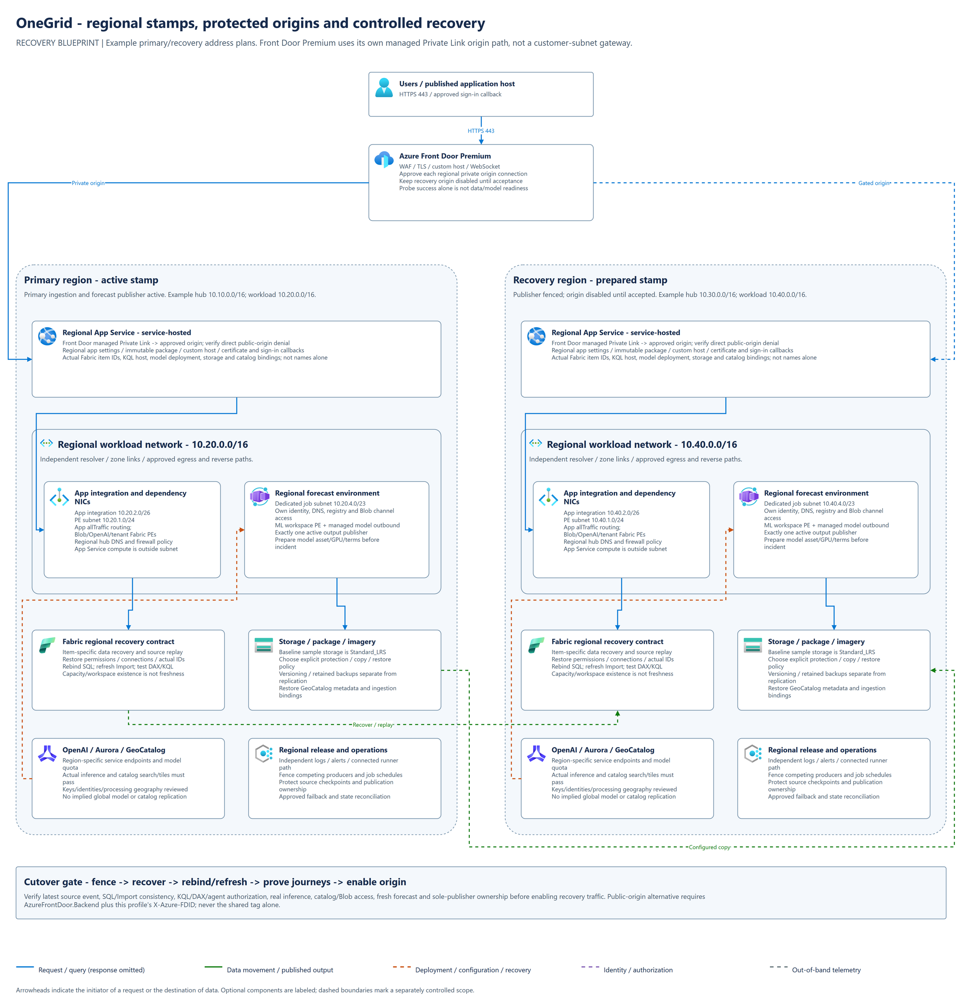

# OneGrid multiregion architecture

[Solution overview](../../README.md) | [Enterprise implementation](enterprise-landing-zone.md)

A multiregion OneGrid deployment coordinates application availability with recovery of
operational data, semantic models, geospatial content, AI inference, and weather publication.
Define recovery time (RTO), recovery point (RPO), and maximum accepted data age for each
journey rather than assigning one untested objective to the whole workload.

## Architecture

[Download SVG](../diagrams/onegrid-reference-multiregion.svg) |
[Editable draw.io diagrams](../diagrams/onegrid-reference-architecture.drawio) |
[All nine technical sheets](../diagrams/onegrid-reference-gallery.html) |
[Traffic and security contracts](traffic-and-security.md)

Azure Front Door represents the global ingress implementation. Enable the recovery origin
only after dependency and data acceptance passes. Dashed green paths represent explicitly
configured data-copy or item-recovery workflows. Select the recovery mechanism for each
Fabric item and storage account, then replay, restore permissions, and rebind connections.

Configure each region through the OneGrid resource template and environment-specific
settings. Maintain routing, replication, item recovery, fencing, and cutover automation
alongside the regional deployments in the workload delivery pipeline.

### Workflow

1. Front Door sends normal user traffic to the accepted primary origin. App Service
   queries its configured regional data, geospatial, storage, and model endpoints.
2. Source ingestion, semantic refresh, and forecast publication run under the primary
   environment's ownership. Recovery copies and item definitions follow the chosen
   dependency-specific protection mechanisms.
3. During an incident, operators fence primary writers, recover dependencies, and apply
   the recovery environment's actual IDs, connections, permissions, and DNS configuration.
4. The recovery environment passes data-backed readiness checks, including access,
   freshness, model inference, and sole forecast-publisher ownership.
5. Operators enable recovery traffic only after these gates pass, observe the restored
   journeys, and reconcile state before an approved failback.

### Components

| Component | Regional preparation | Recovery verification |
| --- | --- | --- |
| App Service | Compatible plan, immutable package, settings, sign-in callback, network path | UI/API, sign-in, WebSocket reconnect, data-backed journeys |
| Fabric capacity/workspace | Approved recovery capacity, item definitions, permissions, connection inventory | Recovered items, actual IDs, DAX/KQL and source freshness |
| Lakehouse and Import model | Protected source tables, SQL connection configuration, refresh identity | SQL metadata, model binding/refresh, counts and timestamps |
| Eventhouse | Retention/recovery design, source replay/checkpoints | Latest events, outage data, duplicates/late data behavior |
| Storage | Chosen redundancy/copy and retained versions for assets, outputs, packages | Required blobs, authorization, endpoint/configuration changes |
| GeoCatalog | Source imagery, STAC metadata, ingestion identity/configuration | Search, item completeness, ingestion, rendered tiles |
| Azure OpenAI | Approved secondary model/version, quota, data-processing geography | Model call, grounded answer, tool authorization |
| Aurora | Model asset, image/environment, accepted terms, regional GPU quota | Actual inference and output normalization |
| Forecast job | Pipeline image, input access, job identity, publication ownership | Single active publisher, current cycle, valid normalized output |
| Identity/network/monitoring | Entra access, DNS, ingress/egress, certificates, operational visibility | Administration and alerts remain available during region loss |

## Design patterns

### Regional deployment stamps

Treat application package, configuration, model deployment, storage, and data connections
as a regional stamp. Record all workspace/item IDs and bindings explicitly. Reusing an item
name in another workspace does not preserve its ID or connection.

### Active/passive and active/active

Choose cold, warm, or hot standby from measured recovery objectives and capacity availability.
Active/passive is often simpler for source ingestion and forecast publication. Active/active
also requires write ownership, consistency, source routing, conflict handling, and independent
regional data readiness; two healthy web front ends alone do not provide that behavior.

## Data and state

Select Fabric recovery mechanisms for each item type and capacity setting. Protect source
data and item definitions separately. During recovery, recreate/recover dependent items,
restore permissions, rebind SQL/model connections, refresh Import, and update the app's
workspace/dataset/KQL settings.

Plan Eventhouse replay from connector checkpoints and durable queues. Identify the last
confirmed event and data-loss/duplicate window. Validate restored queries rather than
assuming data is current because a workspace exists.

For storage, choose redundancy/copy policies based on residency, RPO, and retention.
Retain versions or backups independently of replication, because deletion or corruption
can also be replicated.

Retain GeoCatalog source imagery, STAC metadata, render settings, and ingestion configuration.
Exercise the service recovery or catalog reconstruction path with representative data.

## Forecast and model continuity

Reserve recovery-region Azure OpenAI quota and validate model/version compatibility.
Test endpoint/deployment switching with the application's actual identity and data tools.

Prepare Aurora GPU capacity according to RTO. A workspace and endpoint are not sufficient
without a healthy model deployment and inference test. Preserve model asset/version,
input configuration, channel/output permissions, and container image.

Keep exactly one forecast publisher responsible for the active output. One deployment
approach is to prepare the recovery model with `deployAuroraSchedule=false`, then enable
the recovery job through an approved regional template update during cutover. Include
that deployment time in RTO and fence the primary publisher before enabling the secondary.
If primary control is unavailable, use a previously tested fencing/ownership mechanism.

## Network and traffic management

Use an enterprise-approved global ingress/routing policy. Keep regional origin restrictions,
certificates, callbacks, DNS, and dependency access equivalent. Do not route users to the
recovery app until DAX/KQL, authorization, selected model features, and freshness tests pass.

For Azure Front Door, restrict each origin to the approved Front Door path. When using
Premium private origins, approve and validate each regional Private Link connection.
Keep the recovery origin disabled until the release gate passes; a successful HTTP health
probe alone doesn't establish data or model readiness.

For public App Service origins, combine the `AzureFrontDoor.Backend` service tag with
an access restriction that matches **this profile's** `X-Azure-FDID` value. The shared
service tag alone doesn't identify the workload's Front Door instance. For Premium
private origins, approve each origin connection and explicitly verify public-origin
denial. Keep backend hostnames, TLS/SNI, custom probes, and application sign-in callbacks
consistent with the published host.

Recover the forecast job's network independently from App Service. The recovery job
must resolve and reach its regional Aurora endpoint, registry, input sources, and Blob
channel before publication is enabled. Revalidate service-to-source connections for
Fabric refresh, shortcuts, and GeoCatalog; global web routing doesn't recover these paths.

Include shared identity, DNS, deployment runners, registries, secrets, and monitoring in
failure analysis. Ensure the recovery environment does not still depend exclusively on
the failed region for package loading or critical configuration.

### Cutover acceptance

| Gate | Pass condition |
| --- | --- |
| Origin access | Approved Front Door path succeeds; direct public-origin access is denied |
| Application | Sign-in, REST, and WebSocket reconnect succeed on the published host |
| Data | Actual recovery item IDs, bindings, permissions, DAX/KQL results, and freshness meet the declared objectives |
| Inference | Approved model/version responds; Aurora produces a valid normalized forecast when enabled |
| Publication ownership | Primary writer is fenced and the recovery job is the sole authorized active publisher |
| Operations | DNS, package loading, connected administration, diagnostics, and alert delivery don't depend exclusively on the failed region |

## Recovery procedure

1. Declare the incident, identify failed journeys, and authorize failover.
2. Fence primary ingestion/publication where required; record source and output checkpoints.
3. Recover Fabric items/data, storage content, catalog context, and model dependencies.
4. Apply secondary IDs, bindings, grants, application settings, and sign-in configuration.
5. Refresh the semantic model; test DAX/KQL, counts, latest observations, and access boundaries.
6. Test model calls and weather outputs, including provenance and maximum accepted age.
7. Change traffic only after readiness passes; communicate feature/data degradation.
8. Observe latency, errors, capacity, throttling, and publisher ownership.
9. Reconcile data and approve failback; stop competing writers before returning traffic.

## Considerations

### Reliability

Measure achieved RTO/RPO for app, data, catalog, and model paths. Test delayed
copies, unavailable quota, source outages, and shared dependency failure.

### Security

Preserve data residency, model processing rules, identity isolation, and audit
evidence during recovery. Use controlled emergency access rather than broad incident grants.

### Cost Optimization

Budget standby App Service/Fabric/GPU capacity, duplicated diagnostics,
replication, and egress against the chosen recovery objectives.

### Operational Excellence

Version both regional configurations, automate repeatable
recovery steps, and retain exercise results with owned remediation.

### Performance Efficiency

Validate recovery capacity at expected failover load, including
semantic refresh, ingestion backlog, model quotas, and interactive queries.

## Next steps

Implement the regional deployment and recovery steps in the
[workload delivery pipeline](../implementations.md) and exercise them through
[Day 2 operations](../operations.md).
