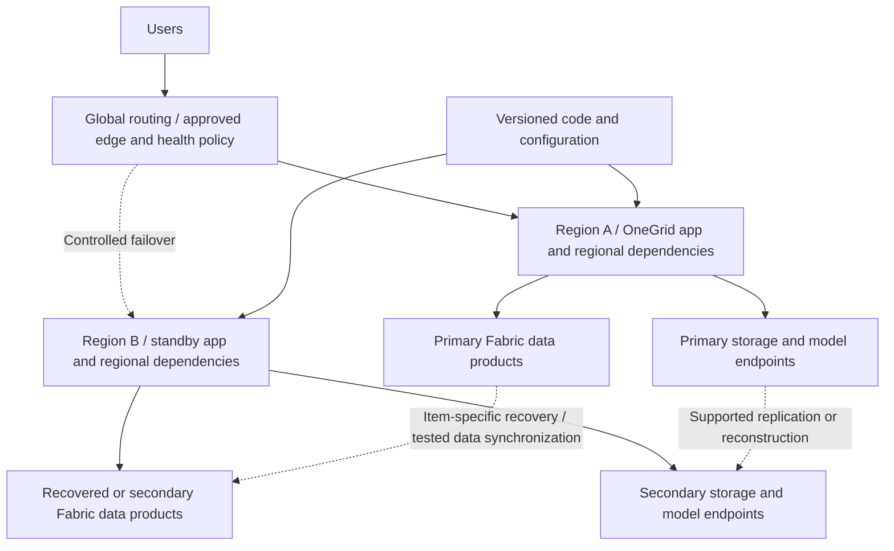

# OneGrid baseline for multiregion workloads

[Documentation home](../../README.md) | [Enterprise integration](enterprise-landing-zone.md)

This architecture extends the single-region baseline with a recovery-region design. Define
business-approved **RTO** and **RPO** for asset queries, telemetry, chat, imagery, and weather
separately. An available page with stale forecasts or an unreachable semantic model is not
a recovered workload.

Article structure: [AKS baseline for multiregion clusters](https://learn.microsoft.com/azure/architecture/reference-architectures/containers/aks-multi-region/aks-multi-cluster).
The regional workload here uses App Service; cluster-specific guidance applies only if AKS
is adopted.

> [!IMPORTANT]
> This is a target design. The supplied template does not deploy paired app environments,
> global routing, cross-region Fabric recovery, or automated failover.

## In this article

- [Architecture](#architecture)
- [Components](#components)
- [Alternatives](#alternatives)
- [Design patterns](#design-patterns)
- [Considerations](#considerations)
- [Next steps](#next-steps)
- [Related resources](#related-resources)

## Architecture

Arrows describe required recovery/synchronization work, not guaranteed native replication.
The design must prove runtime and control-plane recovery across every dependency.

## Components

| Dependency | Current baseline | Target recovery approach and test |
| --- | --- | --- |
| Regional application hosts | One App Service app/plan | Deploy a compatible second environment and the same immutable package. Test configuration, WebSocket reconnect, and identity redirects. |
| Global traffic routing | Not supplied | Configure approved edge/routing, origin restrictions, representative health checks, and controlled cutover. |
| Fabric data products | Workspace/items on chosen capacity | Review capacity disaster-recovery settings and experience-specific support. Protect definitions/source data; test recreation, grants, rebinding, and refresh. |
| Semantic model | Import over deployment-specific SQL endpoint | Restore/recreate source and model, bind the secondary SQL connection, refresh, validate counts/DAX, and switch dataset settings. |
| Eventhouse/KQL | Regional telemetry dependency | Select supported protection/recovery and ingestion replay; test checkpoints, duplicates, retention, and freshness. |
| Storage | `Standard_LRS` | Select supported redundancy/copy based on RPO/residency; test package, asset, output, and endpoint changes independently. |
| GeoCatalog | Optional regional catalog | Verify current recovery capabilities; retain source assets, STAC metadata, ingestion config, and a tested rebuild/repoint procedure. |
| Azure OpenAI | Regional account/model dependency; deployment type may process more broadly | Approve a secondary model/version, reserve quota, secure connectivity, and test endpoint/deployment switching. |
| Aurora | Optional regional Azure ML GPU endpoint | Prove inference readiness with model asset, image/environment, accepted terms, and GPU quota. Endpoint creation is insufficient. |
| Forecast job | Optional regional scheduler | Restore image, identities, configuration, and inputs; enforce a single publisher/fencing procedure. |
| Shared identity, DNS, edge, monitoring | Externally governed dependencies | Verify emergency administration, certificates, resolution, logs, alerts, and routing during the outage. |

## Alternatives

An active/passive application is an initial design to evaluate, not an imposed requirement.
Choose cold, warm, or hot standby from measured recovery objectives and capacity availability.
Active/active needs explicit write ownership, consistency, and conflict handling; routing
traffic to two applications does not make the data plane active/active.

If AKS is justified, use regional clusters and the Microsoft AKS baseline. This changes
compute/platform operations, not Fabric, GeoCatalog, or model recovery responsibilities.

## Design patterns

### Geode pattern considerations

A geode should serve its users with an explicit regional dependency/data ownership model.
OneGrid is not currently implemented as independent geodes. Identify cross-region/shared
Fabric, identity, catalog, and model dependencies before claiming a region is self-sufficient.

### Deployment stamp considerations

Treat a regional app, configuration, permissions, and required dependencies as a versioned
deployment stamp. Record tenant/workspace/item IDs instead of assuming they are portable.
Recreate bindings and permissions during recovery. Use the same immutable package, with
approved region-specific settings.

## Considerations

### Cluster deployment and bootstrapping

For the current App Service workload, bootstrap a second environment with reviewed IaC,
identities, package access, networking, data binding, and diagnostics. The template's allowed
regions do not establish service availability or quota.

The heading follows the AKS source article. If AKS is adopted, add cluster bootstrap,
registry/image access, workload identity, ingress, and upgrade coordination. No cluster
bootstrap is needed or supplied for the current host.

### Reliability

Measure achieved RTO/RPO, including data restoration, semantic refresh, model/GPU readiness,
and operator authorization. Test regional app loss, shared dependency failure, delayed
copies, unavailable quota, and stale forecasts. Replication is not backup: corruption and
deletion can propagate.

### Network topology

Integrate each regional environment with approved platform connectivity, DNS, routes, and
supported private endpoints. Confirm the recovery path does not depend on failed primary
DNS, runners, firewall policy delivery, or package storage.

### Traffic management

Use representative readiness checks before changing traffic. Test certificates, origin
restrictions, redirects, sessions, and WebSocket reconnect. A health endpoint alone is not
proof that the secondary can serve the data-backed journey.

### Shared resource considerations

Inventory tenant identity, shared Fabric capacity, central AI gateway, registries, secrets,
monitoring, and control planes. Avoid a "secondary" environment whose critical dependencies
still exist only in the primary region.

### Security

Replicate approved controls and least-privilege grants, not broad temporary incident roles.
Validate secondary authorization, residency, secrets, and model processing scope. Preserve
incident auditability through failover and failback.

### Data, state, and cache

Fabric recovery is item-specific. Capacity DR settings and multi-geo placement do not prove
every item fails over together. Follow the
[Fabric reliability](https://learn.microsoft.com/fabric/security/reliability-fabric) and
[experience-specific recovery](https://learn.microsoft.com/fabric/security/experience-specific-guidance)
guidance. Protect definitions and data separately; rebuild SQL/model bindings and caches,
then verify actual recovered timestamps.

Fence scheduled writers before activating secondary publication. If the primary cannot be
reached, rely on a previously tested fencing mechanism, not merely a browser-routing change.

### Cost Optimization

Budget standby Fabric, App Service, GPU, logs, replication, and egress. Validate the recovery
region can absorb load; a cheaper standby that cannot acquire quota may miss its RTO.

### Operational Excellence

Keep the failover/failback decision, data-loss approval, and feature degradation explicit.
Exercise recovery and retain measured results. Assign an owner to every gap before declaring
the target design operational.

## Next steps

Implement and rehearse this recovery sequence:

1. Declare the incident and authorize failover.
2. Fence primary writes and scheduled publishers.
3. Restore/replay Fabric and storage dependencies; record recovered timestamps and data loss.
4. Rebind secondary SQL/model connections, IDs, identities, settings, and model endpoints.
5. Validate authentication, authorization, DAX/KQL, freshness, and selected optional features.
6. Route users only after readiness passes; label degraded features and stale data.
7. Monitor latency, errors, throttling, and capacity; confirm single-scheduler ownership.
8. Reconcile data and approve failback; stop competing writers before returning traffic.

Assign accountable owners through the [Day 2 operations guide](../operations.md).

## Related resources

- [Microsoft AKS multiregion architecture](https://learn.microsoft.com/azure/architecture/reference-architectures/containers/aks-multi-region/aks-multi-cluster).
- [Fabric recovery responsibilities](https://learn.microsoft.com/fabric/security/reliability-fabric).
- [OneGrid enterprise integration](enterprise-landing-zone.md).
- [Implementation catalog](../implementations.md).
