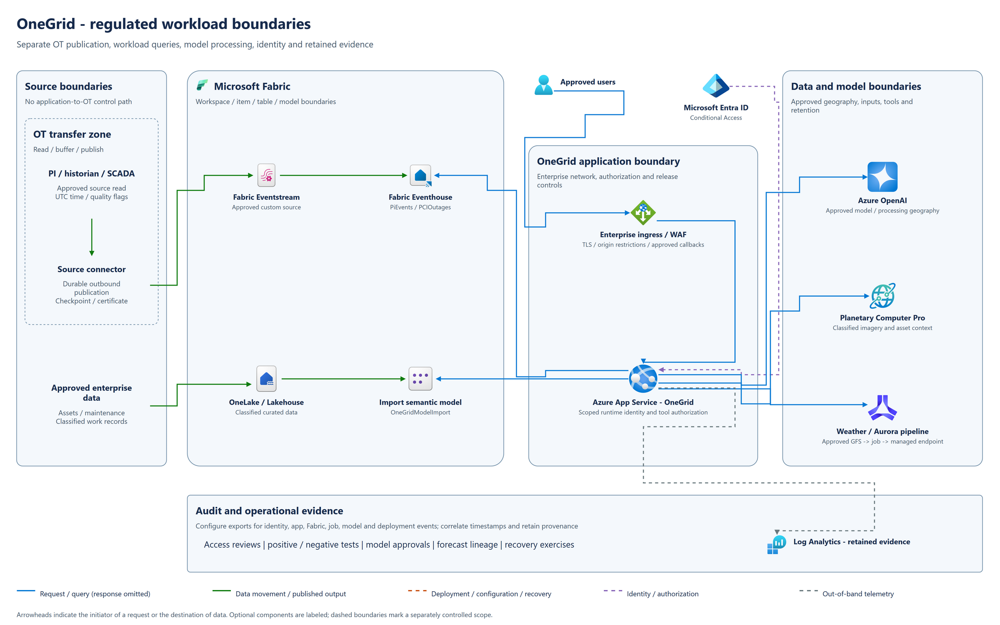

# OneGrid regulated workload architecture

[Solution overview](../../README.md) | [Enterprise implementation](enterprise-landing-zone.md)

A regulated OneGrid workload combines operational intelligence with explicit control of
data movement, administration, analytical access, model use, and operational decisions.
The design retains the same Fabric, geospatial, weather, AI, and application planes while
assigning controls and evidence to each boundary.

## Architecture

[Download SVG](../diagrams/onegrid-regulated-workload.svg) |
[Editable draw.io diagrams](../diagrams/onegrid-architecture.drawio)

Query arrows identify the requesting workload, including weather-output reads. Identity
controls and diagnostic export are separate paths. Configure and verify evidence collection
for every listed service; audit retention isn't part of the application request route.

The OT boundary is an ingestion boundary. Deploy source connectors with approved source-read
permissions and outbound publication rather than opening a direct application path into
plant control networks. The application supports operator decisions; engineering and
safety-critical actions retain their approved human and control-system processes.

## Shared responsibility and scope

| Owner | Responsibility |
| --- | --- |
| Platform/security | Identity guardrails, connectivity, central logs, privileged access, policy and incident response |
| Workload team | App authorization, runtime configuration, deployment controls, model/tools, workload alerts |
| Data owner | Classification, permitted uses, retention, source quality, sharing, residency, access decisions |
| Operations | Source continuity, freshness, maintenance, recovery exercises, incident evidence |
| Compliance/assessor | Applicable obligations, control mapping, assessment, accepted exceptions |

Define the system boundary before implementation: customer data sources, connector hosts,
Fabric tenant/workspaces, Azure resources, users, model processing, storage copies, logs,
and administrative access. Map requirements to this specific inventory and data flow.

## Data protection

Classify asset coordinates, critical-infrastructure metadata, telemetry, work orders,
equipment manuals, prompts, answers, and derived predictions. Apply minimization and
approved retention to both primary data and diagnostic copies.

Record regions and processing scope for Fabric capacities, storage, GeoCatalog, Azure ML,
Azure OpenAI, and recovery copies. The ARM default Azure OpenAI deployment type is
`GlobalStandard`; choose and verify model processing geography against actual requirements.
Evaluate encryption/key-management needs per service and test the selected configuration.

Separate generated/seeding data from observed production measurements in ingestion,
presentation, and evidence. Preserve timestamps, lineage, quality flags, model version,
forecast input cycle, and publication time.

## Identity and access controls

- Use Entra groups and Conditional Access for user access, with privileged elevation and
  emergency access procedures for administration.
- Separate provisioner, runtime, refresh, ingestion, workspace-connection, and forecast
  identities; inventory grants and credentials.
- Protect and rotate the Import refresh service-principal secret. Prove a complete model
  refresh after every credential change.
- Configure and verify OneLake roles, semantic permissions/filtering, KQL access, SQL access,
  sharing, exports, and Data Agent tools.
- Test unauthorized API calls, cross-site/asset data access, chat retrieval, cached answers,
  and exports. User sign-in and shared service-identity authorization are distinct controls.

## Network and model boundaries

Use the approved enterprise ingress, egress, DNS, service-access, and operator paths.
Validate model calls, Fabric queries, package mounting, blob channels, and weather/imagery
source access through those controls.

Approve model versions, tools, grounding sources, prompt retention, and input data classes.
Evaluate prompt injection, unauthorized tool use, sensitive-data leakage, and ungrounded
answers before a release. Retain evaluation results and approval records. Apply human
oversight to generated maintenance and storm-response recommendations.

## Control implementation and evidence

| Objective | OneGrid implementation boundary | Acceptance evidence |
| --- | --- | --- |
| Source separation | Connector permissions, buffer, endpoint, certificate | Approved network path; source access test; outage/replay exercise |
| Data authorization | App APIs, Fabric/SQL/KQL permissions, model filters, exports | Permitted/denied test results for actual query identities |
| Restricted model use | Azure OpenAI/Aurora configuration and agent tools | Model/geography approval, tool policy, evaluation results |
| Credential protection | Refresh identity, deployment identity, connector certificates | Inventory, rotation drill, redacted logs/artifacts |
| Administrative control | Platform/workload privileged roles, deployment approvals | Access reviews, elevation records, change approvals |
| Auditability | Identity, app, Fabric, job, model, deployment events | Searchable correlated events; retention/access test |
| Supply-chain control | App package, pipeline image, source commit, dependencies | Build/package identity, review results, promotion and rollback evidence |
| Weather provenance | Input cycle, model/version, job result, normalized output | Timestamp/lineage checks and stale-output test |
| Continuity | Source checkpoints, Fabric items/data, storage, app/model recovery | Achieved RTO/RPO, restored-query results, incident exercise |

Associate each row with the organization's control identifiers, accountable owner, evidence
location, review cadence, and remediation records.

## Operational acceptance

1. Approve system scope, classification, residency, threat model, and control mapping.
2. Configure enterprise and workload controls in nonproduction.
3. Exercise positive/negative access, source interruption, stale data, model misuse,
   credential rotation, restore, and rollback.
4. Resolve findings or record the approved owner, compensating control, and review date.
5. Obtain workload, security, data, operational, and applicable assessment approvals.
6. Reassess after significant changes to sources, models/tools, permissions, regions,
   service features, or recovery arrangements.

## Next steps

Use [Day 2 operations](../operations.md) for recurring control operation and
[multiregion recovery](multiregion.md) for coordinated regional failure exercises.
