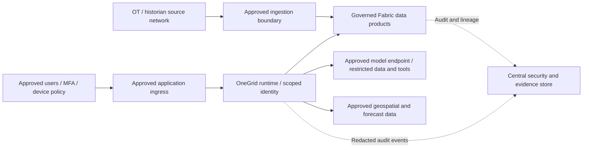

# OneGrid regulated workload architecture

[Documentation home](../../README.md) | [Enterprise integration](enterprise-landing-zone.md)

This architecture series applies a control-oriented approach to sensitive OneGrid workloads:
establish shared responsibility, prepare the environment, implement controls, and gather
evidence before production approval.

Article structure: [Introduction to AKS regulated cluster for PCI DSS 4.0.1](https://learn.microsoft.com/azure/aks/pci-intro).
The structure is reused for OneGrid's App Service/Fabric workload; AKS and PCI applicability
are not assumed.

> [!IMPORTANT]
> This is a target design, not a regulated deployment profile or compliance certification.
> Energy-sector, privacy, sovereignty, and payment-card obligations are not interchangeable.
> Identify applicable requirements with legal, security, and an independent assessor.

## In this article

- [Shared responsibility model](#shared-responsibility-model)
- [Before you begin](#before-you-begin)
- [Series overview](#series-overview)
- [Next steps](#next-steps)

## Shared responsibility model

| Responsibility | Accountable party | Boundary |
| --- | --- | --- |
| Underlying managed service infrastructure | Microsoft, according to each service's responsibility model | Service attestations do not certify customer configuration or the whole solution |
| Platform guardrails, identity, network, security operations | Organization's platform/security teams | Must implement and operate approved controls |
| App authorization, data permissions, model tools, configuration, lifecycle | OneGrid workload and data owners | Must verify effective behavior and produce evidence |
| Applicable obligations, control mapping, assessment | Compliance/legal and qualified independent assessor | Must determine scope and approve evidence; architecture text cannot replace assessment |

Treat OT ingestion as a separately engineered boundary. Do not create a direct inbound route
from the app to plant control systems. The workload provides decision support, not a safety
system or an autonomous control loop.

## Before you begin

Complete the [enterprise architecture](enterprise-landing-zone.md) integration design.
Approve the data classification, threat model, system boundary, dependency inventory, control
owners, service/region eligibility, and evidence-retention requirements.

**Foundry and weather inference.** The default Azure OpenAI SKU is `GlobalStandard`. Validate
processing geography, logging, abuse-monitoring terms, model/version, and availability
against actual requirements. Do not send restricted asset metadata, credentials, or raw
telemetry to models without approval. Use authorized tools, human oversight, and forecast
provenance/age/uncertainty records. Generated recommendations must not directly actuate OT.

**Fabric.** Validate tenant/workspace, OneLake, semantic-model, KQL, SQL endpoint, and export
permissions. User sign-in does not automatically impose end-user RLS on shared service-identity
queries. Test chat, aggregates, downloads, caches, and diagnostics for data isolation.
Approve preview features explicitly; redesign or exclude features that cannot meet a required
network or security control.

**AKS, only if adopted.** No cluster is deployed. A future AKS host additionally requires
cluster/workload identity, network policy, admission controls, image provenance, secrets
integration, node/pod isolation, patching, and cluster audit retention. These do not replace
Fabric or AI controls.

## Series overview

Use the following control areas as the review sequence. The linked OneGrid articles provide
workload-specific design and operating detail; they are not independently certified controls.

| Control area | Target implementation | Evidence and acceptance test | Owner / guidance |
| --- | --- | --- | --- |
| Network segmentation | Approved ingress, constrained egress, supported private connectivity, isolated management | Firewall/DNS configuration; blocked bypass and denied-egress tests | Network/platform; [networking](enterprise-landing-zone.md#networking) |
| Data protection | Classification, minimization, residency, encryption, key management, retention | Data-flow/terms review; key and restore tests; documented service gaps | Data/security; [Fabric data protection](fabric.md#protect-data) |
| Vulnerability management | Reviewed changes, dependency scanning, artifact provenance, immutable versions | Build evidence, approvals, package digest, tested rollback | Engineering; [release operations](../operations-runbook.md#change-release-and-rollback) |
| Access controls | Group-based access, MFA/Conditional Access, elevation, server-side and data authorization | Access review; privileged records; disabled-user and cross-boundary negative tests | Identity/application/data; [Fabric access](fabric.md#access-data) |
| Monitoring operations | Central redacted logs, appropriate retention, restricted evidence access, immutable retention where required | Queryable app/data/admin events; tamper/retention and alert-delivery tests | Security operations; [operations runbook](../operations-runbook.md) |
| Policy management | Approved policies, least-privilege bootstrap, controlled exceptions | Compliance results; owned, expiring exceptions; credential/privilege inventory | Platform/security; [Azure Policy](enterprise-landing-zone.md#azure-policy) |
| AI assurance | Approved model/version, prompt/tool review, authorization-aware grounding, human oversight | Prompt-injection/data-leakage tests, evaluation results, model change approval | AI/workload/data; [model selection](baseline.md#model-and-tool-selection) |
| Credential protection | Approved secret store, rotation, scoped identities, separated deployment privileges | Rotation drill; access logs; secrets absent from code, artifacts, and logs | Platform/workload; [identity lifecycle](../operations-runbook.md#data-and-model-lifecycle) |
| Continuity and incident response | Tested backup, item recovery, replay, failover where required, escalation | Measured restore against approved RTO/RPO; incident exercise | Workload/SRE; [recovery design](multiregion.md) |

This is not an exhaustive regulatory mapping. Associate each row with the organization's
actual control identifiers, implementation records, evidence location, and review dates.

## Next steps

1. Approve scope, classification, residency, and a formal control mapping.
2. Implement enterprise and regulated controls in nonproduction.
3. Run functional, denied-access, AI misuse, recovery, and incident-response tests.
4. Review evidence; resolve or formally accept every gap.
5. Obtain the required independent assessment and production approval.
6. Operate the controls using the [Day 2 guide](../operations.md); reassess after significant
   service, model, data, identity, or architecture changes.

For the source series and the distinction between design guidance and certification, see
[Microsoft's regulated AKS guidance](https://learn.microsoft.com/azure/aks/pci-intro).
