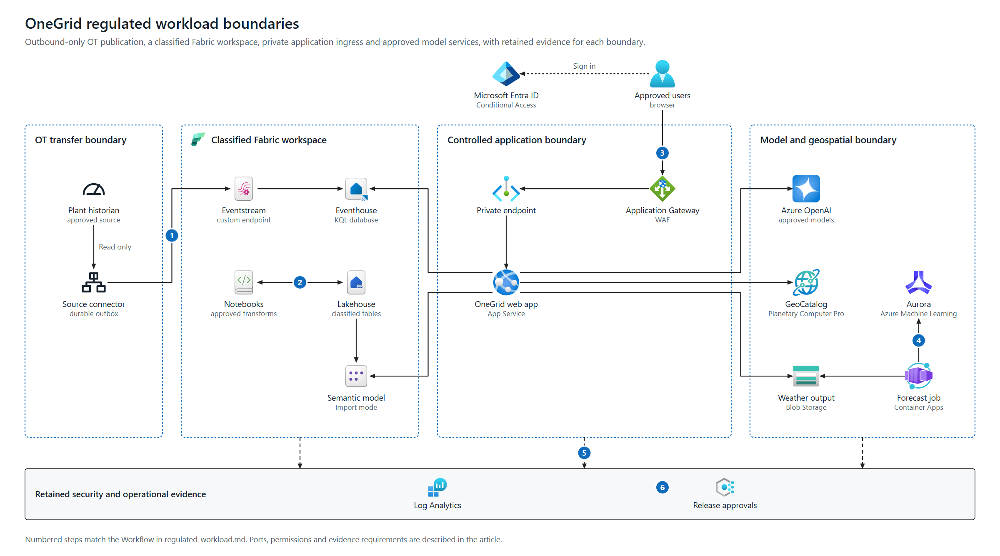

# OneGrid regulated workload architecture

[Solution overview](../../README.md) | [Enterprise implementation](enterprise-landing-zone.md)

A regulated OneGrid workload combines operational intelligence with explicit control of
data movement, administration, analytical access, model use, and operational decisions.
The design retains the same Fabric, geospatial, weather, AI, and application planes while
assigning controls and evidence to each boundary.

## Architecture

<a href="../diagrams/onegrid-reference-regulated.svg"><picture><source media="(prefers-color-scheme: dark)" srcset="../diagrams/onegrid-reference-regulated-dark.png"></picture></a>

[Download SVG](../diagrams/onegrid-reference-regulated.svg) |
[Diagram source](../diagrams/sheets/regulated.py) |
[Monitoring detail](../diagrams/onegrid-reference-monitoring.png) |
[Traffic and security contracts](traffic-and-security.md)

Numbered steps match the workflow below. Solid arrows show data or calls toward the service
that receives them; dashed lines are optional, binding or evidence paths, and the dotted
line is user sign-in. The app's workload identity makes each call into the Fabric and model
boundaries, including weather-output reads.

### Workflow

1. An approved connector reads operational sources in the transfer zone and publishes
   outward to Eventstream; it doesn't expose an application-to-plant control path.
2. Fabric ingests telemetry and curates asset history under the configured workspace,
   source-connection, table, and semantic permissions.
3. Users sign in with Microsoft Entra ID and reach the published application host through
   Application Gateway WAF and the app's private endpoint. The backend authorizes each
   request before its workload identity queries the configured data and model services.
4. AI tools and Aurora process only their approved inputs. The forecast job publishes
   weather output that retains its input cycle, model version, and publication timestamp
   for operational review.
5. Supported identity, application, data, model, job, and deployment events flow to
   controlled evidence stores outside the user request path.
6. Release and operational acceptance test both permitted and denied behavior; owners
   approve exceptions and retain evidence against the organization's control mapping.

The OT boundary is an ingestion boundary. Deploy source connectors with approved source-read
permissions and outbound publication rather than opening a direct application path into
plant control networks. The application supports operator decisions; engineering and
safety-critical actions retain their approved human and control-system processes.

The connector reads with read-only source permissions and keeps each reading's timestamp,
quality, and equipment identity. It publishes with its certificate-based identity over AMQP
over WebSockets on TCP 443 by default, keeps durable checkpoints and retries in its outbox,
and needs egress only to the actual Eventstream source endpoint. Assign each source to one
publishing connector.

## Shared responsibility and scope

| Owner | Responsibility |
| --- | --- |
| Platform/security | Identity guardrails, connectivity, central logs, privileged access, policy and incident response |
| Workload team | App authorization, runtime configuration, deployment controls, model/tools, workload alerts |
| Data owner | Classification, permitted uses, retention, source quality, sharing, residency, access decisions |
| Operations | Source continuity, freshness, maintenance, recovery exercises, incident evidence |
| Compliance/assessor | Applicable obligations, control mapping, assessment, accepted exceptions |

Define the system boundary before implementation: customer data sources, connector hosts,
Fabric tenant/workspaces, Azure resources, users, model processing, storage copies, logs,
and administrative access. Map requirements to this specific inventory and data flow.

## Data protection

Classify asset coordinates, critical-infrastructure metadata, telemetry, work orders,
equipment manuals, prompts, answers, and derived predictions. Apply minimization and
approved retention to both primary data and diagnostic copies.

Record regions and processing scope for Fabric capacities, storage, GeoCatalog, Azure ML,
Azure OpenAI, and recovery copies. The ARM default Azure OpenAI deployment type is
`GlobalStandard`; choose and verify model processing geography against actual requirements.
Evaluate encryption/key-management needs per service and test the selected configuration.

Separate generated/seeding data from observed production measurements in ingestion,
presentation, and evidence. Preserve timestamps, lineage, quality flags, model version,
forecast input cycle, and publication time.

In the classified workspace, the processed Eventstream destination writes `PiEventsRaw` and
the update policy produces `PiEvents`. Eventhouse doesn't replicate telemetry to the
Lakehouse, so classify source and curated Lakehouse tables separately and set their
retention. Notebooks apply approved transformations under their own run identity and source
connection, and work, health, and weather joins use the shared asset keys.

## Identity and access controls

- Use Entra groups and Conditional Access for user access, with privileged elevation and
  emergency access procedures for administration.
- Separate provisioner, runtime, refresh, ingestion, workspace-connection, and forecast
  identities; inventory grants and credentials.
- Protect and rotate the Import refresh service-principal secret. Prove a complete model
  refresh after every credential change. The refresh reads the SQL analytics endpoint over
  encrypted TDS on TCP 1433 and needs explicit SQL and model permissions.
- Configure and verify OneLake roles, semantic permissions/filtering, KQL database, table,
  and function access, SQL access, sharing, exports, and Data Agent tools. Test export,
  build, and query permissions, and make row-level and object-level security (RLS/OLS)
  match the identity that actually calls the model.
- Test unauthorized API calls, cross-site/asset data access, chat retrieval, cached answers,
  and exports. User sign-in and shared service-identity authorization are distinct controls.

## Network and model boundaries

Use the approved enterprise ingress, egress, DNS, service-access, and operator paths.
Validate model calls, Fabric queries, package mounting, blob channels, and weather/imagery
source access through those controls.

Use the [enterprise traffic matrix](enterprise-landing-zone.md#traffic-flow-matrix)
as the network-control inventory. Associate each enabled path with a data class, caller
identity, destination, enforcement point, and evidence owner. In particular:

- Prove that the private application path works and its direct public origin is denied.
  Application Gateway WAF reaches App Service through its private endpoint; preserve the
  host name, TLS/SNI, and sign-in callback through the gateway, and use Entra access
  policies to admit only approved users. Users connect over HTTPS and WSS on TCP 443.
- Verify tenant-level Fabric connectivity for the combined semantic-model workspace,
  processed Eventstream ingestion, and independently authorized storage connections.
- The app's KQL, DAX, model, STAC, and weather-output Blob calls use HTTPS on TCP 443.
  Shared workload identity needs explicit data and tool checks on every call path.
- Reach Azure OpenAI through its private account endpoint with explicit authentication,
  and minimize sensitive data in prompts and tool results.
- Grant GeoCatalog roles and its source-Blob ingestion identity separately, restrict
  classified imagery and render permissions, approve any public API egress, and accept
  the service-to-storage network path on its own.
- Run the forecast job in its own subnet with its own managed identity, and reach Azure
  Machine Learning through a private inbound endpoint with managed outbound networking.
  Test Aurora from the forecast job's environment, not from an unrelated operator host
  or App Service console. A short-lived SAS on the Blob channel doesn't bypass storage
  firewalls.
- Approve browser-originated map/glyph access and external forecast inputs separately
  from server egress. A private application endpoint doesn't make those requests private.
- Record public and private destination choices explicitly; managed identity, encryption,
  and data-processing geography are separate controls.

Approve model versions, tools, grounding sources, prompt retention, and input data classes.
Evaluate prompt injection, unauthorized tool use, sensitive-data leakage, and ungrounded
answers before a release. Retain evaluation results and approval records. Apply human
oversight to generated maintenance and storm-response recommendations, and require human
approval before consequential actions. The baseline deployment wrapper leaves the optional
governance configuration disabled; enable it and verify the resulting controls rather than
relying on inventory views.

## Control implementation and evidence

| Objective | OneGrid implementation boundary | Acceptance evidence |
| --- | --- | --- |
| Source separation | Connector permissions, buffer, endpoint, certificate | Approved network path; source access test; outage/replay exercise |
| Data authorization | App APIs, Fabric/SQL/KQL permissions, model filters, exports | Permitted/denied test results for actual query identities |
| Restricted model use | Azure OpenAI/Aurora configuration and agent tools | Model/geography approval, tool policy, evaluation results |
| Credential protection | Refresh identity, deployment identity, connector certificates | Inventory, rotation drill, redacted logs/artifacts |
| Administrative control | Platform/workload privileged roles, deployment approvals | Access reviews, elevation records, change approvals |
| Auditability | Identity, app, Fabric, job, model, deployment events | Searchable correlated events; retention/access test |
| Supply-chain control | App package, pipeline image, source commit, dependencies | Build/package identity, review results, promotion and rollback evidence |
| Weather provenance | Input cycle, model/version, job result, normalized output | Timestamp/lineage checks and stale-output test |
| Continuity | Source checkpoints, Fabric items/data, storage, app/model recovery | Achieved RTO/RPO, restored-query results, incident exercise |

Associate each row with the organization's control identifiers, accountable owner, evidence
location, review cadence, and remediation records.

Configure and test evidence collection separately for App Service, Application Gateway,
Azure resources, Microsoft Entra ID, Fabric, and model services. Evidence export and audit
retention are out of band: they aren't part of the application request route and don't make
an otherwise unauthorized request safe. Control permissions, retention, and redaction for
central logs and archives, including their monitoring network path, and never log secrets
or tokens. Retained evidence includes approved and denied access, source freshness, Import
refresh, model and tool evaluations, public-origin denial, and recovery exercises. Validate
each DAX, KQL, Data Agent, Blob, and tool path; a dashboard or governance-intent record
isn't an enforcement mechanism.

## Operational acceptance

1. Approve system scope, classification, residency, threat model, and control mapping.
2. Configure enterprise and workload controls in nonproduction.
3. Exercise positive/negative access, source interruption, stale data, model misuse,
   credential rotation, restore, and rollback.
4. Resolve findings or record the approved owner, compensating control, and review date.
5. Obtain workload, security, data, operational, and applicable assessment approvals.
6. Reassess after significant changes to sources, models/tools, permissions, regions,
   service features, or recovery arrangements.

## Next steps

Use [Day 2 operations](../operations.md) for recurring control operation and
[multiregion recovery](multiregion.md) for coordinated regional failure exercises.
