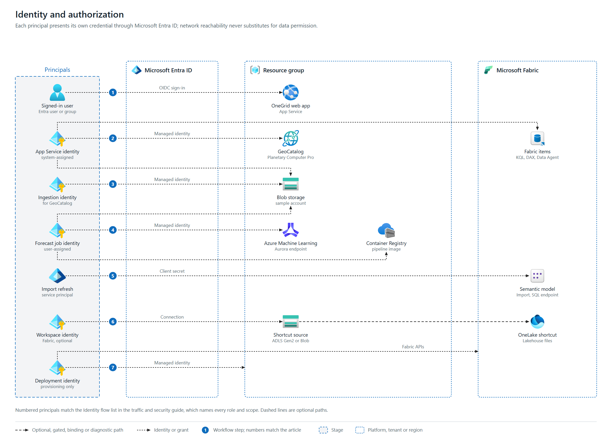
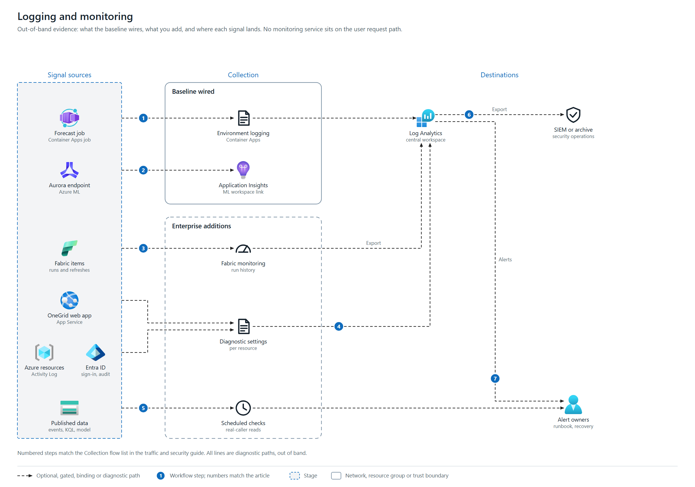
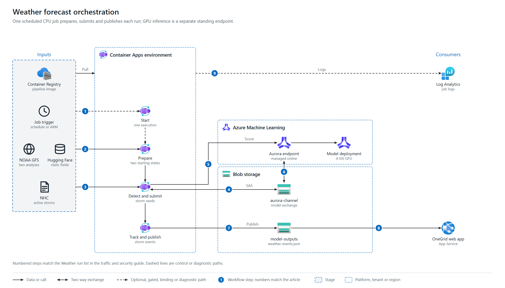

# OneGrid traffic, identity, security, and monitoring

Part of the [OneGrid landing zone design guide](design-guide.md).

[Solution overview](../../README.md) | [Detailed diagram gallery](../diagrams/onegrid-reference-gallery.html)

The architecture sheets separate the deployed OneGrid resource/runtime contract from
enterprise network, monitoring, regulated-workload, and recovery additions. They use actual
service boundaries rather than placing SaaS or App Service compute inside customer subnets.
Example addresses are design allocations, not an inventory obtained from an Azure subscription.

## Architecture sheets

| Sheet | Light drawing | Dark drawing | Principal decision |
| --- | --- | --- | --- |
| Landing zone | [PNG](../diagrams/onegrid-reference-landing-zone.png) | [PNG](../diagrams/onegrid-reference-landing-zone-dark.png) | OneGrid subscriptions in the management group hierarchy beside the platform subscriptions; design areas A–H |
| Deployment | [PNG](../diagrams/onegrid-reference-deployment.png) | [PNG](../diagrams/onegrid-reference-deployment-dark.png) | What the template deploys into one resource group, what the provisioner creates in Fabric, and the repeatable stamp |
| Resource naming | [PNG](../diagrams/onegrid-reference-naming.png) | [PNG](../diagrams/onegrid-reference-naming-dark.png) | Name patterns resolved from `main.bicep` and a recommended resource group split by lifecycle |
| Logical view | [PNG](../diagrams/onegrid-reference-baseline.png) | [PNG](../diagrams/onegrid-reference-baseline-dark.png) | Complete enabled resource and runtime paths; authenticated public endpoints |
| Fabric | [PNG](../diagrams/onegrid-reference-fabric.png) | [PNG](../diagrams/onegrid-reference-fabric-dark.png) | Ingestion, SQL/Import refresh, KQL/DAX, source connections, and data permissions |
| Enterprise | [PNG](../diagrams/onegrid-reference-enterprise.png) | [PNG](../diagrams/onegrid-reference-enterprise-dark.png) | Actual subnet responsibilities and separate service private endpoints |
| DNS | [PNG](../diagrams/onegrid-reference-dns.png) | [PNG](../diagrams/onegrid-reference-dns-dark.png) | Inbound resolution, linked zones, outbound forwarding, and caller tests |
| Weather | [PNG](../diagrams/onegrid-reference-weather.png) | [PNG](../diagrams/onegrid-reference-weather-dark.png) | Scheduled CPU execution, GPU scoring, Blob channel, and publication |
| Identity | [PNG](../diagrams/onegrid-reference-identity.png) | [PNG](../diagrams/onegrid-reference-identity-dark.png) | User, runtime, refresh, workspace, ingestion, and deployment identities |
| Monitoring | [PNG](../diagrams/onegrid-reference-monitoring.png) | [PNG](../diagrams/onegrid-reference-monitoring-dark.png) | Baseline-wired signals versus diagnostics and alerting to implement |
| Regulated | [PNG](../diagrams/onegrid-reference-regulated.png) | [PNG](../diagrams/onegrid-reference-regulated-dark.png) | OT publication boundary, actual authorization paths, and retained evidence |
| Multiregion | [PNG](../diagrams/onegrid-reference-multiregion.png) | [PNG](../diagrams/onegrid-reference-multiregion-dark.png) | Protected regional origins, dependency-specific recovery, and publisher fencing |

The gallery links SVGs and PNGs for every sheet. Each sheet is defined in
[docs/diagrams/sheets](../diagrams/sheets/) and written as static SVG by the standard-library
[builder](../diagrams/build_diagrams.py), which validates text fit, routing and label
placement first. PNGs are rendered locally by Edge or Chrome. No solution content is
submitted to a hosted rendering service. The same build writes
[onegrid-architecture.drawio](../diagrams/onegrid-architecture.drawio), which holds every
sheet as an editable page.

## What the resource template creates

The [Bicep template](../../planetary-computer-pro-poc/deploy/azure/main.bicep) creates selected
Azure resources and invokes the
[Fabric/application provisioner](../../planetary-computer-pro-poc/infra/deploy.ps1).
Component parameters select the enabled planes.

| Area | Source-grounded baseline | Additional enterprise implementation |
| --- | --- | --- |
| Application | Linux App Service, Node 22, HTTPS-only, TLS 1.2 minimum, WebSocket, system-assigned identity | WAF, private origin, custom host/certificate, outbound integration, DNS, access tests |
| Storage | Standard LRS, HTTPS-only, TLS 1.2, anonymous Blob access disabled; private containers | Network rules, private endpoints, private DNS, source-service access, protection/recovery |
| Microsoft Foundry | Account/model deployment; explicit public network access enabled in baseline Bicep | Approved processing geography/model; private endpoint, identity policy, public denial |
| Aurora | Workspace/backing storage/Key Vault/Application Insights; AADToken online endpoint; conditional GPU deployment | Quota/model readiness, inbound workspace PE, managed outbound network and backing-resource grants |
| Forecast job | CPU job, own identity, schedule, registry access, Blob/ML grants, environment Log Analytics | Dedicated VNet-integrated workload profiles environment, source egress, private registry/scoring/channel access |
| Fabric | Capacity/workspace/items, semantic refresh and configured identity/item grants | Tenant Private Link/public block, supported source connections, retention and monitoring |
| Enterprise network | Not declared by the baseline resource template | VNets, subnet delegations, peering, WAF, firewall, UDRs, NSGs, resolver endpoints and private endpoints |
| Recovery/monitoring | Selected resource wiring and execution logs | Recovery automation, protected copies, connected runners, diagnostic settings, alerts and acceptance evidence |

Changing the picture does not deploy these additions. Promote the enterprise resource
definitions and settings through IaC. In particular, do not rely on a portal-only change to
public access that a subsequent baseline deployment can replace.

## Network and name-resolution design

The enterprise and DNS sheets use this illustrative, non-overlapping address plan:

| Boundary | Example range | Responsibility |
| --- | --- | --- |
| Primary hub | `10.10.0.0/16` | Platform connectivity |
| AzureFirewallSubnet | `10.10.0.0/26` | Approved public egress; example next hop `10.10.0.4` |
| Resolver inbound | `10.10.1.0/28` | Dedicated `Microsoft.Network/dnsResolvers` subnet; example static VIP `10.10.1.4` |
| Resolver outbound | `10.10.1.16/28` | Separate dedicated resolver subnet; no client-facing inbound VIP |
| Primary workload | `10.20.0.0/16` | OneGrid network integration |
| Gateway subnet | `10.20.0.0/24` | Dedicated Application Gateway subnet |
| Private endpoint subnet | `10.20.1.0/24` | Separate NICs/connections for app and supported dependency services |
| App integration subnet | `10.20.2.0/26` | Delegated to `Microsoft.Web/serverFarms`; outbound only |
| Job environment subnet | `10.20.4.0/23` | Dedicated workload profiles environment, delegated to `Microsoft.App/environments` |
| Recovery hub / workload | `10.30.0.0/16` / `10.40.0.0/16` | Independently configured recovery DNS, routes, endpoints and source access |

These are complete design allocations, not subnet-size minimum recommendations for every
deployment. Select sizes from actual scaling/platform requirements.

1. A user resolves the published host and connects to the gateway over HTTPS/WSS 443.
   The gateway opens a separate HTTPS connection to the app private endpoint, preserving
   the approved host, backend TLS/SNI, and custom health-probe host.
2. The app private endpoint is **inbound only**. App dependency requests use the separate
   integration subnet. Set `outboundVnetRouting.allTraffic=true` when application and
   configuration/bootstrap traffic must follow the VNet route.
3. Configure and test the job environment's own network at creation. Its image pulls,
   NOAA/static/feed downloads, ML scoring, and Blob access do not inherit app integration.
4. Private endpoint requests normally use the more-specific private route. A default
   `0.0.0.0/0` firewall route alone does not force PE traffic through inspection. Inspection
   requires the intended network policies, specific routes, and verified return path.
5. Custom DNS clients reach the resolver inbound VIP over UDP/TCP 53. Linked private zones
   answer private service queries. Outbound forwarding applies only to configured customer
   namespaces; avoid forwarding them back into the same resolver.
6. A forwarding-ruleset VNet link is not peering, and peering is not implicitly transitive.
   Direct inbound DNS and service traffic must have actual network reachability.

### Endpoint and protocol matrix

Keep original service hostnames in SDKs and let DNS resolve the private addresses.
Do not replace an HTTPS endpoint with a private IP literal.

| Initiator | Destination / protocol | Authorization / network requirement |
| --- | --- | --- |
| Browser | App host, HTTPS/WSS 443 | Approved ingress, valid user session, application authorization |
| Gateway | App Service origin, HTTPS 443 | Private DNS, origin host/certificate/SNI/probe; deny public bypass |
| App | KQL / DAX / Data Agent, HTTPS 443 | Actual item IDs, separate data permissions, tenant Fabric private access |
| App | Microsoft Foundry account, HTTPS 443 | Configured Entra or API-key path, approved model; private account endpoint |
| App | Blob package/assets/output, HTTPS 443 | App storage grant plus tested startup and runtime network access |
| App | GeoCatalog API, HTTPS 443 | Catalog role and explicit approved API egress |
| App | ARM start/status API, HTTPS 443 | Token for management API; Jobs Operator scoped to the job |
| Connector | Eventstream custom endpoint, AMQP over WSS 443 | Actual broker/source namespace, Entra/certificate producer identity, published destination/mapping |
| Connector, optional mode | Same source, native AMQP/TLS 5671 | Explicit transport choice plus HTTPS/token dependencies |
| Refresh identity / SQL client | Lakehouse SQL, encrypted TDS 1433 | SQL/table permissions; firewall handles MSSQL/TDS, not HTTPS |
| Job | Aurora scoring, HTTPS 443 | Job ML token and workspace permission; workspace PE for private inbound |
| Job / model deployment | Blob channel, HTTPS 443 | Short-lived delegation SAS plus reachable network path from **both** callers |
| Job | Registry / image data, HTTPS 443 | AcrPull, registry/data DNS; private ACR requires Premium rather than baseline Basic |
| Job | NOAA GFS / NHC / HuggingFace and download hosts, HTTPS 443 | Explicit runtime public-source egress; not customer imagery |
| GeoCatalog ingestion | Source Blob container, HTTPS 443 | Associated ingestion identity + Blob Reader; service-to-source networking separately validated |
| Fabric shortcut | Blob or compatible ADLS Gen2 source, HTTPS 443 | Real connection ID and source credentials/network path; not just a provisioner grant |
| Browser | Azure Maps / Esri / glyphs, HTTPS 443 | Browser network policy; does not traverse App Service integration |

### Private DNS and public-access settings

| Service | DNS / access boundary |
| --- | --- |
| App Service | `privatelink.azurewebsites.net`; include SCM if used; public access must be explicitly tested/disabled |
| Blob | `privatelink.blob.core.windows.net`; private container authorization is not private networking |
| ADLS source, when selected | `privatelink.dfs.core.windows.net` and required Blob path; confirm compatible source configuration |
| Microsoft Foundry | `privatelink.openai.azure.com` for the deployed account host |
| ACR | `privatelink.azurecr.io`, including registry and service-generated image-data records |
| ML | Workspace-supplied records under `privatelink.api.azureml.ms`; notebook zone only when used; resolve actual scoring hostname |
| Fabric | Use the tenant PE's generated DNS configuration for actual KQL, Power BI and Fabric API targets |
| Monitoring | AMPLS and supported Azure Monitor endpoints/DNS when private monitoring is required |

The combined workspace contains `OneGridModelImport`. Workspace-level Private Link cannot
replace tenant-level connectivity for this workspace while semantic models remain excluded
from workspace-level support. Preserve Eventstream `ProcessedIngestion`; do not switch to
direct ingestion while applying private-network controls.

Client Private Link into Fabric does not establish Fabric-to-source access. Similarly,
a Blob PE in the customer VNet does not establish GeoCatalog-to-source access. Select and
prove the source-service mechanism before disabling a required public source path.

## Identity and authorization

<a href="../diagrams/onegrid-reference-identity.svg"><picture><source media="(prefers-color-scheme: dark)" srcset="../diagrams/onegrid-reference-identity-dark.png"></picture></a>

[Download SVG](../diagrams/onegrid-reference-identity.svg) |
[Diagram source](../diagrams/sheets/identity.py)

The identity sheet records separate principals, the credential each presents, and what it
can reach. Dotted lines are grants and token context, not network hops; network reachability
never substitutes for data permission.

### Identity flow

1. **Signed-in user:** an Entra user or group signs in through the OIDC app registration and
   callback, which establishes an application session. Conditional Access is enterprise
   configuration. Sign-in does not automatically apply that user's row permissions to every
   shared-identity DAX, KQL, Data Agent, or Blob request; test each tool and data path with
   permitted and denied users.
2. **App Service identity (system-assigned):** requests resource-specific Entra access tokens
   over HTTPS 443 through the app's own network configuration. The template grants Storage
   Blob Data Contributor on the sample account, GeoCatalog Administrator on the catalog, and
   Jobs Operator scoped to the one forecast job. The provisioner applies the Fabric (KQL, DAX,
   Data Agent), model and configured Microsoft Foundry grants separately; Microsoft Foundry
   also supports an explicitly configured API-key path. Verify actual scope and every application data and
   tool path.
3. **GeoCatalog ingestion identity (user-assigned):** associated with the GeoCatalog resource;
   its managed-identity ingestion source uses the container URL. The template grants Storage
   Blob Data Reader on the sample storage account. It is separate from the app's catalog
   administration role. Catalog public API controls and GeoCatalog-to-source storage network
   access are separate checks.
4. **Forecast job identity (user-assigned):** selected with `AZURE_CLIENT_ID` and used through
   `DefaultAzureCredential` for an Azure ML token (audience `https://ml.azure.com`, endpoint
   `authMode` AADToken), a Storage token, and the user-delegation SAS for the channel. The
   template grants AzureML Data Scientist on the workspace and Storage Blob Data Contributor on
   the sample account. An auto-created registry grants AcrPull to this identity; a supplied
   registry needs its explicit pull grant. SAS and RBAC still require reachable network paths.
5. **Import refresh service principal:** a dedicated refresh application whose client secret
   is stored in a Fabric cloud connection; it is neither the signed-in user nor the App Service
   identity. It reads the Lakehouse SQL analytics endpoint over encrypted TDS 1433 with exact
   database, schema, and table grants. Bind the intended connection to `OneGridModelImport`,
   refresh after source updates, and test credential rotation and data freshness.
6. **Fabric workspace identity (optional):** a separate native workspace identity. The
   optional `createConnection` path provisions it and an ADLS Gen2 cloud connection with
   `WorkspaceIdentity` authentication; a supplied, valid Blob connection ID is the other
   supported path. The shortcut needs a source storage reader grant, a real `connectionId`,
   the correct Blob or DFS endpoint, and a permitted source network path. A Fabric-plane
   deployment identity with Blob Reader does not automatically authenticate this shortcut,
   and transforming the files into hazard tables is a separate job.
7. **Deployment identity (user-assigned):** the privileged provisioning identity calls the ARM
   and Fabric APIs through the approved build and operator path. Template grants include
   resource-group Owner and storage User Access Administrator (scoped to the sample storage
   account) for provisioning tasks, plus optional Microsoft Graph `Application.ReadWrite.OwnedBy`;
   directory consent is an explicit decision. Treat this as deployment access, not a runtime
   entitlement: keep credentials and administrative tooling out of runtime code, use approved
   release and elevation controls, and remove unneeded standing grants after deployment.

For every principal, record principal IDs and role scope, Fabric item and database grants,
token audience, connection owner, credential rotation, and denied-access tests. Never infer
access from matching display names, a successful sign-in, a private IP, or the existence of an
identity resource.

The regulated design requires implementation and permitted/denied evidence for each call
path. The baseline wrapper disables optional governance configuration; a governance-intent
record or UI inventory is not blanket enforcement.

## Logging and monitoring

<a href="../diagrams/onegrid-reference-monitoring.svg"><picture><source media="(prefers-color-scheme: dark)" srcset="../diagrams/onegrid-reference-monitoring-dark.png"></picture></a>

[Download SVG](../diagrams/onegrid-reference-monitoring.svg) |
[Diagram source](../diagrams/sheets/monitoring.py)

Collection inside the solid **Baseline wired** boundary is deployed by the template; collection
inside the dashed **Enterprise additions** boundary is yours to configure and test. Every link
is out-of-band evidence; no monitoring service proxies user requests.

### Collection flow

1. **Forecast job:** the Container Apps environment's `appLogsConfiguration` (wired in Bicep)
   sends the job's stdout and stderr to the configured Log Analytics workspace. The job logs the
   cycle, source, step count, candidate count, track count, publish location, exceptions, status,
   and duration. Configure retention and access, watch failure, timeout, and retry evidence, and
   compare `generatedAtIso` with `analysisTimeIso`: a failed run can leave old output, so alert on
   its age.
2. **Aurora endpoint:** the Azure ML workspace references Application Insights. Creating that
   resource is not complete telemetry coverage: select and enable managed-endpoint diagnostics,
   metrics, and inference collection explicitly to see GPU deployment health, failed scoring and
   throttling, latency, capacity, backing-resource access, and model version provenance. Validate
   log content and privacy before retention.
3. **Fabric (enterprise addition):** use Fabric's supported monitoring, admin, and run-history
   interfaces for source acknowledgments and the newest `PiEvents` row, notebook and pipeline run
   results, model refresh history, SQL and table freshness, and capacity health. Build any export
   to central monitoring explicitly, with its own permissions, retries, and audit trail; client
   Private Link does not export Fabric logs.
4. **Web app, Azure resources, and Entra (enterprise addition):** configure supported App Service
   logs or diagnostic settings plus actual application instrumentation (HTTP, console, request
   failures, tool latency), and correlate each UI, API, or WebSocket request with its KQL, DAX, or
   model call. Configure resource diagnostic settings (Blob, Key Vault, ACR, Microsoft Foundry, gateway),
   subscription Activity Log export, and Entra sign-in and audit export independently, choosing
   supported categories, destinations, retention, and region or tenant policy; no universal
   switch covers all services. Do not log bearer tokens, sensitive prompts, or connection secrets.
5. **Published data (enterprise addition):** scheduled checks run the actual caller's read or
   query (`weather-events.json` timestamps and provenance, the latest KQL event, the Import
   model's last successful refresh, exactly one active forecast publisher), check age, shape, and
   authorization, retain the result, and alert the owner. Static health probes are not data or
   model readiness tests.
6. **Retention and security operations:** export to an approved central workspace, archive, or
   SIEM for public-access changes, denied calls, role changes, privileged access review, and
   incident ownership.
7. **Alerts to owners:** agree freshness, RTO, and RPO thresholds and route each alert to a named
   owner with a runbook and tested recovery. Test the alert by controlled failure, not by
   dashboard presence.

| Signal | Current wiring / required implementation | Acceptance |
| --- | --- | --- |
| Forecast execution | Container Apps environment is wired to Log Analytics; Python logs execution stages and failures | Trigger a run; locate its output/error logs and correlate the cycle and timestamps |
| ML | Workspace references Application Insights; select endpoint/deployment diagnostics, metrics and inference collection explicitly | Real scoring call, failures, latency and healthy model deployment |
| App / gateway | Implement supported logs, diagnostic settings and actual app instrumentation | UI/API/WebSocket/tool failure correlates with the correct caller and dependency |
| Fabric | Use Fabric monitoring/run/refresh history and actual source/query checks; implement central export separately | Source/raw/curated/SQL/Import freshness, failed runs, capacity and query success |
| Azure resources / Activity Log / Entra | Configure each supported resource/subscription/tenant diagnostic path independently | Role/public-access changes, denied calls, retention, access controls and incident ownership |
| Data and recovery readiness | Implement scheduled real-caller checks and alerts | Analysis/generation age, latest event, last refresh, model readiness and one active publisher |

Platform metrics and Activity Log are generated automatically, but resource-log collection
requires diagnostic settings. A destination existing does not mean every service is sending
the desired evidence. Private monitoring requires a deliberate AMPLS design with supported
Azure Monitor endpoints and private DNS for the chosen signals; a Log Analytics workspace
alone is not private monitoring. Networks sharing DNS should not independently override the
same Azure Monitor zones with conflicting scopes. Select supported collection paths and test
ingestion/query access, agent and platform endpoints, redaction, alert delivery, and the
administration path.

Avoid secrets/tokens and unapproved sensitive payloads in logs. Specify retention, RBAC,
archive/immutability where required, alert routing, named ownership and a tested runbook.
Do not insert monitoring as an inline hop in the user or inference path.

## Forecast interpretation

<a href="../diagrams/onegrid-reference-weather.svg"><picture><source media="(prefers-color-scheme: dark)" srcset="../diagrams/onegrid-reference-weather-dark.png"></picture></a>

[Download SVG](../diagrams/onegrid-reference-weather.svg) |
[Diagram source](../diagrams/sheets/weather.py)

### Weather run

1. The job's schedule (`0 1,7,13,19 * * *`: 01, 07, 13 and 19 UTC) or an optional app request
   to the ARM job API starts one execution. The app needs Jobs Operator scoped to the job; the
   job has no inbound HTTP listener. Before Python starts, the environment pulls the pipeline
   image from Container Registry with the job's own identity (AcrPull); an enterprise private
   registry requires Premium. The container (Python 3.11, CPU torch, 2 vCPU and 4 GiB) runs
   `python -m aurora_pipeline.run`, selects its managed identity with `AZURE_CLIENT_ID`,
   processes one cycle and exits. Replica timeout is 3600 seconds with a retry limit of 1.
2. Prepare (`config.py`, `initial_conditions.py`) downloads two GFS f000 0.25-degree analyses
   six hours apart from NOAA's public S3 bucket, choosing the earlier cycle for data latency
   (a 13 UTC run uses the 00 and 06 UTC analyses), and the Aurora static fields (land mask,
   elevation, soil) from the `microsoft/aurora` Hugging Face repository. Allow the actual
   download and CDN hosts. It converts units and grid into two starting weather states:
   temperature, wind, pressure, and humidity on 13 pressure levels. Customer imagery is not an
   Aurora input.
3. Detect (`tracking.py`, `nhc.py`) turns pressure minima with nearby strong winds into
   candidate centres, matches them to the NHC active storm feed (names and positions, not Aurora
   predictions), falls back to a tropical-latitude filter when NHC is unavailable, and creates
   official `aurora.Tracker` seeds. With no storms and no regional export, the job skips the
   endpoint and publishes an empty list.
4. The job writes the starting conditions to the `aurora-channel` container with a short-lived
   user-delegation SAS (job role: Storage Blob Data Contributor). The SAS authorizes Blob
   operations but does not bypass a storage firewall, so both the job and the model deployment
   need a reachable path.
5. The job (`inference.py`) calls the Aurora managed online endpoint over HTTPS 443, through the
   workspace private endpoint when private, with an Entra token: endpoint `authMode` AADToken,
   token audience `https://ml.azure.com`, template grant AzureML Data Scientist on the workspace.
   It requests `aurora-0.25-finetuned` for 20 six-hour steps.
6. The model deployment (default GPU `Standard_NC24ads_A100_v4`) reads the starting state from
   the channel and writes the predicted fields back for the job to download. Aurora predicts
   atmospheric fields; it is not trained anew per execution. Workspace and endpoint existence is
   not readiness: the deployment needs the model asset, accepted terms, GPU quota, and a healthy
   deployment, and the model choice is separate from the CPU image. Workspace identity, endpoint
   identity, ML backing storage, Key Vault, and Application Insights have distinct lifecycles and
   permissions; validate artifact pulls and backing-resource roles. For private operation the
   workspace private endpoint handles inbound and the managed network handles deployment
   outbound: allow managed private endpoints or approved destinations for the Blob channel, ML
   backing storage, Key Vault, and image artifacts. That policy is not the Container Apps
   environment subnet or App Service VNet integration.
7. Track and publish follows each seed through the returned fields (the starting position and
   intensity come from the input analysis; forecast positions, winds, and pressure come from the
   rollout), converts units, movement, and categories, and writes `weather-events.json`, with
   analysis and generation timestamps and the horizon, to `model-outputs`. The file is
   overwritten only after successful processing.
8. The web app reads the published events with its own identity and checks analysis age,
   generation age, and provenance; an optional configured Fabric connection can read them too.
   App start requests go to ARM, never to the scoring endpoint.
9. The environment sends the job's logs (cycle, source, step count, candidate count, track count,
   publish location, and failures) to Log Analytics.

The job runs in its own Container Apps workload profiles environment. In the enterprise
example that is `10.20.4.0/23`, with its own DNS, routes, firewall rules, and identity, and
the customer Blob account is a separate service boundary on HTTPS 443 that must be reachable
from both the job and the managed model network.

The [forecast implementation](../../planetary-computer-pro-poc/aurora/aurora_pipeline/run.py)
selects the prior six-hour cycle for availability, combines two starting states, detects
and filters storm seeds, invokes Aurora, tracks the rollout and publishes normalized data.
Twenty steps mean 120 hours **from analysis time**, not from the job's start time.

Gust (`wind * 1.25`), cone (`25 + 1.5 * leadHours` miles) and track-length confidence are
application estimates, not calibrated ensemble probabilities. An empty storm result can
skip inference; failure before publication can leave the prior file. Both analysis and
generation timestamps matter. Customer asset consequence/failure logic is a separate
business calculation, not automatically supplied by atmospheric forecasts.

## Regional recovery

The recovery sheet chooses Front Door Premium managed Private Link origins. These
connections belong to Front Door's managed path, not to an invented customer gateway
subnet. Approve both regional origins and verify public-origin denial.

Prepare regional dependencies and use this release sequence:

1. Fence the primary ingestion/forecast publishers.
2. Recover data by each item's supported mechanism; retain/replay source checkpoints.
3. Restore permissions/connections and apply actual regional item IDs and endpoints.
4. Refresh Import and test KQL/DAX, inference, GeoCatalog, Blob, authorization and freshness.
5. Enable the accepted recovery origin and confirm exactly one forecast publisher.

Baseline sample storage is LRS, not automatic cross-region protection. Copies, retained
versions/backups, Fabric recovery and catalog reconstruction require explicit implementation.
For a public-origin alternative, combine `AzureFrontDoor.Backend` with the matching
profile's `X-Azure-FDID`; the shared tag alone is insufficient.

## Source review and drawing method

Reviewed on November 24, 2026. This is source/design verification, not evidence that an Azure
deployment or network acceptance test ran.

The sheets follow the Azure Architecture Center drawing conventions, as used in reference
architectures such as
[Analytics end-to-end with Microsoft Fabric](https://learn.microsoft.com/azure/architecture/example-scenario/dataplate2e/data-platform-end-to-end):
official [Azure architecture icons](https://learn.microsoft.com/azure/architecture/icons/)
with product names beside them, stage and platform containers, numbered dataflow steps, and
protocol, permission and caveat detail in the article text rather than on the drawing.
Network sheets draw VNets and subnets as labeled boxes, in the style of Learn's hub-and-spoke
references.

OneGrid uses original layouts and its own implementation evidence. DNS-lab upstream VMs,
synthetic domains, measured timings and NVA failover assumptions from earlier reference
builders are not imported as OneGrid facts.

| Microsoft guidance | Applied architecture decision |
| --- | --- |
| [App Service private endpoints](https://learn.microsoft.com/azure/app-service/overview-private-endpoint) | Separate inbound PE and outbound integration; explicit public denial |
| [App Service routing](https://learn.microsoft.com/azure/app-service/configure-vnet-integration-routing) | Application and configuration routing, including bootstrap |
| [Application Gateway and App Service](https://learn.microsoft.com/azure/application-gateway/configure-web-app) | Preserve custom host, TLS/SNI, backend DNS and probe |
| [Private endpoint DNS](https://learn.microsoft.com/azure/private-link/private-endpoint-dns) | Original service FQDN and service-specific/generated private records |
| [Resolver endpoints and rulesets](https://learn.microsoft.com/azure/dns/private-resolver-endpoints-rulesets) | Distinct inbound/outbound subnets, linked zones, forwarding and reachability |
| [Container Apps network security](https://learn.microsoft.com/azure/container-apps/firewall-integration) | Independent workload profiles network/UDRs and platform dependencies |
| [ACR private endpoints](https://learn.microsoft.com/azure/container-registry/container-registry-private-endpoints) | Premium SKU, registry/data endpoints and connected build runner |
| [Secure managed online endpoints](https://learn.microsoft.com/azure/machine-learning/how-to-secure-online-endpoint?view=azureml-api-2) | Workspace inbound PE versus managed deployment outbound |
| [Fabric tenant Private Link](https://learn.microsoft.com/fabric/security/security-private-links-overview) and [workspace item compatibility](https://learn.microsoft.com/fabric/security/security-workspace-level-private-links-support) | Tenant boundary for combined semantic-model workspace; source access is independent |
| [Eventstream Entra authentication](https://learn.microsoft.com/fabric/real-time-intelligence/event-streams/custom-endpoint-entra-id-auth) | Actual custom-endpoint namespace, producer principal and credential mode |
| [Fabric SQL connectivity](https://learn.microsoft.com/fabric/data-warehouse/connectivity) | Encrypted TDS 1433 and SQL-aware filtering |
| [GeoCatalog managed-identity ingestion](https://learn.microsoft.com/azure/planetary-computer/set-up-ingestion-credentials-managed-identity) | Associated identity, source container and Blob Reader |
| [Diagnostic settings](https://learn.microsoft.com/azure/azure-monitor/data-collection/diagnostic-settings) | Enable per-resource collection; destination, category and retention checks |
| [Azure Monitor Private Link](https://learn.microsoft.com/azure/azure-monitor/fundamentals/private-link-security) and [network design](https://learn.microsoft.com/azure/azure-monitor/fundamentals/private-link-design) | AMPLS/private DNS is separate from merely creating Log Analytics |
| [Container Apps logs](https://learn.microsoft.com/azure/container-apps/log-monitoring) and [managed-endpoint monitoring](https://learn.microsoft.com/azure/machine-learning/how-to-monitor-online-endpoints?view=azureml-api-2) | Explicit baseline signal wiring versus additional collection/instrumentation |
| [Front Door origin security](https://learn.microsoft.com/azure/frontdoor/origin-security) | Managed private origins, or combined service-tag/profile-ID restrictions |
